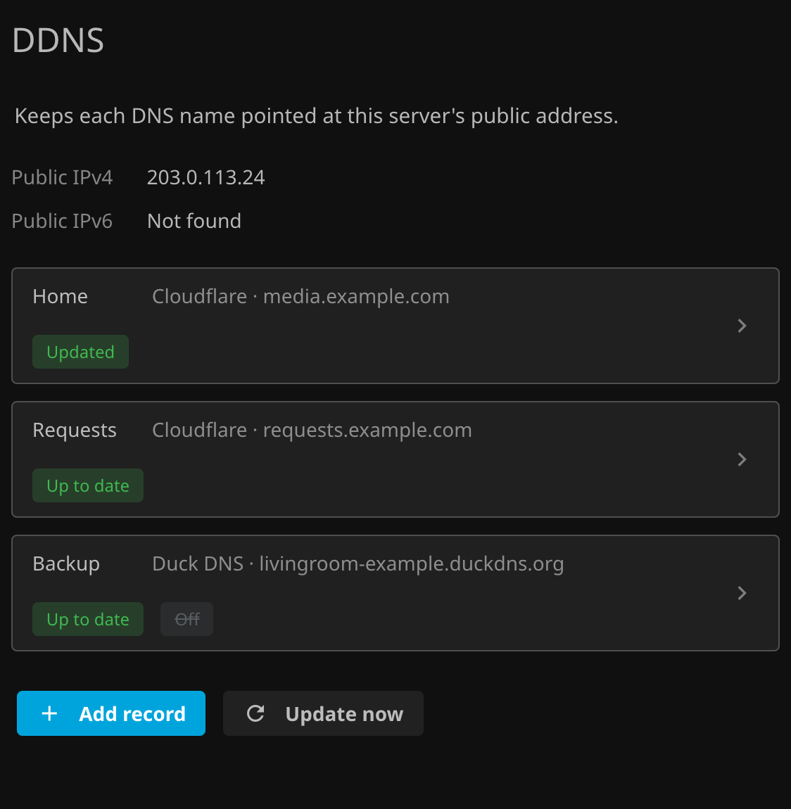
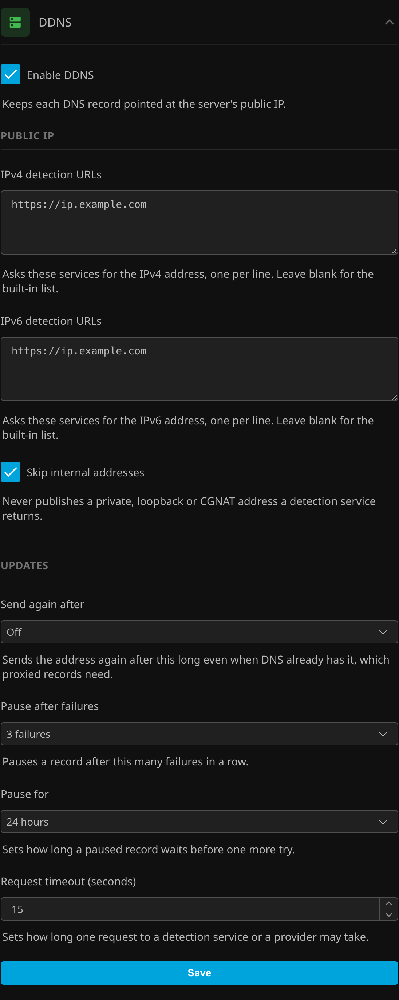
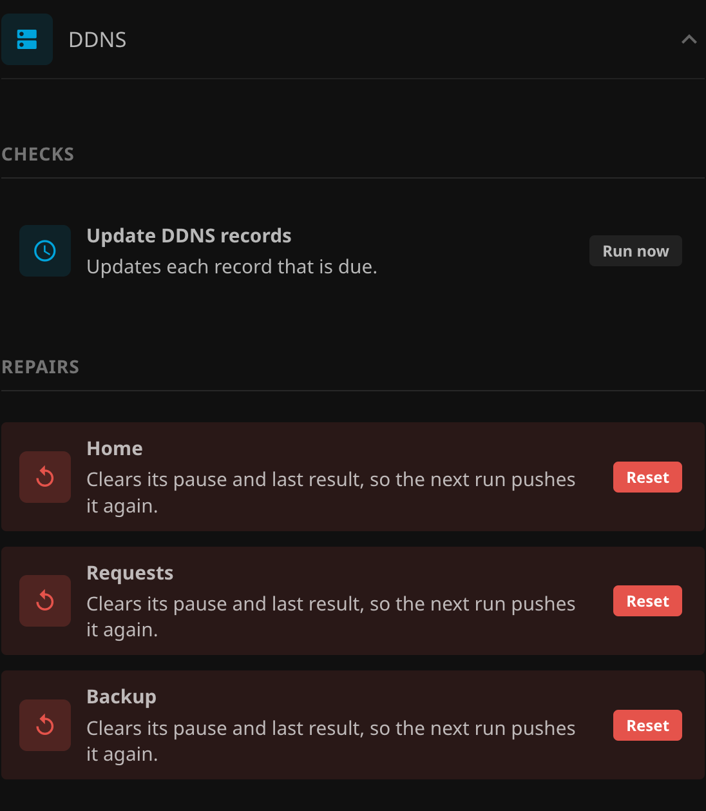

# DDNS

**DDNS** keeps each DNS name pointed at this server's public address. It holds several records, each with its own provider, credentials, name, and how often it updates. The public IP lookup is shared by every record.

## The DDNS Tool

The cards at the top count the **Records**, how many are **Up to date**, and under **Needs attention** how many last failed, paused, or found no address. Under them a card shows the **Public IPv4** and **Public IPv6** the last run found. Then each record has one row with its name, its provider, and at its end its state, its last result, such as **Updated**, **Up to date**, **Paused**, or **Failed**, or **Off** while it does not update. Select a row to open the record in a sidecar, or select **Add record**. **Update now** checks every enabled record at once, whatever its interval, and says how many were updated and how many failed.

| DDNS | DDNS on a phone |
| :---: | :---: |
|  |  |

A warning shows above the list when a detection service returned only an internal address, and when the server cannot encrypt credentials, in which case no credential can be saved.

## Records

The record sidecar has four sections, each led by an icon: **Record**, **Updates**, **More settings**, and **Last run**. **Record** holds the fields its provider uses, with the provider's own labels and a link under **Provider** to the provider's [setup guide](providers/index.md).

* **Provider** picks one of the providers below.
* **Follow the proxy's host names** pushes every enabled internet route's host name under the record's **Zone**, with the record's credentials, in place of one host name. A record with no zone follows every internet route. Wildcards and **Local network only** routes are left out. Each followed name keeps its own status, which the sidecar lists under **Last run**. It shows only while the [Proxy](Proxy.md) is on, or while the record already follows it, and only for a provider whose host name field holds a name. ClouDNS, Directnic, and INWX have no host name field, and DNS Made Easy and Sitelutions take a record ID, so a record with them cannot follow the proxy.
* **Host name** is the DNS name the record keeps pointed at this server, under the label the provider uses, such as **Record name**. It names the record in the list. For DNS Made Easy and Sitelutions it holds the record ID, so type the name yourself as a [Proxy](Proxy.md) route's host name. Any other record's name, and its wildcard while the record updates one, shows under a route's **Use a DDNS name**, which locks the route's host to it.
* **Login**, **Password**, and **Zone** hold what the provider asks for. A stored credential never reaches the browser. The field shows dots, a blank field keeps the stored value, and **Clear** removes it. A credential sent to another provider or server is dropped, so an edit never sends a saved password somewhere new.
* **Update this record** turns updates on or off. The name stays as it is at the provider while off.
* **Updates** holds **Update IPv4** and **Update IPv6**, which keep the A and AAAA records, and **Update every (minutes)**, which sets how often the record is checked. Providers that carry one address hide **Update IPv6**. The update task runs every 5 minutes, which is the shortest interval.
* **More settings** holds **Server override**, **TTL (seconds)**, **Treat as proxied**, and, for the dyndns family, **Wildcard**, **Static DNS**, **MX host**, and **Backup MX**.
* **Last run** shows the record's last result, when it was checked and updated, and the addresses it pushed.

**Remove** asks first. The name stays at the provider as it is.

### How a Record Updates

Each run detects the public address, then for each record that is due it compares the address with what DNS serves for the name. A record whose address already matches is skipped, unless **Send again after** says it is time. A record behind a proxy or CDN, with **Treat as proxied** on, compares with the last address pushed instead.

A record that fails **Pause after failures** times in a row pauses for **Pause for**, and a new public address ends the pause early. Timeouts, network errors, rate limits, and provider server errors pause a record only briefly. When a record carries both families and one already matches, only the other is sent.

Provider replies are shown with every credential masked. A request to a provider never follows a redirect to another server.

### Providers

Each provider has a [setup guide](providers/index.md) that lists its fields and where to find each value.

1984 Hosting, ChangeIP, Cloudflare, ClouDNS, DDNS.fm, DDNSS.de, DigitalOcean, Dinahosting, Directnic, DNS Made Easy, DNSExit, Domeneshop, DonDominio, DSLReports, Duck DNS, Dynadot, DynDNS v1, DynDNS v2, Dynu, easyDNS, eNom, FreeDNS, freemyip.com, Gandi LiveDNS, GoDaddy, Hetzner DNS, Hurricane Electric, Infomaniak, INWX, IONOS, Key-Systems, Mythic Beasts, Namecheap, NearlyFreeSpeech.NET, Njalla, No-IP, NS1, OVH, Porkbun, regfish.de, Simply.com, Sitelutions, Spaceship, Yandex PDD, and ZoneEdit.

Cloudflare, DigitalOcean, Duck DNS, and Porkbun can also publish the TXT record Let's Encrypt checks, so a [Proxy](Proxy.md) route can get its certificate by DNS challenge through them, a [wildcard certificate](Proxy.md#wildcard-certificates) and a [local address](Proxy.md#remote-and-local-addresses) included.

## Settings

**Settings > DDNS** holds the settings every record shares.

| Setting | Default | What it does |
| :--- | :--- | :--- |
| **Enable DDNS** | Off | Keeps each record pointed at the server's public IP. Off updates no record, on schedule or by **Update now**, and keeps every record. |
| **IPv4 detection URLs** | ipify, icanhazip, Amazon, ident.me | Services that reply with the IPv4 address, one per line. Two must agree before an address is used, and plain http is refused. |
| **IPv6 detection URLs** | ipify, icanhazip, ident.me | The same for IPv6. |
| **Skip internal addresses** | On | Never publishes a private, loopback, or CGNAT address. |
| **Send again after** | Off | Sends an unchanged address again after this long. |
| **Pause after failures** | 3 failures | Pauses a record after this many failures in a row. Off never pauses. |
| **Pause for** | 24 hours | How long a paused record waits before one more try. |
| **Request timeout (seconds)** | 15 | How long one detection or provider request may take. |

## Troubleshooting

**Troubleshooting > DDNS** shows why the last run could not find the public IP, when it could not, with the checks and repairs.

* **Update DDNS records** runs the scheduled task, which checks each record that is due.
* **Update every record** updates every enabled record now and lists what each provider said.
* **Reset a record** clears the picked record's pause, failure count, and last pushed address, so the next run pushes it again.

## Scheduled Task

**Update DDNS records** runs every 5 minutes and at startup. It checks only the records whose interval has passed. Change its schedule under **Dashboard > Scheduled Tasks**.

## Notifications

DDNS sends these events to [Notifications](Notifications.md).

| Event | When |
| :--- | :--- |
| `ddns.failed` | A record could not be pushed, so its name may point at an old address. |
| `ddns.paused` | A record failed often enough to pause. |
| `ddns.recovered` | A record that was failing was pushed again. |
| `ddns.detection_failed` | The public IP could not be found for 4 runs in a row. |

The activity log sums each run into one entry per outcome, such as "DNS records updated", and records every record added, changed, or removed, with who made the change.

## Permissions

DDNS is for administrators only, so it carries no group permission. Which groups receive its events is set on groups under **Notifications**.

## API

Every route needs an administrator.

| Route | What it does |
| :--- | :--- |
| `GET /Ddns/Providers` | Lists the providers with their fields and setup hint, whether each can publish a TXT record, and whether each can follow the proxy. |
| `GET /Ddns/Records` | Lists the records with their status and the detected addresses. Credentials come back as a marker. |
| `POST /Ddns/Records` | Adds a record. |
| `PUT /Ddns/Records/{id}` | Saves a record. |
| `DELETE /Ddns/Records/{id}` | Removes a record. |
| `POST /Ddns/Records/{id}/Reset` | Starts a record over. |
| `GET /Ddns/Settings` and `POST /Ddns/Settings` | Read and save the shared settings. |
| `POST /Ddns/Update` | Checks every enabled record now. |

Records and their credentials change only through these routes. A save of the whole plugin configuration keeps them as they are.
