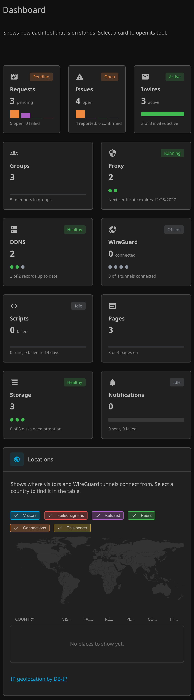

# Dashboard

**Dashboard** is Necto's home. It sums up each tool that is on, shows where the proxy's visitors and the WireGuard tunnels connect from, the address to share, and what Necto's tools did last.

| Dashboard | Dashboard on a phone |
| :---: | :---: |
|  |  |

## Cards

A status card sums up each tool that is on, in sidebar order, every card the same width. Select a card to open its tool. **Issues** has a card only with **Enable issues** on, and **Proxy** and **VPN** only while each is on. A card whose tool could not be read shows **Error** and "Could not read this tool".

Each card ends in one bar split into parts, in the colors the tool's own page uses. A legend under the bar names every part with a dot in its color and its count, in bar order. While every part is 0, a line under it says the tool has nothing yet, such as "No requests yet". The pill uses the same words and colors across Necto.

| Pill | Color | Means |
| :--- | :--- | :--- |
| **Failed** | Red | Something failed, such as a request, a route's certificate, or a script run |
| **Offline** | Red | The proxy is on but not running |
| **Warning** | Orange | Something needs a look soon, such as a certificate close to expiry or a disk running low |
| **Pending** | Purple | Something waits for an administrator, such as a request or an issue report |
| **Active** | Green | The tool is doing its work |
| **Off** | Gray | Everything the tool holds is turned off |
| **Idle** | Gray | The tool has nothing yet |

| Card | Number | Bar |
| :--- | :--- | :--- |
| **Groups** | Groups besides **Everyone** | **Members** of a group beside users in **No group**. Administrators are left out |
| **Requests** | Requests waiting for approval | A part per request status |
| **Issues** | Open issue reports, reported or confirmed | A part per issue state |
| **Invites** | Active invites | A part per invite state |
| **Proxy** | Active routes | Active, failed, and off routes. A certificate that expires within 14 days names its date in place of the line |
| **DDNS** | Records, counting each name a record follows | A part per last result, and the records that are off |
| **VPN** | Connected peers and connections | A part per peer and connection state |
| **Scripts** | Runs that failed in the last 14 days | Runs that succeeded and failed |
| **Pages** | Published pages | Published and unpublished pages |
| **Storage** | Disks Jellyfin uses, as the **Storage** tool counts them | A part per disk state |
| **Notifications** | Sends in the send log | Sends that went and that failed |

## Locations

**Locations** is one world map with a country table under it. It shows while **Proxy** or **VPN** is on, and is hidden while both are off.

| Layer | Shows | Tool |
| :--- | :--- | :--- |
| **Visitors** | The people the proxy saw | Proxy |
| **Failed sign-ins** | Failed sign-ins through the proxy | Proxy |
| **Refused** | Connections the proxy refused | Proxy |
| **Peers** | WireGuard peers, by the address they connect from | WireGuard |
| **Connections** | WireGuard connections, by the host they connect to | WireGuard |
| **This server** | This server's own country | Either |

A tool that is off takes its layers with it. A layer button turns its layer on or off, and the table shows a column for each layer that is on but **This server**, which only marks the map. On a narrow screen each column heading shows as an icon. The country column takes the width of its longest name. The table shows a dash in each column until the map is read and while the location database loads, and "No locations yet." when no country has anything to show. Select a country on the map to select its row, or a row to mark its country.

Places come from the location database the proxy uses, DB-IP's free database, kept on this server. WireGuard's tunnel ends are placed on the server, and no address leaves it. While WireGuard is on, the database stays loaded at country detail even when **Record visitors** is off. "The location database is loading. Places show once it is ready." shows until it is. The host is placed at this server's country, which Necto looks up from its public address.

## Share Your Server

**Share your server** shows the address people use from the internet as a QR code to scan into the Jellyfin apps, with **Copy image**, **Download**, and **Share** where the browser can share. It shows once the proxy is on with a route to this Jellyfin. **Public** marks a public name. **Home only** marks a name only the home network knows, such as `jellyfin.lan`, and says to add a route with a public name in **Proxy**.

## Recent Activity

**Recent activity** lists Necto's newest activity log entries, newest first, each with its tool's icon. An error is marked red and a warning orange, and other entries take no mark. It reads the latest 500 entries of Jellyfin's activity log and lists up to 20 of Necto's.

The map and **Recent activity** are read again every minute while the page is open, and the cards each time it opens.

## Routes

| Route | What it does |
| :--- | :--- |
| `GET /Dashboard/Map` | Gives the map: the proxy's totals by country while it is on, the WireGuard tunnel ends with their countries while it is on, and this server's country |
| `GET /Dashboard/Activity?limit={n}` | Gives Necto's newest activity log entries, up to 50, 20 by default |

The cards read each tool's own routes, such as `GET /Groups/Users`, `GET /Requests/Stats`, and `GET /Proxy/Status`, and the share card reads `GET /Proxy/PublicAddress`. Every route is for administrators.
