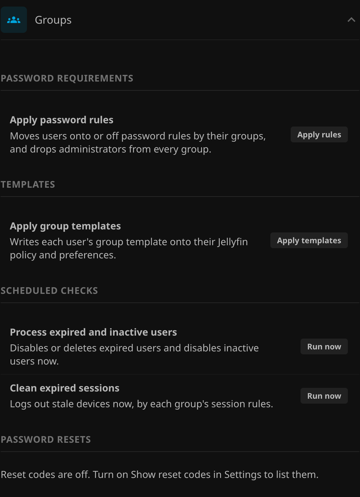

# Groups

Groups set what their members may do in every Necto tool, and hold the account rules their members follow.

## The Groups Tool

Cards at the top count the server's users: **Administrators**, **Active**, **Inactive** for members past their groups' inactivity window, **Disabled**, and **Expiring** for members whose groups expire them within 7 days.

| Groups | Groups on a phone |
| :---: | :---: |
|  |  |

**Groups** lists every group, **Everyone** first, then the others in group order. Each row shows how many members the group has and which account rules it has on. Select a row to open the group in a sidecar, select **Add group** to start a new one, or select **Group order** to reorder them.

The sidecar holds the group's name, its members, **Account rules**, **Access and features**, **Preferences**, and one collapsible section per tool. Its shelf holds **Delete**, **Cancel**, and **Save**. **Save** asks first while the group has an expiry date and **Delete the account** as its method, since those members cannot come back. **Delete** asks first, with the group's name in the title, such as "Delete Family". Its members keep their other groups, and a member in no other group takes **Everyone**.

Every tool fills its own section.

## Group Order

**Group order** opens the groups in a sidecar, each with **Move up** and **Move down**, and **Save** keeps the order. The order decides whose template a member of several groups takes. **Everyone** always comes first, and only applies to users in no group.

## Everyone

**Everyone** always exists and cannot be deleted or renamed. It holds every user who is in no other group, so its permissions and rules apply only to those users. A user in a group never takes **Everyone**. On a fresh install it gives nothing but the updates about a user's own requests and issues, in **Notifications**.

## Members

A user may be in several groups. Administrators may do everything, so no group holds them. A member promoted to administrator leaves every group on the next group save or server start, and a deleted user leaves every group at once.

**Settings > Groups > Group for new users** sets the group a new user joins. With **Everyone** picked, a new user joins no group.

## How Groups Combine

A member of several groups gets what any of them gives.

* An allow from any group allows, such as **Allow requests**.
* A count or limit takes the largest any allowing group gives. 0 is no limit, so it beats any number.
* A list holds what every group lists, such as the pages a member may open.

The account rules combine the other way, since any one group may keep a member's account.

* **Password requirements** hold when any group enforces them. The member meets the strictest rule of those groups, and gets the most generous **Password changes** of them.
* **Expiry** applies once every group has expired, on the latest date. **Delete the account** needs every group to ask for it, else the account is disabled.
* **Inactivity** and **Session management** apply only when every group has them on, after the largest window any group gives.

Administrators are never held to an account rule.

A template writes whole Jellyfin settings, so it does not combine. A member takes the template of the first of their groups, in group order, that has **Set Jellyfin settings** on. A user in no group takes Everyone's.

## Account Rules

### Password Requirements

* **Enforce password requirements** holds members' passwords to the rules below. Members on Jellyfin's own sign in move onto Necto's password rule provider, which signs them in as Jellyfin does. A member signed in elsewhere, such as LDAP, stays where they are.
* **Disallow empty passwords** refuses an empty password. While off, an empty password always passes, since it means the account has no password.
* **Minimum length** sets the shortest password allowed.
* **Password changes** sets whether members may set or change their own password.
* **Require a capital letter**, **Require a number**, and **Require a symbol** each add a rule.

| Action | Allowed | Initial password only | Disallowed |
| :--- | :--- | :--- | :--- |
| Member changes their password | If it meets the rules | Refused | Refused |
| Member with no password sets one | If it meets the rules | If it meets the rules | Refused |
| Administrator changes a member's password | Always | Always | Always |

A refused change shows the reason on the password form, and writes "Password change rejected" or "Password change blocked" to the activity log. The forgotten password flow always passes, since only an administrator can read its code.

!!! warning "Before removing Necto"
    Members held to password rules sign in through Necto's provider. Turn off every group's password requirements and save before removing the plugin, so each member moves back to the provider they had.

### Expiry

* **Expire members on a date** disables or deletes members once the date comes.
* **Expiry date** sets the day. The next **Process expired and inactive users** task run on or after it expires members.
* **Expiration method** sets what happens. **Disable the account** can be undone. **Delete the account** removes each member and their data for good.

### Inactivity

* **Disable inactive users** disables members who stop using the server.
* **Days of inactivity before disabling** sets the window. A member who never signed in is left alone.

### Session Management

* **Clean up old sessions** logs out members' devices that go too long without checking in.
* Each rule sets **Applies to**, its **Clients**, and **Days before logout**. **All clients** covers every client, **Only these clients** covers the listed ones, and **All except these clients** covers the rest.
* Where several rules of one group cover a client, the shortest window wins, and the editor names the clients that overlap.

## Templates

**Access and features** and **Preferences** write Jellyfin's own user settings onto members.

* **Set Jellyfin settings** turns the group's template on. It is written onto members when a group is saved or reordered, when a user is created or joins through an invite, and when the server starts.
* Each setting shows **Member** or **Group**. **Member** leaves the setting as each member has it. **Group** sets it to the value under it.
* **Access and features** holds Jellyfin's library, channel, and device access, media deletion, playback, Live TV, remote control, parental control with the access schedule, and the profile's switches, such as **Disable this user** and **Hide this user from login screens**.
* **Maximum allowed parental rating** lists each rating once per score and sub score, and keeps both, as Jellyfin does.
* **Preferences** holds the subtitle and audio languages and modes, **Google cast version**, missing episodes, the Collections view, the ten home screen sections, the library order, and the libraries on the home screen, in home sections, and grouped into views. **Subtitle mode** explains the picked mode under it.
* While the template sets **Library access** to some libraries, the library order and the library lists leave out the libraries members cannot see. A library left out keeps its place and its choices.
* A template that sets **Disable this user** off never turns on an account its groups' expiry or inactivity turned off.
* Administrators are never changed by a template.

## Tool Permissions

| Section | Fields |
| :--- | :--- |
| **Requests** | **Allow requests**, **Movies**, **Series**, **Unreleased titles**, **Auto approve movies**, **Auto approve series**, **Open requests at once**, **Movie quota**, **Series quota**, **Seasons per series**, **Movie profiles**, **Series profiles**, **See all requests**, **See requesters**, **Manage requests**. See [Requests](Requests.md#permissions) |
| **Issues** | **Allow reports**, **Issue limit**, **Manage issues**. See [Issues](Issues.md#permissions) |
| **Invites** | **Allow invites**, **Open invites**, **Invite to any group**, **Invite groups**. See [Invites](Invites.md#members-invites) |
| **WireGuard** | **Allow peers**, **Peers per member**, **Data per member (GB)**, **Period**. See [WireGuard](WireGuard.md#permissions) |
| **Scripts** | **Run every script**, **Scripts that run**. See [Scripts](Scripts.md#groups) |
| **Custom pages** | **Open every page**, **Pages members may open** |
| **Notifications** | **Receive every event**, **Events**, **Browser notifications**, **Jellyfin messages**. See [Notifications](Notifications.md#who-gets-an-event) |

## Scheduled Tasks

| Task | What it does | Runs |
| :--- | :--- | :--- |
| **Process expired and inactive users** | Disables or deletes users whose groups have expired, and disables inactive users | Daily at midnight |
| **Clean expired sessions** | Logs out devices past their groups' session windows | Daily at midnight |
| **Apply password rules** | Drops administrators and deleted users from the groups, and moves users onto or off password rules | When the server starts |
| **Apply group templates** | Writes each user's group template onto their Jellyfin policy and preferences | When the server starts |

## Settings

**Settings > Groups** holds the settings that are not permissions.

* **Group for new users** sets the group a new user joins.
* **Show reset codes** lists the codes of pending password resets in **Troubleshooting**. Use HTTPS so they cannot be read in transit.

## Troubleshooting

**Troubleshooting > Groups** holds the repairs.

* **Apply rules** moves users onto or off password rules by their groups, and drops administrators from every group.
* **Apply templates** writes each user's group template onto them, and reports how many took one.
* **Run now** beside **Process expired and inactive users** asks first, then runs the task. A deleted user cannot come back.
* **Run now** beside **Clean expired sessions** runs the task.
* **Password resets** counts the pending resets that are **Active**, **Expiring** within 5 minutes, and **Expired**, warns to use HTTPS, and lists each with its user, its state, and its code, expired ones last, while **Show reset codes** is on.

| Reason | What to do |
| :--- | :--- |
| A member is not held to the group's password rules | Check that the member signs in with Jellyfin's own provider, then select **Apply rules** |
| "Reset codes are off. Turn on Show reset codes in Settings to list them." | Turn on **Show reset codes** in **Settings > Groups** |

## Activity Log

| Entry | When |
| :--- | :--- |
| "Group created", "Group deleted" | A group is created or deleted |
| "Users enrolled in password rules", "Users removed from password rules" | Users move onto or off password rules |
| "Password change blocked", "Password change rejected" | A member's own change is refused |
| "Users disabled", "Users deleted" | Expiry or inactivity changed accounts in a run |
| "Sessions logged out" | Session cleanup logged out devices in a run |

An entry about one user uses the singular, such as "User disabled".

## API

Every route is for administrators.

| Route | What it does |
| :--- | :--- |
| `GET /Groups` | Lists every group, Everyone first |
| `GET /Groups/{id}` | Gives one group |
| `POST /Groups` | Creates a group |
| `PUT /Groups/{id}` | Saves a group's name, members, and permissions |
| `DELETE /Groups/{id}` | Deletes a group |
| `GET /Groups/Users` | Lists the users with the groups that apply to each, and the expiry date and inactivity window those groups give |
| `GET /Groups/Users/{userId}/Permissions` | Gives what a user may do in every tool |
| `POST /Groups/PasswordRules/Apply` | Moves users onto or off password rules |
| `GET /Groups/ResetCodes` | Lists the pending password resets while **Show reset codes** is on |
| `PUT /Groups/Order` | Puts the groups in a new order from every group's id, then writes the templates |
| `POST /Groups/Templates/Apply` | Writes each user's group template, and gives how many took one |

A refused change answers `400` with `{ "Error": "..." }`, and a missing group or user answers `404`.
