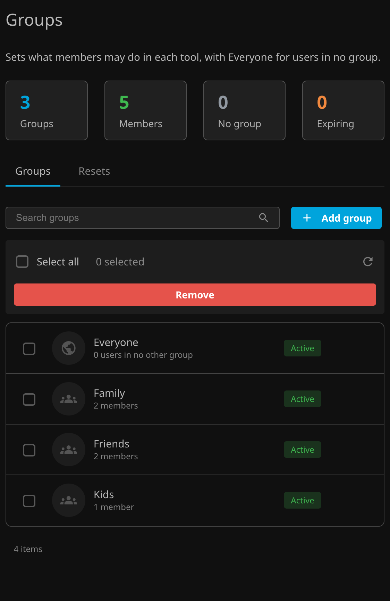
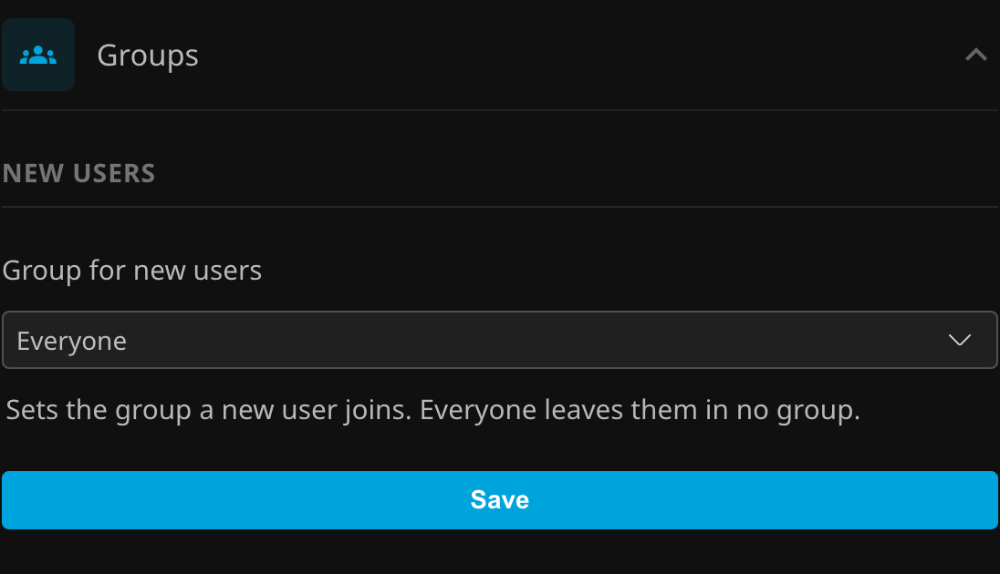

# Groups

Groups set what their members may do in every Necto tool, the account rules they follow, and their Jellyfin access and preferences. A user is in one group at most.

## The Groups Tool

Cards at the top count the **Groups** besides **Everyone**, the **Members** in one, the users in **No group**, whom **Everyone** holds, and the members **Expiring** within 7 days. Administrators are left out, since no group holds them. The cards show a dash until the groups are read.

| Groups | Groups on a phone |
| :---: | :---: |
|  |  |

**Groups** lists every group, **Everyone** first. Each row shows how many members the group has and which account rules it has on. Select a row to open the group in a sidecar, or select **Add group** to start a new one.

The sidecar holds the group's name, then a collapsible section for each part, closed until opened except **Members**.

| Section | What it holds |
| :--- | :--- |
| **Members** | The users in the group |
| **Account rules** | **Password requirements**, **Expiry**, **Inactivity**, **Session management**, and **Password resets**, each its own section |
| **Access** | **Library access**, **Device access**, **Media deletion**, **Media playback**, **Live TV**, **Remote control**, **Parental control**, and **Profile**, as on Jellyfin's user pages |
| **Preferences** | **Subtitles**, **Playback**, **Display**, and **Home**, as on a user's own preference pages |
| **Requests**, **Issues**, **Invites**, **VPN**, **Pages**, **Notifications** | What members may do in each tool that is on |

A section's tile is green while the group gives members anything in it, such as a rule turned on, a row set by the group, or **Allow requests**, and gray while it gives nothing. The shelf holds **Remove** and **Save**, and the close button leaves, asking first when there are unsaved edits. **Save** asks first while the group has an expiry date and **Delete the account** as its method, since those members cannot come back. **Remove** asks first, with the group's name in the title, such as "Remove Family". Its members keep their accounts and take **Everyone**.

## Everyone

**Everyone** always exists and cannot be removed or renamed. It holds every user who is in no other group, so its permissions and rules apply only to those users. A user in a group never takes **Everyone**. On a fresh install it gives nothing but the updates about a user's own requests and issues, in **Notifications**.

## Members

A user is in one group at most. The member list names the group a user is in now, and saving moves them here. Administrators may do everything in Necto, so no group holds them, and Necto never writes their Jellyfin settings. A member promoted to administrator leaves their group on the next group save or server start, and a deleted user leaves at once.

**Settings > Groups > Group for new users** sets the group a new user joins. With **Everyone** picked, a new user joins no group.

A configuration stored with a user in several groups keeps them in the first, in the stored order, and the server log names each user moved.

## Account Rules

### Password Requirements

* **Enforce password requirements** holds members' passwords to the rules below. Members on Jellyfin's own sign in move onto Necto's password rule provider, which signs them in as Jellyfin does. A member signed in elsewhere, such as LDAP, stays where they are.
* **Disallow empty passwords** refuses an empty password. While off, an empty password always passes, since it means the account has no password.
* **Minimum length** sets the shortest password allowed.
* **Password changes** sets whether members may set or change their own password.
* **Require a capital letter**, **Require a number**, and **Require a symbol** each add a rule.

| Action | Allowed | Initial password only | Disallowed |
| :--- | :--- | :--- | :--- |
| Member changes their password | If it meets the rules | Refused | Refused |
| Member with no password sets one | If it meets the rules | If it meets the rules | Refused |
| Administrator changes a member's password | Always | Always | Always |

A refused change shows the reason on the password form, and writes "Password change rejected" or "Password change blocked" to the activity log. The forgotten password flow always passes, since only an administrator can read its code.

!!! warning "Before removing Necto"
    Members held to password rules sign in through Necto's provider. Turn off every group's password requirements and save before removing the plugin, so each member moves back to the provider they had.

### Expiry

* **Expire members on a date** disables or deletes members once the date comes.
* **Expiry date** sets the day. The next **Process expired and inactive users** task run on or after it expires members.
* **Expiration method** sets what happens. **Disable the account** can be undone. **Delete the account** removes each member and their data for good.

### Inactivity

* **Disable inactive users** disables members who stop using the server.
* **Days of inactivity before disabling** sets the window. A member who never signed in is left alone.

### Session Management

* **Clean up old sessions** logs out members' devices that go too long without checking in, each time **Clean expired sessions** runs.
* Each rule sets **Applies to**, its **Clients**, and **Days before logout**. **All clients** covers every client, **Only these clients** covers the picked ones, and **All except these clients** covers the rest.
* **Clients** lists the clients seen on the server, from its devices and sessions, and the common Jellyfin clients, to pick from. **Other clients** takes any other name.
* Where several rules of one group cover a client, the shortest window wins, and the editor names the clients that overlap.

### Password Resets

* **Show reset codes** lists members' pending password resets on the **Resets** tab of the Groups page. Use HTTPS so they cannot be read in transit.
* An administrator is in no group, so an administrator's reset code never shows.

## Jellyfin Settings

**Access** and **Preferences** write Jellyfin's own user settings onto members, with Jellyfin's own words.

* Each setting is a row with **Member** and **Group**. **Member** leaves the setting as each member has it, and the row shows the group's own value dimmed. **Group** writes the row's value onto every member.
* Each section's header counts its rows on **Group**, such as **2 set by group**, and so does the header of the part above it.
* **Library access**, **Device access**, and **Media deletion** each start with an "all" checkbox, as Jellyfin does. Turn it off to pick libraries, channels, or devices from a list under it.
* **Maximum allowed parental rating** lists each rating once per score and sub score, and keeps both, as Jellyfin does.
* **Subtitle mode** explains the picked mode under it.
* While the group sets **Library access** to some libraries, the library order and the library lists of **Home** leave out the libraries members cannot see. A library left out keeps its place and its choices.
* **Preferences** starts with when the preferences are written. **Maintain** writes them on every save and sync, so members always match the group. **On join only** writes them once, as a user joins the group, and leaves members free to change them after.
* The settings are written when a group is saved, when a user is created or joins through an invite, when the server starts, and daily, with the **Apply group Jellyfin settings** task. A setting changed by hand on a member's Jellyfin page goes back to the group's on the next sync, while a row on **Member** is never touched.
* A group that sets **Disable this user** off never turns on an account its expiry or inactivity turned off.
* A group stored with **Set Jellyfin settings** off loads with every row on **Member**, so nothing it never wrote starts being written.

## Tool Permissions

| Section | Fields |
| :--- | :--- |
| **Requests** | **Allow requests**, **Movies**, **Series**, **Unreleased titles**, **Auto approve movies**, **Auto approve series**, **Open requests at once**, **Movie quota**, **Series quota**, **Seasons per series**, **Movie profiles**, **Series profiles**, **See all requests**, **See requesters**, **Manage requests**. See [Requests](Requests.md#permissions) |
| **Issues** | **Allow reports**, **Issue limit**, **Manage issues**. See [Issues](Issues.md#permissions) |
| **Invites** | **Allow invites**, **Open invites**, and **Invite groups** as **Permissive** for any group or **Restrictive** for the groups picked. See [Invites](Invites.md#members-invites) |
| **VPN** | **Allow peers**, **Peers per member**, **Data per member (GB)**, **Period**. See [VPN](VPN.md#permissions) |
| **Pages** | **Permissive** for every signed in page, pages added later too, or **Restrictive** for the pages picked |
| **Notifications** | Each event about a member, under the tool that sends it, with a **Browser** switch for browser notifications and a **Jellyfin** switch for Jellyfin messages. Events for administrators are set in **Settings > Notifications**. See [Notifications](Notifications.md#who-gets-an-event) |

A new group starts with **Pages** and **Invite groups** on **Permissive**. Which users a script runs for is set on the script, in its editor's **Groups** section. See [Scripts](Scripts.md#groups).

## Scheduled Tasks

| Task | What it does | Runs |
| :--- | :--- | :--- |
| **Process expired and inactive users** | Disables or deletes users whose groups have expired, and disables inactive users | Daily at midnight |
| **Clean expired sessions** | Logs out devices past their group's session window | Daily at midnight |
| **Apply password rules** | Drops administrators and deleted users from the groups, and moves users onto or off password rules | When the server starts |
| **Apply group Jellyfin settings** | Writes each user's group Jellyfin settings onto their account | When the server starts, and daily at midnight |

## Settings

**Settings > Groups** holds the settings that are not permissions.

* **Group for new users** sets the group a new user joins.

## Password Resets

The Groups page shows its counts above two tabs, **Groups** with the list, and **Resets**. While no group has **Show reset codes** on, the **Resets** table says how to turn it on. Otherwise it lists each member's pending reset with its user, when it expires, and **Active**, **Expiring** within 5 minutes, or **Expired**, expired ones last, and under the table warns to use HTTPS when the dashboard is open over plain HTTP. Select a reset to see its code and copy it.

## Troubleshooting

**Troubleshooting > Groups** holds the repairs.

* **Apply** beside **Apply password rules** moves users onto or off password rules by their group.
* **Apply** beside **Apply group Jellyfin settings** writes each user's group Jellyfin settings onto them, and reports how many took them.
* **Run now** beside **Process expired and inactive users** asks first, then runs the task. A deleted user cannot come back.
* **Run now** beside **Clean expired sessions** runs the task.

| Reason | What to do |
| :--- | :--- |
| A member is not held to the group's password rules | Check that the member signs in with Jellyfin's own provider, then select **Apply** beside **Apply password rules** |
| "Reset codes are off. Turn on Show reset codes in a group's Password resets to list them." | Turn on **Show reset codes** under **Account rules > Password resets** in the group's editor |

## Activity Log

| Entry | When |
| :--- | :--- |
| "Group created", "Group removed" | A group is created or removed |
| "Users enrolled in password rules", "Users removed from password rules" | Users move onto or off password rules |
| "Password change blocked", "Password change rejected" | A member's own change is refused |
| "Users disabled", "Users deleted" | Expiry or inactivity changed accounts in a run |
| "Sessions logged out" | Session cleanup logged out devices in a run |

An entry about one user uses the singular, such as "User disabled".

## API

Every route is for administrators.

| Route | What it does |
| :--- | :--- |
| `GET /Groups` | Lists every group, Everyone first |
| `GET /Groups/{id}` | Gives one group |
| `POST /Groups` | Creates a group |
| `PUT /Groups/{id}` | Saves a group's name, members, and permissions, moving its members out of any other group |
| `DELETE /Groups/{id}` | Removes a group |
| `GET /Groups/Users` | Lists the users with the groups that apply to each, and the expiry date and inactivity window those groups give |
| `GET /Groups/Users/{userId}/Permissions` | Gives what a user may do in every tool |
| `POST /Groups/PasswordRules/Apply` | Moves users onto or off password rules |
| `GET /Groups/ResetCodes` | Lists the pending password resets of members whose group has **Show reset codes** on |
| `POST /Groups/Templates/Apply` | Writes each user's group Jellyfin settings, and gives how many took them |

A refused change answers `400` with `{ "Error": "..." }`, and a missing group or user answers `404`.
