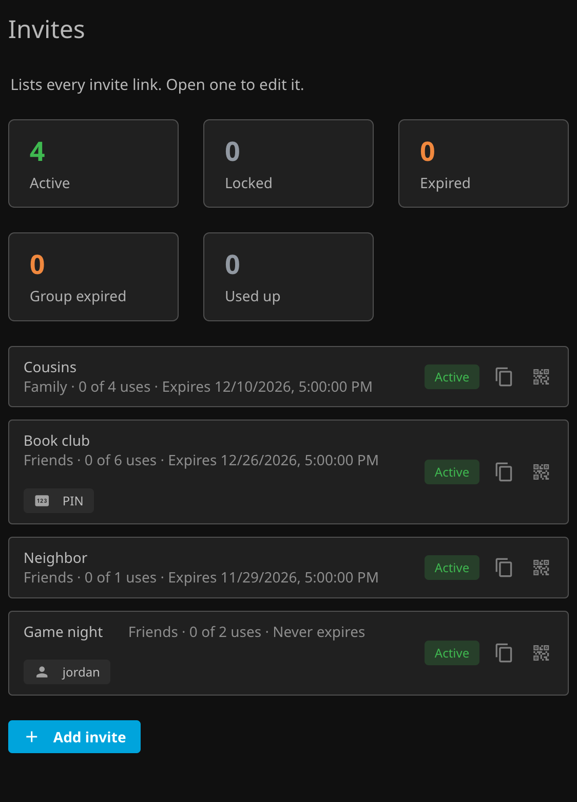
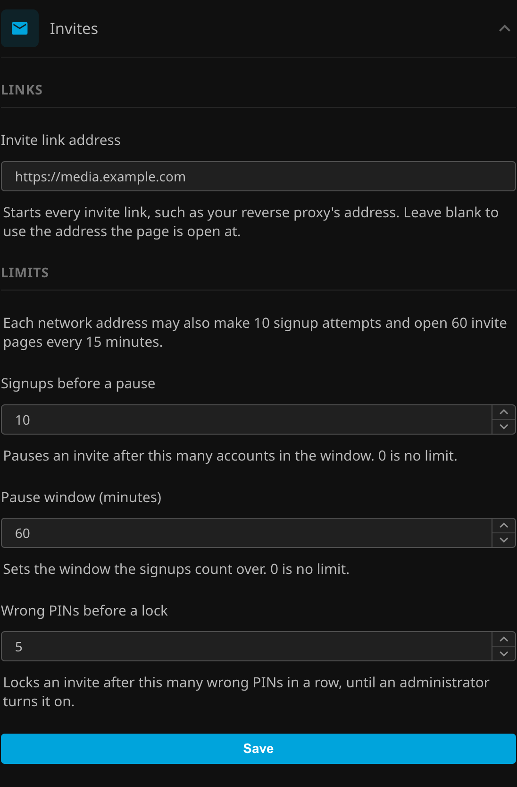
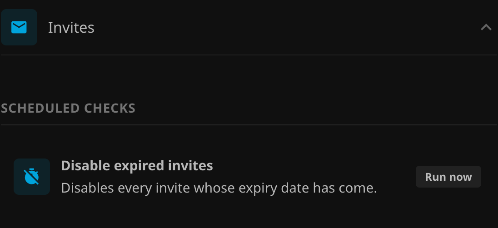

# Invites

Invites are links anyone may use to make their own account on the server, in the invite's group.

## The Invites Tool

**Invites** counts the invites in each state at the top, then lists every invite, oldest first, with its group, its uses, and its expiry, and at the row's end its state badge, **Copy link**, and **Show QR code**, which opens the code with **Copy image** and **Download** in a sidecar. A PIN tag marks an invite that asks for a PIN, and a person tag names the member who made it. Select **Add invite** to make one, or select a row to open it in a sidecar.

| Invites | Invites on a phone |
| :---: | :---: |
|  |  |

| State | Means |
| :--- | :--- |
| **Active** | The link works |
| **Locked** | The invite was turned off, or locked itself after too many wrong PINs |
| **Expired** | The invite's expiry date has come |
| **Group expired** | The group a new account would join has expired |
| **Used up** | The invite made as many accounts as it may |

The sidecar of an invite sets it out in three steps, **Link**, **Invite**, and **Links for new users**, each led by its icon. **Link** shows the link with **Copy** and a QR button, which opens the QR code with **Copy image** and **Download**. Its shelf holds **Remove**, **Turn off** or **Turn on**, **Duplicate**, **Cancel**, and **Save**.

* **Name** names the invite in the Invites tool. The sign-up page never shows it.
* **Welcome message** shows under the sign-up page's heading.
* **Group** sets the group a new account joins. **Group for new users** follows **Settings > Groups > Group for new users** at the moment the link is used, and **Everyone** joins no group. A group that disallows password changes cannot take invites, so it is not listed. A warning shows while the picked group has expired, since sign-ups into it are refused.
* **Uses** sets how many accounts the link makes. 0 is no limit.
* **Expiry date** stops the link on that day. Leave it blank to keep the link until it is used up.
* **PIN** asks for six digits on the sign-up page. A stored PIN stays hidden, and **Remove PIN** beside the field clears it on save.
* **Links for new users** shows each link as a button once the account is made, such as a guide. Each needs button text and a full http or https address.

**Turn on** clears an invite's wrong PINs. It is refused while the expiry date has passed or the group disallows password changes. Moving the expiry date ahead turns an invite back on. **Duplicate** makes a new link with the same settings and PIN. **Remove** asks first, with the invite's name in the title, such as "Remove Family", and the accounts the invite made stay.

## The Sign-up Page

An invite link opens `/invites/{token}`, drawn as the web client's sign in page with the server's logo and no user menu. The page shows the welcome message under **Create your account**, a **PIN** field when the invite has a PIN, and **User name**, **Password**, and **Confirm password**. **Create account** makes the account, then shows the invite's links under **Go to sign in**. A missing PIN, user name, or password, or passwords that differ, show their reason over the button before anything is sent. A link that does not work shows **Invite unavailable** and never says why.

| Sign-up | Sign-up on a phone |
| :---: | :---: |
|  |  |

The account joins the invite's group, takes that group's password rules and Jellyfin settings, and never takes the group for new users on the way. It is held disabled until its password is set, so it can never be signed in to without one, and it stays disabled when its group's Jellyfin settings disable accounts. A sign-up that fails partway removes the account, so the user name can be tried again.

## Members' Invites

A member whose groups allow invites makes and shares their own at `/invites`, in the web client with its header, libraries, and user menu. **Your invites** lists each invite with its state, group, and uses, and **Copy link**, **Show QR code**, and **Delete** buttons. **New invite** makes one with **Name**, **Group**, **Uses**, and **Expiry date**, and **Add invite** adds it. **Groups > Invites** sets who may do this.

* **Allow invites** lets members make invites.
* **Open invites** sets how many working invites a member may have at once. 0 is no limit.
* **Invite to any group** lets members' invites join any group, or **Invite groups** names the groups.

A member deletes only their own invites. **Browser notifications** holds **Notify me in this browser**, so the member hears when their invites are used, as their groups allow. It shows while **Settings > Notifications** offers browser notifications.

## Limits

!!! warning "Reverse proxy users: add your proxy to Known proxies"
    The address limits count each visitor by the address Jellyfin sees. Behind a reverse proxy, Jellyfin sees the real visitor only when the proxy is listed under **Dashboard > Networking > Known proxies**. Otherwise every visitor shares the proxy's address and one budget. The server log warns once when invite calls look like they come through an untrusted proxy.

* **Wrong PINs before a lock** locks an invite after that many wrong PINs in a row, from anyone, until an administrator turns it on.
* **Sign-ups before a pause** and **Pause window (minutes)** pause an invite once it has made that many accounts in the window. 0 in either is no limit.
* Each network address may open 60 invite pages and make 10 sign-up attempts every 15 minutes, across all invites. Every attempt counts. Past that the server answers "Too many attempts from your network. Wait a few minutes and try again." IPv6 visitors are counted per /64. These limits reset when the server restarts.
* A taken user name gets "Could not create the account. Check the details and try again.", so the page cannot be used to find out who has an account.

## Settings

**Settings > Invites** holds the settings.

| Setting | What it does | Default |
| :--- | :--- | :--- |
| **Enable invites** | Lets invite links make accounts, and members make their own invites at `/invites`. Off says every invite is unavailable, answers 404 at `/invites` and its routes, stops the expiry task, and keeps every invite | Off |
| **Invite link address** | Starts every invite link, such as your reverse proxy's address. Blank uses the address the page is open at. A warning shows while links would use plain http | Blank |
| **Sign-ups before a pause** | Pauses an invite after this many accounts in the window | 10 |
| **Pause window (minutes)** | Sets the window the sign-ups count over | 60 |
| **Wrong PINs before a lock** | Locks an invite after this many wrong PINs | 5 |

## Troubleshooting

**Troubleshooting > Invites** holds **Run now** beside **Turn off expired invites**.

| Reason | What to do |
| :--- | :--- |
| "Too many wrong PINs. This invite is locked." | Open the invite and select **Turn on** |
| "This invite was used recently. Try again later." | Wait for the pause window, or raise **Sign-ups before a pause** |
| "This invite's group has expired. Ask the server's administrator for a new invite." | Move or clear the group's expiry date |
| "This invite's expiry date has passed. Move the date forward to turn it on." | Set a new **Expiry date** |
| "The group disallows password changes, so it cannot take invites." | Pick another group, or change the group's **Password changes** |

## Scheduled Tasks

| Task | What it does | Runs |
| :--- | :--- | :--- |
| **Turn off expired invites** | Turns off every invite whose expiry date has come | Daily at midnight |

An invite stops working on its expiry date before the task runs.

## Activity Log and Events

| Entry | When | Event |
| :--- | :--- | :--- |
| "Invite created" | An invite is made | `invites.created` for a member's invite |
| "Account made with an invite" | An invite makes an account | `invites.used` |
| "Invite reached its limit" | An invite makes its last account | `invites.usedUp` |
| "Invite locked by PIN" | Wrong PINs lock an invite | `invites.locked` |
| "Wrong invite PIN", "Wrong invite PINs" | Wrong PINs, summed in a burst | None |
| "Invite expired", "Expired invites" | The expiry task turns invites off | `invites.expired` |

See [Notifications](Notifications.md#events) for who gets each event.

## API

| Route | Who | What it does |
| :--- | :--- | :--- |
| `GET /Invites/List` | Administrators | Lists every invite |
| `POST /Invites` | Administrators | Makes an invite |
| `PUT /Invites/{id}` | Administrators | Changes an invite. A `Pin` of `null` keeps it, and an empty one removes it |
| `POST /Invites/{id}/Duplicate` | Administrators | Makes a copy with a new link |
| `POST /Invites/{id}/Enabled` | Administrators | Turns an invite on or off |
| `POST /Invites/{id}/Expiry` | Administrators | Moves an invite's expiry date |
| `DELETE /Invites/{id}` | Administrators | Deletes an invite |
| `GET /Invites/Mine` | Signed in users | Gives the caller's invites, limits, and groups |
| `POST /Invites/Mine` | Signed in users | Makes an invite for the caller, within their groups |
| `DELETE /Invites/Mine/{id}` | Signed in users | Deletes one of the caller's invites |
| `GET /invites` | Anyone | A member's invite page, which asks the viewer to sign in |
| `GET /invites/{token}` | Anyone | The sign-up page |
| `GET /invites/{token}/Info` | Anyone | Says whether the invite works, its welcome message, and whether it asks for a PIN |
| `POST /invites/{token}/Redeem` | Anyone | Makes the account |

The list is at `/Invites/List` because `/invites` is the member page. A refused change answers `400` with `{ "Error": "..." }`, and the sign-up routes answer `429` past the address limit.
