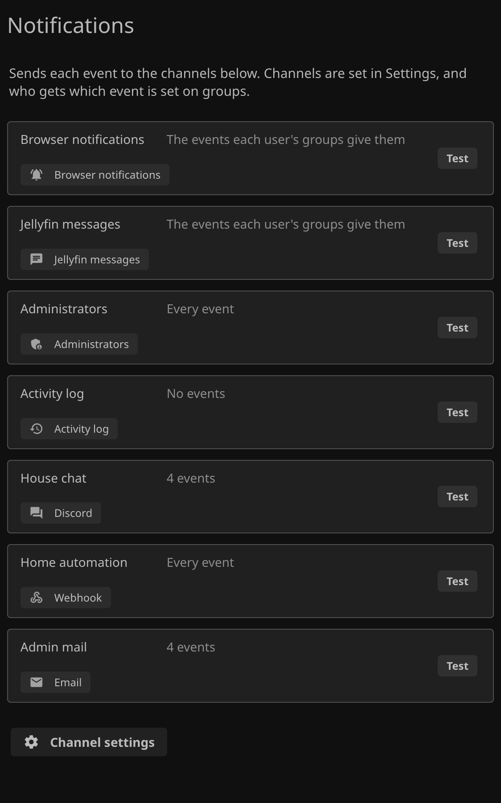
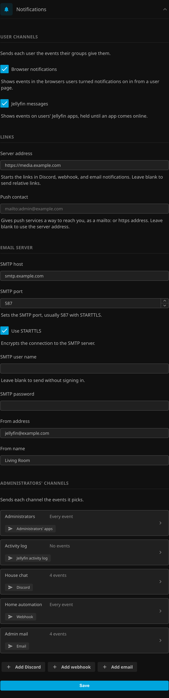
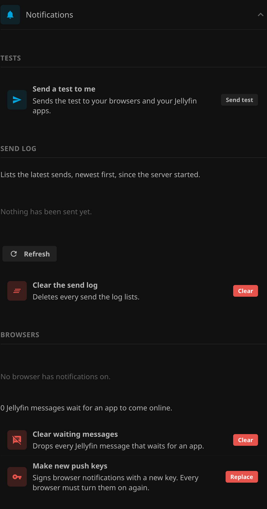

# Notifications

Notifications sends every event a Necto tool reports to the people and channels it goes to.

## Channels

Cards at the top count the sends in the send log that went, as **Sent**, and those that **Failed**. They show a dash until the log is read.

**Notifications** lists every channel, each with **Test**, which sends the test event to that channel and shows what happened. A channel with a name of its own, such as a webhook, also shows its kind. **Channel settings** opens **Settings > Notifications**, where the channels are set.

| Notifications | Notifications on a phone |
| :---: | :---: |
|  |  |

| Channel | Sends to | Events |
| :--- | :--- | :--- |
| **Browser notifications** | The browsers a user turned notifications on in, from a user page | The events the user's groups give them, when a group turns this channel on |
| **Jellyfin messages** | A message on the user's Jellyfin apps, held until an app comes online | The events the user's groups give them, when a group turns this channel on |
| **Administrators** | Every administrator's Jellyfin apps, and the browsers they turned notifications on in | The events the channel picks, every event by default |
| **Activity log** | Jellyfin's activity log | The events the channel picks, none by default |
| Discord | A Discord channel webhook, as an embed | The events the channel picks |
| Webhook | Any address that takes a POST, as JSON or a custom body | The events the channel picks |
| Email | The addresses the channel lists, through the SMTP server | The events the channel picks |

A test of **Browser notifications**, **Jellyfin messages**, or **Administrators** goes to the administrator who selected it. A channel that fails never stops the others, and every send is written to the send log.

## Who Gets an Event

* **Groups > Notifications** sets the events members receive, with **Receive every event** or a pick from **Events**, listed under the tool that sends each, and the channels they receive them on, with **Browser notifications** and **Jellyfin messages**. A member gets their events on each channel one of their groups with events turns on.
* An event for users, such as a request's or an invite's, goes only to the users it is about, when the account is on and their groups give them the event. Administrators get every event about them.
* Any other event, such as a proxy ban or a missing disk, goes to every member who is not an administrator and whose groups give them the event. Administrators get these through **Administrators**.
* Every event goes to each administrators' channel that picks it, or takes every event.
* An administrator the event is about gets it once, as a user, and not again through **Administrators**. An event can also leave people out of **Administrators** and the groups, such as the administrator who approved a request.
* **Everyone** gives **Request approved**, **Request rejected**, **Request available**, and **Issue resolved** on a fresh install, so a user in no group hears about their own requests and issues. A new group starts with the same four, and can drop them.

## Settings

**Settings > Notifications** holds the settings. It saves through its own route, so no stored address, header, or password reaches the page.

The SMTP password, the VAPID private key, and each channel's address, headers, and email addresses live encrypted in their own file, `Jellyfin.Plugin.Necto.Notifications.Secrets.json`, beside the configuration and readable by Jellyfin's account alone. The plugin configuration Jellyfin hands out holds none of them, and saving another page never changes them.

### User Channels

* **Browser notifications** shows events in the browsers users turned notifications on in.
* **Jellyfin messages** shows events on users' Jellyfin apps, held until an app comes online.

### Links

* **Server address** starts the links in Discord, webhook, and email notifications, such as `https://jellyfin.example.com`. Left blank, links stay relative.
* **Push contact** gives push services a way to reach you, as a `mailto:` or https address. Left blank, it is the server address.

### Email Server

* **SMTP host** and **SMTP port** name the server. 587 is the usual port with STARTTLS.
* **Use STARTTLS** encrypts the connection.
* **SMTP user name** and **SMTP password** sign in. Leave the user name blank to send without signing in. The password is stored encrypted.
* **From address** and **From name** say who email comes from.

### Administrators' Channels

Each channel opens in a sidecar. **Add Discord**, **Add webhook**, and **Add email** start a new one, and **Done** keeps it until the section's **Save**.

* **Name** names an added channel. **Administrators** and **Activity log** keep their names and cannot be removed.
* **Send to this channel** turns the channel on or off.
* **Discord webhook address** and **Webhook address** are stored encrypted and never shown again.
* **Post as** and **Avatar address** set who a Discord post comes from.
* **Headers** sends one `Name: value` header a line, such as a token. They are stored encrypted, and kept only while the address stays the same.
* **Use a custom body** sends your own body in place of the one Necto builds. **Body** takes placeholders, and JSON is sent as JSON.
* **Addresses** lists an email channel's recipients, one a line.
* **What posts carry** sets what a Discord, webhook, or email post about a request or an issue carries. See [What Posts Carry](#what-posts-carry).
* **Every event** sends every event, or the list below it picks them.
* **Preview** shows what the channel would get for the test event.

| Placeholder | Holds |
| :--- | :--- |
| `{title}` | The event's title |
| `{body}` | The event's text |
| `{event}` | The event's key, such as `invites.used` |
| `{eventName}` | The event's name, such as Invite used |
| `{level}` | `Info`, `Warning`, or `Error` |
| `{link}` | The page the event opens, made absolute with **Server address** |
| `{time}` | When it was sent, in UTC |
| `{color}` | The Discord color, as a number. See [Discord Colors](#discord-colors) |
| `{serverURL}` | **Server address** |
| `{userId}` | The user the event is about |

An event's own values, such as `{inviteId}`, are placeholders too, and a webhook's JSON carries them under the event's key. A request's or an issue's events add `{name}`, `{year}`, `{type}`, `{seasons}`, `{user}`, `{joined}`, `{note}`, `{reason}`, `{decidedBy}`, `{overview}`, `{days}`, `{poster}`, and `{request}` or `{issue}`, the whole record as JSON. A custom body gets them whatever the post switches say, except that `{user}` says Someone while **Requester or reporter** is off.

### What Posts Carry

| Switch | Discord | Webhook | Default |
| :--- | :--- | :--- | :--- |
| **Poster** | The thumbnail | `poster` | On |
| **Overview** | Under the text | `overview` | On |
| **Requester or reporter** | A field. Off, the post names no one and says Someone | `user`, and `userId` | Off |
| **Joined** | A field | `joined` | Off |
| **Seasons** | A field | `seasons` | On |
| **Notes** | A field | `note` | On |
| **Time** | The embed's time | `time` | On |
| **Whole request or issue** | Not sent | `request` or `issue`, as JSON | On |

An email channel offers **Requester or reporter** only, since an email carries the event's words alone. A switch left on with nothing to carry sends `null` in a webhook and no field in Discord.

### Discord Colors

Each request and issue event has its own embed color. Every other event takes its level's, blue for `Info`, orange for `Warning`, and red for `Error`.

| Event | Color |
| :--- | :--- |
| New request | Amber, `#FFC107` |
| Request approved | Blue, `#00A4DC` |
| Request available | Green, `#4CAF50` |
| Aging request | Orange, `#FF9800` |
| Expiring request | Deep orange, `#FF5722` |
| Request rejected and Request not sent | Red, `#F44336` |
| Issue reported | Orange, `#FF9800` |
| Issue resolved | Green, `#4CAF50` |

## Browser Notifications

Necto makes its VAPID key pair the first time a page needs it, and keeps the private key encrypted in the Notifications secrets file. In a browser, every user page registers one service worker, `Notifications/Push/Worker.js`, at the server's root, so a browser keeps one subscription for all of them. The request page installed as an app keeps its own worker, since a phone ties notifications to the installed app. A user page shows **Turn on notifications** while the browser can take them, and **Turn off notifications** once it has.

A request's or an issue's notification shows its poster, and a newer one about the same request or issue replaces the older one on a device. Other events replace the last one of the same kind.

!!! info "HTTPS"
    Browsers allow notifications only on a page served over HTTPS, or on localhost. On an iPhone or iPad the page must be added to the home screen first.

## Events

Each tool lists the events it sends in a static class named `<Tool>Events`, with `public static IReadOnlyList<NectoEventInfo> All`. Necto finds every list by reflection, so a tool's events show in every picker once its list exists.

A tool sends each event through `INotifier.SendAsync` as a `NectoEvent`: its key, title, and text, with the user it is about, any `OtherUserIds`, the `ExceptUserIds` the Administrators channel and the groups leave out, the page it opens, its level, and its data. `Hold` set off sends a Jellyfin message only to apps online now, `OneDevice` shows it on each user's most recent app only, and `ImageUrl` adds a poster to Discord and browser notifications.

* `Audience` sends an event to its users only, or to its channels only, when the two read other words, such as a refused request's.
* `Values` holds placeholders only a custom body reads, which a built webhook post leaves out.
* `Fields` holds what a post carries, each shown as the channel's switches allow.
* `Anonymous` is the event told without naming its user, which a channel with **Requester or reporter** off sends.
* `Tag` replaces an older browser notification with the same tag, and `Subject` lets held Jellyfin messages about one thing be dropped once it is gone.

A test checks that every key a tool sends is in a list, so no event is left out of the pickers.

| Key | Name | For users | Sent when |
| :--- | :--- | :--- | :--- |
| `notifications.test` | Test notification | Yes | **Test** or **Send a test to me** is selected |
| `invites.used` | Invite used | Yes, to the member who made the invite | An invite makes an account |
| `invites.usedUp` | Invite used up | Yes, to the member who made the invite | An invite makes its last account |
| `invites.locked` | Invite locked | Yes, to the member who made the invite | Wrong PINs lock an invite |
| `invites.expired` | Invites expired | No | The expiry task turns invites off |
| `invites.created` | Member invite made | No | A member makes an invite |
| `requests.created` | New request | Yes, to the requester and those who joined | Someone requests a title |
| `requests.approved` | Request approved | Yes, to the requester and those who joined | A request is approved |
| `requests.declined` | Request rejected | Yes, to the requester and those who joined | A request is rejected |
| `requests.available` | Request available | Yes, to the requester and those who joined | A requested title reaches the library |
| `requests.failed` | Request not sent | Yes, to the requester and those who joined | Radarr or Sonarr refuses a request |
| `requests.aging` | Aging request | No | A request waits longer than Settings allows |
| `requests.expiring` | Expiring request | No | A waiting request is rejected within three days |
| `issues.created` | Issue reported | Yes, to every reporter | Someone reports an issue |
| `issues.updated` | Issue resolved | Yes, to every reporter | A manager resolves or declines an issue |
| `proxy.banned` | Address banned by the proxy | No | An address is banned for failed sign-ins |
| `proxy.certificate_expiring` | Certificate expiring | No | A certificate expires within two weeks and is not being renewed |
| `proxy.certificate_failed` | Certificate failed | No | A certificate could not be issued, renewed, or loaded |
| `proxy.certificate_issued` | Certificate issued or renewed | No | Let's Encrypt issues or renews a certificate |
| `proxy.start_failed` | Proxy could not start | No | Another program holds the proxy's ports |
| `proxy.unreachable` | Proxy unreachable from the internet | No | The scheduled check cannot reach the HTTPS port |
| `proxy.visitors_hidden` | Visitors hidden behind one address | No | Most visitors look local |
| `ddns.failed` | DDNS record failed | No | A record could not be pushed to its provider |
| `ddns.paused` | DDNS record paused | No | A record failed so often that it is paused |
| `ddns.recovered` | DDNS record works again | No | A failing record is pushed again |
| `ddns.detection_failed` | Public IP not found | No | The public address could not be found for several runs |
| `wireguard.connected` | Peer connected | No | A peer makes its first handshake |
| `wireguard.disconnected` | Peer disconnected | No | A peer goes quiet |
| `wireguard.connection-established` | Connection established | No | This server reaches another WireGuard host |
| `wireguard.connection-lost` | Connection lost | No | This server loses another WireGuard host |
| `wireguard.data-limit` | Data limit reached | No | A peer or connection reaches its data limit |
| `wireguard.failed` | Tunnel failed | No | A tunnel keeps failing to start |
| `scripts.failed` | Script run failed | No | A script run ends with a failed step |
| `pages.records_added` | Records added | No | Pages add records to a store that notifies |
| `pages.records_removed` | Records removed | No | Records are deleted from a store that notifies |
| `pages.store_cleared` | Store cleared | No | An administrator clears a store |
| `storage.disk_missing` | Disk missing | No | A disk a library uses goes missing |
| `storage.disk_unresponsive` | Disk unresponsive | No | A disk stops answering in time |
| `storage.disk_back` | Disk back | No | A missing or unresponsive disk is back |
| `storage.disk_remounted` | Disk remounted | No | A missing disk is mounted again |
| `storage.remount_failed` | Disk not remounted | No | A missing disk could not be mounted again |
| `storage.smart_warning` | Disk health warning | No | A disk's SMART data says it is failing, too hot, or worn |
| `storage.space_low` | Disk low on space | No | A disk passes its warning point |
| `storage.space_full` | Disk full | No | A disk passes its error point |
| `storage.scan_blocked` | Library scan blocked | No | A library scan is blocked while a disk is missing |
| `storage.format_failed` | Disk not formatted | No | A disk could not be formatted |

## Troubleshooting

**Troubleshooting > Notifications** holds the tests and repairs.

* **Send test** beside **Send a test to me** sends the test to your browsers and your Jellyfin apps.
* **Send log** lists the latest 200 sends, newest first, with what happened. It starts empty when the server starts. **Refresh** reads it again, and **Clear** beside **Clear the send log** empties it.
* **Browsers** lists the browsers with notifications on, by user, with the count of Jellyfin messages waiting for an app.
* **Clear waiting messages** asks first, then drops every held Jellyfin message.
* **Replace** beside **Make new push keys** asks first, then makes a new key pair. Every browser must turn notifications on again.

| Reason | What to do |
| :--- | :--- |
| "No browser has notifications on. Turn them on from a user page first." | Open a user page, such as `/invites`, in that browser and select **Turn on notifications** |
| "Set the SMTP server in Settings first." | Fill **SMTP host** and **From address** in **Settings > Notifications** |
| "Add an address to the channel first." | Add an address to the email channel |
| "Could not send the email. Check the SMTP settings." | Check the host, port, STARTTLS, and sign in, then select **Test** |
| A Discord or webhook test fails | Check the address, then select **Preview** to see what is sent |

## Limitations

* Email uses STARTTLS. A server that only takes TLS from the start, usually on port 465, cannot be used.
* The send log lives in memory, so a restart clears it.

## API

| Route | Who | What it does |
| :--- | :--- | :--- |
| `GET /Notifications/Events` | Administrators | Lists every event, by tool |
| `GET /Notifications/Channels` | Administrators | Lists the channels the page shows |
| `POST /Notifications/Channels/{id}/Test` | Administrators | Sends the test to one channel |
| `POST /Notifications/Preview` | Administrators | Shows what a channel would get for the test |
| `GET /Notifications/Settings` | Administrators | Gives the settings, every secret hidden |
| `PUT /Notifications/Settings` | Administrators | Saves the settings, keeping secrets sent back as kept |
| `GET /Notifications/Log`, `DELETE /Notifications/Log` | Administrators | Gives or clears the send log |
| `GET /Notifications/Push` | Administrators | Lists the browsers and the held count |
| `POST /Notifications/Push/Keys` | Administrators | Makes a new VAPID key pair |
| `DELETE /Notifications/Held` | Administrators | Drops every held Jellyfin message |
| `GET /Notifications/Push/Key` | Signed in users | Gives the VAPID public key, or `404` while browser notifications are off |
| `POST /Notifications/Push/Subscribe` | Signed in users | Turns on notifications for the caller in one browser |
| `POST /Notifications/Push/Unsubscribe` | Signed in users | Turns them off for the caller in one browser |
| `GET /Notifications/Push/Worker.js` | Anyone | The service worker every user page shares |

A refused save answers `400` with `{ "Error": "..." }`.
