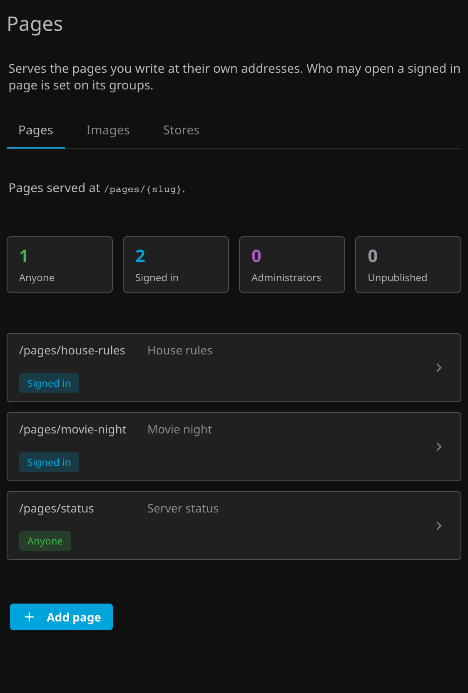
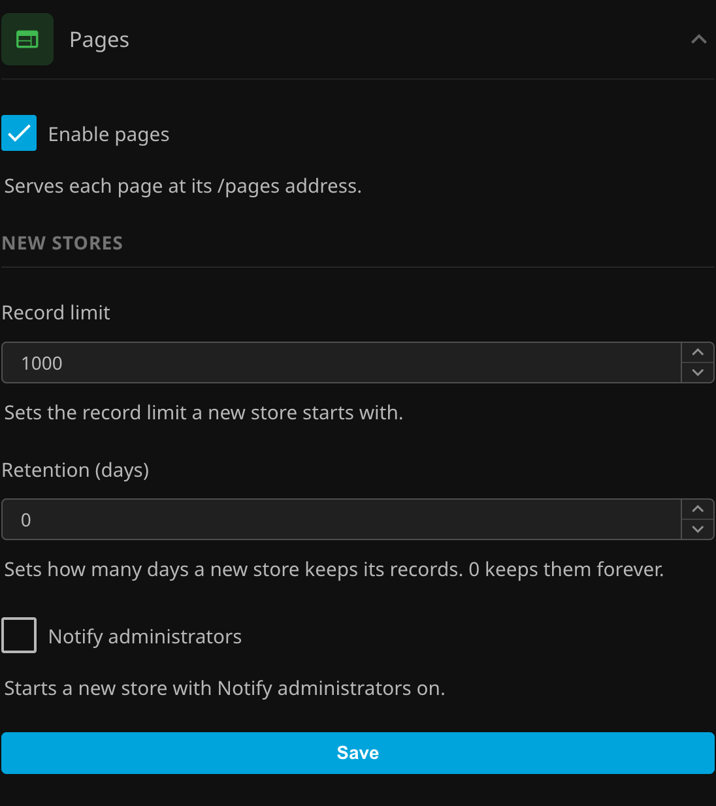
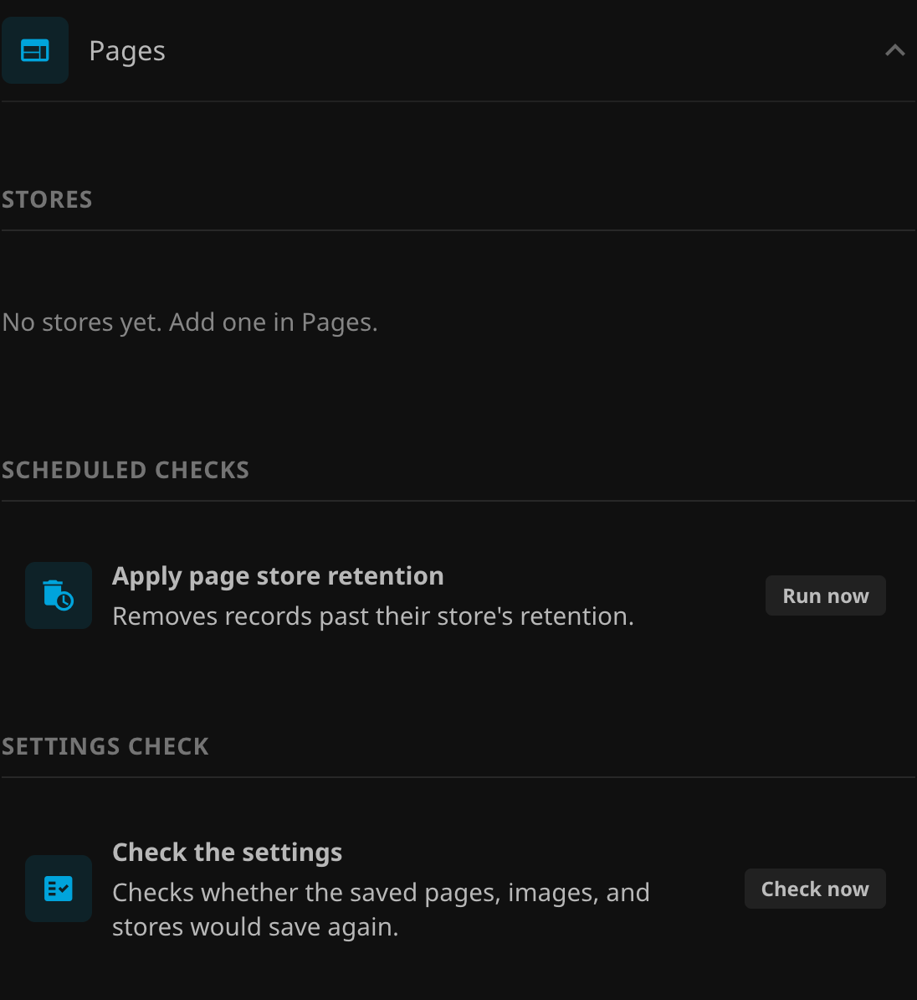

# Pages

**Pages** serves pages you write at their own addresses, with the images they use and the stores they keep records in.

## What It Does

* Serves each page at `/pages/{slug}`, written as separate HTML, CSS, and JavaScript or as one complete document.
* Opens a page for **Anyone**, for **Signed in** users whose groups give it, or for **Administrators**.
* Hosts images for the pages, public or embedded only into pages at their tier.
* Lets a page call fixed server side routes with stored credentials, and keep records in stores on the server.

!!! warning "Only publish content you trust"
    A page is content you supply, and it may load scripts and images from anywhere. Use HTTPS and a reverse proxy or a VPN if you expose the pages to the internet.

## The Pages Tool

**Pages** has three tabs: **Pages**, **Images**, and **Stores**, each with one line under it on what it holds. Each list opens a record in a sidecar, whose shelf holds **Delete**, **Cancel**, and **Save**. A save asks the server first whether it would take the change, so a refused save shows its reason, such as "Two pages use the slug rules.". The tool holds no settings, which are in **Settings > Pages**.

| Pages | Pages on a phone |
| :---: | :---: |
|  |  |

## Pages

**Pages** counts the pages by tier and lists each by its title over its address, with its tier and tags for **Unpublished** and **System access**. A page with no title is listed by its address. Select **Add page** for a new one.


The page sidecar holds:

* **Slug** sets the page's address. It keeps lower case letters, digits, dashes, and underscores. The **URL** under it shows the full address with a copy button.
* **Title** sets the document title.
* **Visibility** sets who may open the page. For **Signed in** its line says the page opens for administrators and the groups that give it. See [Who May Open a Page](#who-may-open-a-page).
* **Published** serves the page at its address. An unpublished page answers as not found.
* **Use a single webpage file** serves one complete HTML document as written, in place of separate HTML, CSS, and JavaScript.
* **Allow system access** runs the page without the sandbox. See [System Access](#system-access).
* **HTML**, **CSS**, and **JavaScript** are tabs over the source box, each showing its own part of the page. The tabs hide and the box holds the whole document while **Use a single webpage file** is on.

The slugs `asset`, `store`, `stores`, and `configuration` are kept for the pages' own routes.

### How a Page Is Served

The page is built into one document and embedded in a small host page as a sandboxed frame on an opaque origin, with no `allow-same-origin`. Its scripts run, its forms submit, and its links open in new tabs, but it cannot read the viewer's token, cookies, or storage. The Jellyfin origin may frame a page, and other sites cannot.

The page takes the web client's look before its own CSS: the web client's Noto Sans font, light text on its dark background, and its links, headings, tables, fields, and buttons. A page with no CSS reads like the web client, and any CSS the page sets wins. The browser tab shows the page's **Title**.


A page that needs a signed in viewer opens on the web client's loading screen. It finds this server's saved sign-in, matched by server id or by an address on this exact origin, asks for the page with it, and writes the page in. A viewer with no sign-in gets the web client's sign in form and the page once they sign in. One the page refuses sees **You can't open this page**, and a page that went away, or an address with no page, shows **Page not found**.

## Who May Open a Page

| Visibility | Who opens it |
| :--- | :--- |
| **Anyone** | Everyone, signed in or not |
| **Signed in** | Administrators, and members of a group that gives the page |
| **Administrators** | Administrators only |

A group gives pages in **Groups > Pages**, with **Open every page** or **Pages members may open**. **Pages members may open** lists the **Signed in** pages, since the other tiers ignore groups, and keeps a page the group already gives after it moves to another tier. A user in no group takes **Everyone**, which gives no page until you choose one. The check runs before the page is built, so a refused viewer never receives its HTML, CSS, or JavaScript. An API key carries no user, so it cannot open a **Signed in** page.

!!! note "A viewer reads the source"
    Groups narrow who receives a page. Everyone who receives it can read its source, since a browser needs the source to show it.

## Images

**Images** hosts images for the pages. The list of images comes first, and the drop zone under it takes new ones. Drop or select images to upload them, up to 5 MB each. An upload with the name of an image already there replaces it and keeps its tier. The cards count **Images**, **Other** files, and their total **Size**.


Use an image by the path on its row, `asset/{name}`, from the page's HTML or CSS:

```html

```

Each image has a tier of its own:

* **Anyone** images are public at `/pages/asset/{name}`, served with `nosniff` and a sandbox policy. Any file that is not an image is served as a download.
* **Signed in** and **Administrators** images are never served by address, since an image fetch carries no token. A page at the image's tier or higher has each `asset/{name}` reference replaced with the image's data as it is served. A page below the image's tier shows a broken image.

!!! warning "Public images are cached"
    Browsers and caches may keep an **Anyone** image for five minutes. To take one down at once, delete it rather than raising its tier.

Pages reuse the server's own favicon, served at `/pages/favicon.ico`.

## System Access

**Allow system access** serves a page without the sandbox, so it runs on the Jellyfin origin with the reach of the web client. Its scripts can call the server as the viewer, so turn it on only for pages you wrote, and host any outside library yourself.

### Server Routes

A page with system access can have **Server routes**. Select **Add route** and give it a **Name**, a **Target URL**, and optionally a **Username** and **Password**. The page calls it through an injected helper:

```js
serverFetch('name', { method: 'POST', body: '...' })
```

The call reaches `/pages/{slug}/api/{name}`, and the server forwards it to the target with the route's HTTP Basic credentials.

* The target is fixed in the settings, so a page reaches only what you wired up. Only absolute `http` and `https` targets are taken.
* A route reaches exactly its page's audience, checked before anything is forwarded.
* The page's own request headers go to the target. The viewer's Jellyfin credentials and cookies never do.
* The target's `ETag`, `Last-Modified`, `Content-Type`, `Content-Disposition`, `Content-Language`, `Content-Encoding`, `Content-Range`, `Accept-Ranges`, `Location`, `Retry-After`, `Link`, `Vary`, and custom `X-` headers come back. Anything that would act on the Jellyfin origin, such as `Set-Cookie`, is dropped. A document a browser could run script in comes back sandboxed.
* A route never follows a redirect, so its credentials stay with the host it names and the page sees the redirect itself.
* A request may be up to 4 MB and an answer up to 16 MB. A larger request answers `413`, a larger answer `502`, an unreachable target `502`, and one slower than 30 seconds `504`.
* Passwords are stored encrypted and never sent to the browser. A stored one shows as kept, and **Clear password** removes it on the next save. A renamed page or route keeps its password while the target stays on the same host. A route that points to another host needs its password entered again.

## Stores

A store keeps records that pages with system access read and write:


```js
pageStore.write('queue', { url: value }, { label: value });
pageStore.read('queue').then(function (records) { console.log(records); });
pageStore.read('queue', id);
pageStore.readAll('queue');
pageStore.remove('queue', id);
```

`write` takes a record id or an object with `id` and `label` as its third argument. Without an id it adds a record, and with one it replaces that record's data. The label names the record in the activity log. The server sets each record's `id`, `createdUtc`, `updatedUtc`, and `userId`, so a page cannot forge them. The shape of `data` is the page's own.

**Stores** counts the stores, their **Records**, and the stores **Open to writes** from anyone. Select **Add store** for a new one. The store sidecar holds:

* **Name** sets the store's address, `/pages/store/{name}`.
* **Accept calls** answers pages that call the store. A store that does not answers as not found.
* **Read** sets the lowest tier that may read the store. A viewer below it reads nothing.
* **Scope** sets how much a reader sees. **All records** shows every record and **User records** only the reader's own. Administrators always see every record. **Scope** hides while **Read** is **Administrators**.
* **Write** sets the lowest tier that may add a record. Changing a record needs the read tier too.
* **Writers edit own records** lets a writer change and delete the records they created while **Scope** is **User records**.
* **Record limit** refuses writes past this count. A record holds at most 64 KB and a store at most 64 MB.
* **Retention** removes records once they reach an age, counted from when each was created.
* **Notify administrators** writes the activity log and sends Notifications when records are added or removed. A burst of writes becomes one entry.

The sidecar shows how full the store is, and a notice when **Write** is **Anyone** or when **Scope** is **All records** with **Read** and **Write** below **Administrators**.

!!! warning "Scope All records lets every writer change every record"
    With **All records**, anyone who clears both tiers may change or delete any record, and **Writers edit own records** has no effect.

Records live in `data/necto/pages/stores/{name}.json` under Jellyfin's data folder, not in the settings, so a settings backup does not hold them. Removing a store keeps its file, and a store added with the same name finds its records again. A file that cannot be read is left alone, and the store answers as empty and refuses writes until the file is repaired or removed and Jellyfin restarts.

| Answer | When |
| :--- | :--- |
| `401` | A caller who is not signed in is below the tier |
| `403` | A signed in caller is below the tier |
| `404` | No store has the name, it does not accept calls, or the record is out of reach |
| `409` | The store is at its record limit |
| `413` | The record is larger than 64 KB |
| `507` | The store would pass 64 MB |

An API key reads and writes a store as an administrator with no user, so it owns no record.

## Settings

**Settings > Pages** sets what a new store starts with.



| Setting | What it does | Default |
| :--- | :--- | :--- |
| **Enable pages** | Serves each page at its `/pages` address. Off answers 404 at every `/pages` address, stops retention, and keeps every page, image, and store | Off |
| **Record limit** | Sets the record limit a new store starts with | 1000 |
| **Retention (days)** | Sets how many days a new store keeps its records, where 0 keeps them forever | 0 |
| **Notify administrators** | Starts a new store with Notify administrators on | Off |

## Troubleshooting

**Troubleshooting > Pages** holds:



* **Stores** lists each store with its records and limit. **Clear** asks first, then deletes every record in the store. A settings backup cannot bring them back.
* **Run now** beside **Apply page store retention** runs the retention task.
* **Check now** beside **Check the settings** asks the server whether the saved pages, images, and stores would save again, and why not.

| Reason | What to do |
| :--- | :--- |
| "You can't open this page" on a **Signed in** page | Give the page to one of the viewer's groups in **Groups > Pages** |
| The sign in form shows on every visit | Turn on **Remember me** in the web client's own sign in, then open the page again |
| "The saved password of the route *name* on the page *slug* could not be kept, since the route was renamed or points to another host. Enter the password again and save." | Enter the route's password again and save |
| "The slug *slug* is kept for the pages' own routes. Pick another." | Pick another slug |
| A store answers as empty and refuses writes | Check the server log for the store file, repair or remove it, then restart Jellyfin |

## Notifications

A store with **Notify administrators** on sends these events. Who receives them is set on groups.

| Event | When |
| :--- | :--- |
| `pages.records_added` | Records were added, summed over a burst |
| `pages.records_removed` | Records were deleted, summed over a burst |
| `pages.store_cleared` | An administrator cleared the store |

## Activity Log

| Entry | When |
| :--- | :--- |
| "Record added", "Records added" | A store with **Notify administrators** took records, such as "Added Big Buck Bunny to queue" |
| "Record removed", "Records removed" | Records were deleted from such a store |
| "Store cleared" | An administrator cleared such a store, such as "Admin cleared 4 records from queue" |

## Scheduled Tasks

| Task | What it does | Runs |
| :--- | :--- | :--- |
| **Apply page store retention** | Removes records past the retention set on their store | Every 6 hours |

A read or write drops a store's expired records too, so the task is for stores nobody touches.

## Security

* Only administrators write pages, images, and stores.
* A page runs in a sandboxed frame on an opaque origin unless it has system access. Its markup only ever reaches the viewer HTML encoded inside that frame.
* A page runs under one `Content-Security-Policy` on every tier, with `object-src 'none'`, `base-uri 'none'`, and `frame-ancestors 'self'`. The loading and not found screens leave out `base-uri`, since they set their own base address, and the page they write in brings `object-src 'none'` and `base-uri 'none'` in its own policy. Every response sets `Cache-Control: no-store`, `Referrer-Policy: no-referrer`, `X-Content-Type-Options: nosniff`, `X-Frame-Options: SAMEORIGIN`, and `X-Robots-Tag: noindex`.
* A page may load images, fonts, styles, scripts, and media from anywhere, run inline script, submit forms, and open popups. It may not use `object` or `embed` content, set a `base` tag, or be framed by another site.
* `allow-popups-to-escape-sandbox` lets a link to another site open as a normal page, and it is the widest hole in the sandbox, since a script can open and drive that window.
* Each request is checked on the server against the page's tier and the caller's groups, or the store's tiers, never against which page made it.

## Permissions

**Groups > Pages** sets which **Signed in** pages members may open, with **Open every page** or **Pages members may open**. See [Groups](Groups.md#tool-permissions). Stores keep their own **Read** and **Write** tiers.

## API

The pages' own addresses:

| Route | Who | What it does |
| :--- | :--- | :--- |
| `GET /pages/{slug}` | Anyone | Serves an **Anyone** page, the loading screen of any other, or the not found screen |
| `GET /pages/{slug}/user` | Signed in | Serves a **Signed in** page to administrators and the groups that give it |
| `GET /pages/{slug}/admin` | Administrators | Serves an **Administrators** page |
| `GET`, `POST /pages/{slug}/api/{name}` | The page's audience | Forwards a server route |
| `GET /pages/asset/{name}` | Anyone | Serves an **Anyone** image |
| `GET /pages/favicon.ico` | Anyone | Serves the server's favicon |
| `GET /pages/store/{name}/read?id={id}` | The store's read tier | Lists the records the caller may see, newest first, or one record |
| `POST /pages/store/{name}/write` | The store's write tier | Adds a record, or replaces one the caller may change |
| `POST /pages/store/{name}/delete` | The store's tiers | Deletes one record the caller may change |

The routes for administrators:

| Route | What it does |
| :--- | :--- |
| `GET /Pages` | Lists every page with its id, title, slug, and tier, for the group editor |
| `GET /Pages/Stores/{name}/Stats` | Gives a store's record count and limit |
| `POST /Pages/Stores/{name}/Clear` | Deletes every record in a store |
| `POST /Pages/Configuration/Check` | Says whether a configuration would save, and why not |
