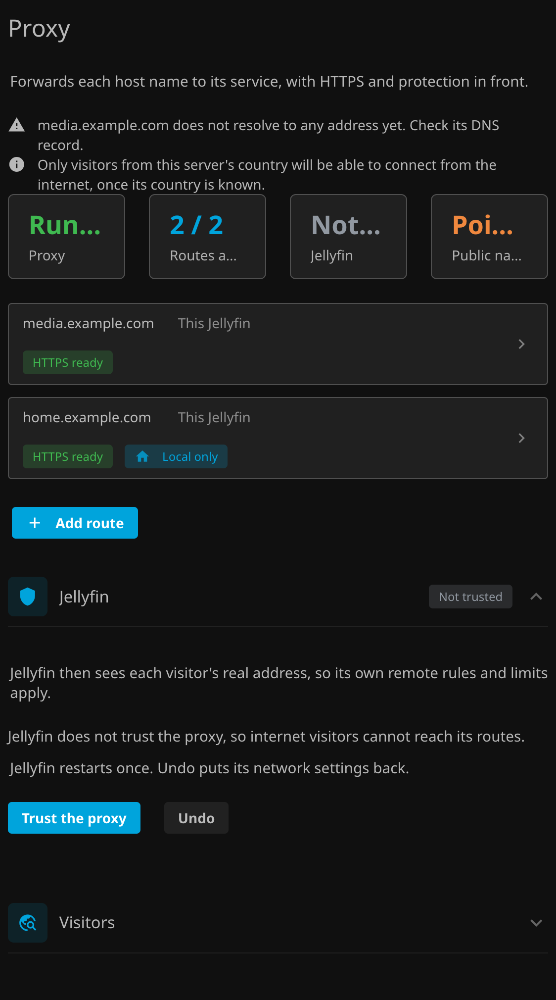
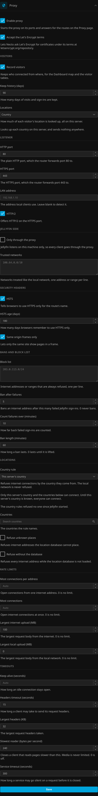
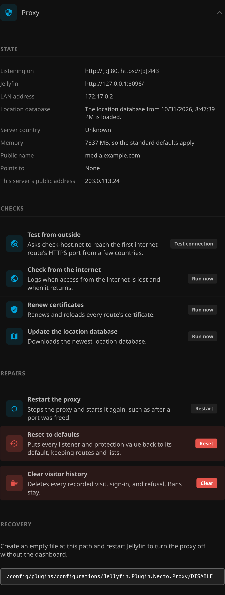

# Proxy

**Proxy** is a reverse proxy that runs inside Jellyfin and forwards each host name to its service, this Jellyfin or any other on your network. A route is a host name, an upstream address, a certificate, and its protection. [Getting Started](GettingStarted.md) walks through the route templates.

## The Proxy Tool

The page opens with notices that need a look, such as a port another program holds, a name that points elsewhere, or visitors that all look local. The cards under them show whether the proxy runs, how many routes it answers for, whether Jellyfin trusts it, and whether the first internet route's name points at this server.

| Proxy | Proxy on a phone |
| :---: | :---: |
|  |  |

The proxy is off until **Settings > Proxy > Enable proxy** is on. While it is off the page says so in place of its cards, **Add route**, **Jellyfin**, and **Visitors**, and lists any routes already added.

The page reads the proxy's status and routes again every 10 seconds, and the visitors every 30 seconds, so a certificate being issued, Jellyfin restarting, and new visitors or bans show without a reload.

## Routes

Each row shows the route's host name, where it forwards with a Jellyfin route's local address, and **Local only** where it applies. Its state sits at the row's end, **Off** for a route that is off, else its certificate's, such as **HTTPS ready**, **Expires soon**, or **Certificate failed**. Select a row to open the route in a sidecar. **Add route** starts from a template: **Jellyfin**, with your domain for the internet and `home` under it as its local address, or **Blank**.

* **Use a DDNS name** comes first while a DDNS record keeps a name, since it decides the host. Picking a name locks **Host name** to it. Picking a wildcard such as `*.example.com` turns **Host name** into one field with `.example.com` shown after it, which takes one name, such as `media`, or `*` for the wildcard itself. **None** frees **Host name**. The server refuses a host that does not fit the DDNS name the route uses.
* **Host name** is the name visitors use, such as `media.example.com`, or a one label wildcard such as `*.example.com`. An exact name beats a wildcard.
* **Answer for this route** turns the route on or off.
* **Forward to** picks **Jellyfin** or **Another service**. **Service address** is the other service's `http` or `https` address and port, such as `http://192.168.1.20:8096`. Paths are forwarded as they come.
* **Local network only** answers only the local network and **Trusted networks**. The internet gets nothing.
* **Local address**, on a route to Jellyfin, is a second name that answers only the local network and **Trusted networks**, such as `home.example.com` beside `example.com`. See [Remote and Local Addresses](#remote-and-local-addresses).

**Forwarding** sets how the route forwards.

A route to **Jellyfin** picks a **Preset**, built on [Jellyfin's reverse proxy guide](https://jellyfin.org/docs/general/post-install/networking/reverse-proxy). Every preset passes WebSockets, streams answers without buffering, and sends the forwarding headers and the visitor's host name to Jellyfin, as the guide's examples do. Each preset is a card with what it is for. Under the cards, the route lists what its preset sets. **Custom** shows those four values as fields to edit, starting from the preset picked before it. A route saved before presets existed uses **Recommended**.

| Preset | Upload limit | Idle timeout | Media idle timeout | Connections to Jellyfin | For |
| :--- | :--- | :--- | :--- | :--- | :--- |
| **Recommended** | Same as Settings | Same as Settings | 360 minutes | 256 | Most servers. The limits in **Settings** are above the guide's 20 MB |
| **Low memory** | 20 MB | 120 seconds | 60 minutes | 32 | A Raspberry Pi or a small VPS. Fewer connections are held, and idle ones go sooner |
| **High bandwidth** | 2048 MB | 900 seconds | 720 minutes | 512 | Viewers on slow or distant links, and large uploads |
| **Custom** | Set | Set | Set | Set | Any other mix |

* **Upload limit (MB)** replaces the limit in **Settings** for this route. Blank keeps the limit in **Settings**, and 0 is no limit.
* **Idle timeout (seconds)** closes a request Jellyfin stays silent on for this long. Blank keeps the timeout in **Settings**.
* **Media idle timeout (minutes)** closes a stream a paused player has not read for this long.
* **Connections to Jellyfin** limits the connections the proxy opens to Jellyfin, for pages and for media each. Requests past it wait for a free connection.

The server's own memory also picks the defaults marked **Auto** in [Settings](#settings), such as fewer open connections below 3 GB.

A route to **Another service** shows its settings directly, and a new one starts with the proxy's own behavior.

* **Pass WebSockets** lets the app hold live connections open. On by default. Off, a WebSocket request gets 403.
* **Buffer answers** holds each answer whole before sending it on. Off by default. Leave it off for streams.
* **Upload limit (MB)** replaces the limit in **Settings** for this route. Blank keeps the limit in **Settings**, and 0 is no limit.
* **Idle timeout (seconds)** replaces the timeout in **Settings** for this route. Blank keeps it.
* **Send the visitor's host name** passes the name the visitor asked for. On by default. Off, the app sees its own address, and `X-Forwarded-Host` still carries the visitor's. Turn it off for an app that refuses any other host, such as qBittorrent.
* **Path prefix** puts a path in front of every request, such as `/radarr` for an app with a URL base.
* **Request headers** and **Response headers** set headers on every request to the app and every answer to the visitor. The proxy refuses a header it sets itself, such as `Host`, `X-Forwarded-For`, or `Strict-Transport-Security`.

### Examples for Other Services

Each app below forwards well with these settings, after the reverse proxy guide the app publishes. Anything not named keeps its default.

| App | Upload limit (MB) | Idle timeout (seconds) | Send the visitor's host name | Path prefix | Why |
| :--- | :--- | :--- | :--- | :--- | :--- |
| Any web app | Blank | Blank | On | Blank | The proxy's own behavior suits most apps |
| Jellyseerr, Seerr, or Overseerr | 20 | Blank | On | Blank | Avatars and settings imports are small |
| Ombi | 20 | Blank | On | Blank | The same small uploads as Seerr |
| Radarr, Sonarr, Lidarr, Prowlarr, or Bazarr | 500 | 300 | On | The app's URL base, such as `/radarr`, when it has one | Manual imports can take minutes to answer, and a backup restore is uploaded whole |
| qBittorrent | 50 | Blank | Off | Blank | Its web UI refuses a host that is not its own, and it takes `.torrent` files |
| Home Assistant | 0 | 3600 | On | Blank | The frontend holds one WebSocket open for hours, and backups are uploaded whole |

Every example passes WebSockets and leaves **Buffer answers** off. Home Assistant also needs this server in its own `trusted_proxies`, with `use_x_forwarded_for` on.

**Remove** asks first. The route's certificate files are deleted, and the service it forwarded to stays.

A local client that asks by this server's address, or by a name no route has, reaches the first Jellyfin route. The internet must ask for a route's name, and the bare address or a scanner's guess gets nothing. Plain HTTP from the internet is sent on to HTTPS for a route's name once it has a certificate.

## Remote and Local Addresses

One route to Jellyfin carries both of its addresses. **Host name** is the remote address, such as `kelp.ink`, which answers the internet. **Local address**, such as `home.kelp.ink`, answers only the local network and **Trusted networks**, and the internet gets nothing for it, over HTTPS or plain HTTP. Both forward to Jellyfin with the route's preset, and both go on its one certificate.

* Point the local address at this server's LAN address inside the house, in your router's or your DNS server's local records.
* Let's Encrypt never reaches a local name, so a route with a local address needs a DNS challenge, through a DDNS record that covers both names. **Pick for me** picks it when one does.
* A route to Jellyfin saved with **Local network only** beside another route to Jellyfin becomes that route's local address, so the two show as one row. It keeps its DNS challenge and its DNS record.

## Wildcard Certificates

**Wildcard certificate**, under **Let's Encrypt**, asks for one certificate that covers the route's domain and every name one level under it, such as `kelp.ink` and `*.kelp.ink`. The editor says so: "Covers kelp.ink and every name under it. Every route under kelp.ink uses this certificate."

* Every other route under the domain, such as `app.kelp.ink`, uses it in place of its own, and its editor says "Uses the wildcard certificate of kelp.ink." A name two levels down, such as `a.b.kelp.ink`, is not covered and keeps its own.
* A wildcard needs a DNS challenge. Let's Encrypt checks `_acme-challenge.kelp.ink` once for the domain and once for the wildcard, one after the other, so a provider that keeps one TXT value per name still works.
* It renews with the other certificates, and **Request certificate** on its route orders it now.

These DDNS providers can publish the TXT record a DNS challenge needs, through the credentials of a DDNS record already set up. Any other provider is refused with a line that names the record it lacks.

| Provider | Needs |
| :--- | :--- |
| [Cloudflare](providers/Cloudflare.md) | An API token with DNS edit permission, and the zone |
| [DigitalOcean](providers/DigitalOcean.md) | An API token with write access, and the zone |
| [Duck DNS](providers/DuckDns.md) | The token. It covers `name.duckdns.org` and the names under it |
| [Porkbun](providers/Porkbun.md) | API access turned on for the domain, the API key and secret API key, and the root domain |

## Certificates

Each route has its own certificate, unless a [wildcard](#wildcard-certificates) covers it, and a handshake is served the one whose name it asked for.

* **Let's Encrypt** issues and renews a certificate. **Challenge** picks how Let's Encrypt checks the name.
    * **HTTP challenge** answers on port 80, so the name must reach this server from the internet.
    * **DNS challenge** publishes a TXT record through a DDNS provider that can, as [Wildcard Certificates](#wildcard-certificates) lists. It needs no open port and covers wildcards, **Local network only** routes, and local addresses. **DNS record** picks the DDNS record whose credentials publish it, or the record whose zone covers the name.
    * **Pick for me** uses a DNS challenge when a DDNS record covers the name, and an HTTP challenge otherwise.
* **PKCS#12 file** and **PEM files** load a certificate from files on this server and reload it when the files change. **Upload a certificate** takes a `.pfx` with its password, or a PEM chain with its key, and keeps them in the route's folder, readable only by Jellyfin's account.
* **Self-signed** issues a certificate from Necto's own root. **Download root** saves the root, to install once on each device. The root vouches only for the self-signed routes' names and private addresses.
* **No certificate** serves the route over HTTP only.

Nothing is asked of Let's Encrypt until **Settings > Proxy > Accept the Let's Encrypt terms** is on. **Request certificate** orders one now, past the usual timing, and still waits out Let's Encrypt's rate limit. It asks first, and is off until the proxy runs with the terms accepted. After a failure a route backs off before it asks again, and each route keeps its own record of attempts. The sidecar shows what the certificate covers, when it expires, who issued it, and the last attempt's error. A self-signed route also shows when the root expires and its SHA-256 fingerprint.

**Test route** sends one request through the running proxy for the route's name and says whether its service answered.

## Jellyfin

The **Jellyfin** section sets Jellyfin to trust the proxy, so Jellyfin sees each visitor's real address and its own remote access rules and bitrate limits apply. Internet visitors cannot reach a Jellyfin route until it does. Routes to other services do not wait for it.

**Trust the proxy** asks first. It then starts a test copy of the proxy and checks it reaches this Jellyfin, writes Jellyfin's network settings, and restarts Jellyfin once. Forward only ports 80 and 443 to this server, since anyone who reaches Jellyfin's own ports gets past the proxy. **Undo trusting the proxy** shows once Jellyfin trusts the proxy. It asks first, then puts them back as they were, and keeps anything an administrator changed since. Jellyfin keeps its own ports throughout, so a proxy that fails to start never locks anyone out. Uninstalling Necto also puts them back.

## Protection

* **Bans** ban an internet address after **Ban after failures** failed Jellyfin sign-ins within **Count failures over (minutes)**, for **Ban length (minutes)**. A ban closes every connection from the address at once, and holds across restarts. Repeat offenders in one IPv6 network are banned by their /56 or /48.
* **Block list** refuses internet addresses and ranges before TLS starts.
* **Rate limits** cap open internet connections per address and in total, requests in flight, sign-ins in flight, upload sizes, and slow readers. The local network is never capped.
* **Locations** refuse internet connections by country with the location database: **This server's country**, **Block these countries**, or **Allow only these countries**, with **Refuse unknown places** and **Refuse without the database**.
* **Trusted networks** are treated like the local network.
* On a Jellyfin route, Jellyfin's startup wizard and API docs are refused from the internet, and its sign-in is read for failed sign-ins.

Every response drops the `Server`, `X-Powered-By`, and timing headers, and gets `nosniff`, a referrer policy, **Same origin frames only**, and **HSTS** for a route's name over HTTPS. Forwarding headers a client sends are replaced, so no client can claim a local address. A save that would block the administrator's own address or country is refused.

## Visitors

The **Visitors** section shows the banned addresses with when each ban began and ends and **Unban**, and what each address did with **Block**, **Unblock**, or **Unblock** for its country. The totals by country are on the [Dashboard](Dashboard.md)'s **Locations**. With **Location lookup** set to **Country and city**, the activity table also shows each visitor's city.

**Block** and unblocking a country ask first, since a country rule covers many people. Unblocking a country lets its addresses through, and addresses blocked one by one stay blocked. Your network and trusted networks are never blocked, so their **Block** is off. An address blocked by a range in the block list has its **Unblock** off, since the range is changed in **Settings**. Hover a button that is off to see why.

With **Record visitors** off, nothing is recorded. Locations are looked up on this server with DB-IP's free database, which the location task keeps current. **Troubleshooting > Proxy** says how the location database stands, or that lookups are off.

The [Dashboard](Dashboard.md) map shows the same totals by country, through `GET /Dashboard/Map`, and its share card shows the proxy's public address from `GET /Proxy/PublicAddress`.

## Settings

**Settings > Proxy** holds every setting that is not a route. A field left at its default follows the default, and a field marked **Auto** follows the server's memory.

* **Enable proxy** starts the proxy on its ports. It is off on a fresh install, and while it is off **Proxy** leaves the sidebar, the Dashboard, and the group editor.
* **Accept the Let's Encrypt terms** lets Necto ask Let's Encrypt for certificates.
Every setting but the first two shows while **Enable proxy** is on, each group in its own part.

* **Visitors**: **Record visitors**, **Keep history (days)**, and **Location lookup** set the visitor history.
* **Listener**: **HTTP port** (80), **HTTPS port** (443), **LAN address**, and **HTTP/2**.
* **Jellyfin**: **Only through the proxy**, which binds Jellyfin to this machine so every client goes through the proxy, and **Trusted networks**. Turning on **Only through the proxy** asks before it saves, since apps, casting, and DLNA that use the server's own address stop working.
* **Security headers**: **HSTS**, **HSTS age (days)**, and **Same origin frames only**.
* **Restrictions**, **Locations**, **Rate limits**, and **Timeouts** as described above.

The description under **Country rule** says what the picked rule does and, for **This server's country**, where this server is. It warns while the location database is missing, when country rules either let everyone through or, with **Refuse without the database**, refuse every internet connection. **Countries** hides while the rule is **Off**. The description under **Location lookup** says what each choice costs, and **Country and city** downloads a database of about 130 MB.

## Troubleshooting

**Troubleshooting > Proxy** shows what the Proxy page does not: the addresses the proxy listens on, the Jellyfin it forwards to, the LAN address, the location database, the server's country, and which defaults the server's memory picks. While a country rule refused anyone, **Refused by country** counts them since Jellyfin started. With a public name, it also shows the name, the addresses it points to, and this server's public address.

* **Test from outside** sends the first internet route's name to [check-host.net](https://check-host.net), which tries to connect to its HTTPS port from a few countries. Only the name and port are sent.
* **Check from the internet**, **Renew certificates**, and **Update the location database** run their tasks now.
* **Restart the proxy** stops it and starts it again, such as after a port was freed.
* **Reset to defaults** puts every listener and protection value back to its default. It lists the settings that change and asks first. The routes, **Trusted networks**, the block list, and the country rule with its countries stay.
* **Clear visitor history** asks first. Bans stay.

To turn the proxy off without the dashboard, create an empty file named `DISABLE` in the proxy's folder, `plugins/configurations/Jellyfin.Plugin.Necto.Proxy` in Jellyfin's data folder, and restart Jellyfin. **Recovery** shows the full path in a code block.

## Scheduled Tasks

| Task | Default schedule | What it does |
| :--- | :--- | :--- |
| **Renew certificates** | Daily at 03:00 | Asks Let's Encrypt for certificates that are missing or within 30 days of expiry, reloads files, and warns two weeks before a certificate expires. |
| **Check from the internet** | Every hour | Runs the outside check and logs when access is lost and when it returns. |
| **Update the location database** | Weekly | Downloads the newest location database. |

## Notifications

| Event | When |
| :--- | :--- |
| `proxy.banned` | An internet address was banned for failed sign-ins. |
| `proxy.certificate_expiring` | A route's certificate expires within two weeks. |
| `proxy.certificate_failed` | A route's certificate could not be issued, renewed, or loaded. |
| `proxy.certificate_issued` | Let's Encrypt issued or renewed a route's certificate. |
| `proxy.start_failed` | The proxy could not start. |
| `proxy.unreachable` | The scheduled check could not reach the HTTPS port from the internet. |
| `proxy.visitors_hidden` | Most visitors look local, so something in front of the proxy hides their addresses. |

## Permissions

Proxy is for administrators only, so it carries no group permission. Which groups receive its events is set on groups under **Notifications**.

## API

Every route needs an administrator.

| Route | What it does |
| :--- | :--- |
| `GET /Proxy/Settings` and `POST /Proxy/Settings` | Read and save the settings. The routes stay as they are. |
| `GET /Proxy/Routes` | Lists the routes and their status. Certificate passwords come back as a marker. |
| `POST /Proxy/Routes`, `PUT /Proxy/Routes/{id}`, `DELETE /Proxy/Routes/{id}` | Add, save, and remove a route. |
| `GET /Proxy/Templates` | Gives the templates under the domain the DDNS records suggest. |
| `POST /Proxy/Routes/{id}/Certificate` | Uploads a certificate, as `multipart/form-data` with `certificate`, `key`, and `password`. |
| `POST /Proxy/Routes/{id}/Certificate/Request` | Orders a Let's Encrypt certificate now. |
| `POST /Proxy/Routes/{id}/Test` | Tests a route through the running proxy. |
| `GET /Proxy/Status` | Describes the proxy. |
| `POST /Proxy/Reachability` | Runs the check from outside. |
| `POST /Proxy/Trust` and `POST /Proxy/Trust/Undo` | Trust the proxy in Jellyfin, and undo it. |
| `POST /Proxy/Restart` | Restarts the proxy. |
| `GET /Proxy/Certificate/Root` | Gives the self-signed root. |
| `GET /Proxy/Defaults` | Gives the defaults in effect. |
| `GET /Proxy/DdnsHostnames` | Lists the names the DDNS records keep. |
| `GET /Proxy/PublicAddress` | Gives the address Jellyfin's apps use, for the share card. |
| `GET /Proxy/Visitors` | Gives the visitors, the bans, the totals by country, this server's location, and the location database status. |
| `POST /Proxy/Visitors/Block`, `Unblock`, `Unban`, `UnblockCountry` | Change the block list. The address or country code is sent in the body as `{ "Value": "203.0.113.5" }`. |
| `POST /Proxy/Visitors/Settings` | Saves the visitor history settings. |
| `POST /Proxy/Visitors/Location/Update` | Downloads the location database now. |
| `DELETE /Proxy/Visitors/History` | Deletes the visitor history. |

Routes and certificate passwords change only through these routes. A save of the whole plugin configuration keeps them as they are.
