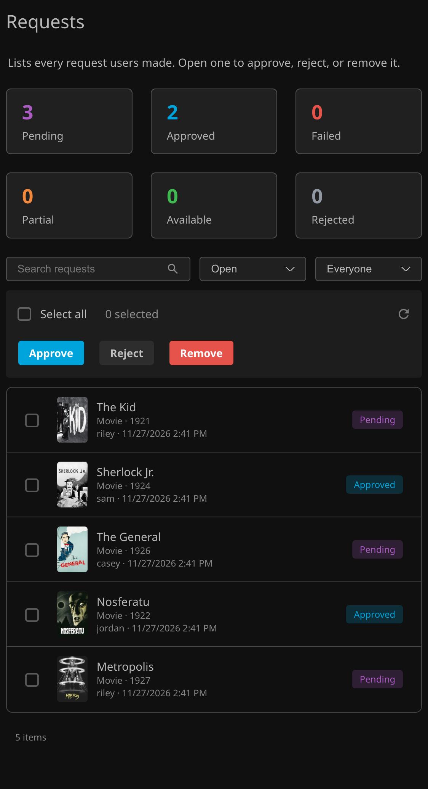
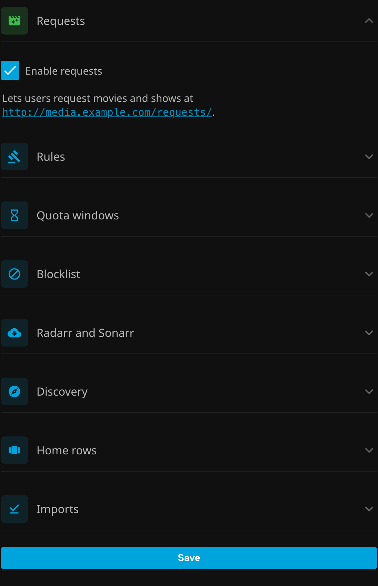
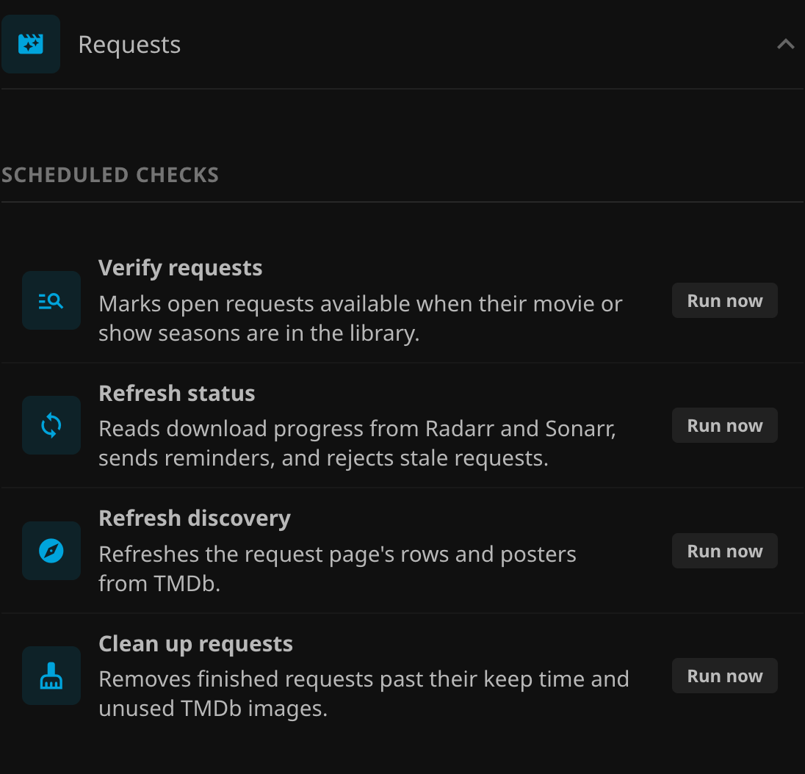

# Requests

Requests lets users search for movies and shows, see what the library already has, and ask for what it does not. Approved requests go to Radarr or Sonarr, and each request turns available once its title reaches the library.

## How It Works

1. A user finds a title on the request page at `/requests` and requests it, picking a profile, such as 1080p or 4K, and for a show its seasons.
2. An administrator, or a member of a group with **Manage requests**, approves or rejects it on the **Requests** tool or on the request page. A group with **Auto approve movies** or **Auto approve series** skips that step, and so does a title whose rating is listed in **Auto approve when rated**.
3. An approved request goes to Radarr (movies) or Sonarr (shows), which downloads it. The download's progress shows on the request.
4. Once the title is in the library, the request turns available and the requester hears of it through **Notifications**.

Without Radarr or Sonarr, approved requests are still tracked, and turn available when the title reaches the library some other way.

## The Request Page

The request page is at `https://jellyfin.example.com/requests/`. It looks and works like the installed web client, with the same header, library buttons, user menu, cards, and details pages, since it loads the web client's own stylesheets. It uses the viewer's Jellyfin session from the same browser, and a viewer who is not signed in signs in on the page itself, with their user and password or with **Quick Connect**.

| Request page | Request page on a phone |
| :---: | :---: |
|  |  |

* With nothing typed, it shows rows. **My requests**, then **Requests** with everyone else's for a viewer who may see them, then **Recently Added**, **Recommended for you**, the trending, upcoming, and popular rows from TMDb, and the home rows set in **Settings**.
* Search checks the library first, then TMDb, in **Movies**, **Shows**, and **People** rows. Search `tmdb:603`, `imdb:tt0133093`, or `tvdb:81189` to find a title by its id.
* A title's page has its genres, studios, and networks as links, **More Like This**, its seasons with their episodes, a trailer, and its collection. A collection's page has **Request all**.
* A row's page has a **Filter** button that works like a library's, with status, type, genre, and for TMDb lists sort, decade, rating, runtime, language, and streaming service.
* Each card's badge says where the title stands: in the library, requested, approved or in Radarr or Sonarr, downloaded, or blocked.
* The user menu's **Notifications** item turns on browser notifications in this browser. It signs the browser up through `/Notifications/Push/Subscribe`, so Requests and Issues events reach it.
* Over HTTPS a browser can install the page as an app called **Requests**.

Titles in libraries the viewer cannot see are never marked as in the library, and other people's requests for them are left out.

### Requesting

Open a title and select **Request**. The form asks for the **Profile**, the **Seasons** of a show, its **Specials** while **Allow specials** is on, and an optional **Note**. It says whether the request needs approval, and shows a bar for each limit the request counts against. A request past a limit cannot be sent.

While a request waits, its requester can change its seasons, profile, and note, or cancel it. Someone else who wants the same title selects **Join request**, which costs no quota, and hears about it as its requester does, without the requester's note or the reason, and without the requester's name unless they may see requesters. When a requester cancels a request others joined, the first who joined takes it over if it fits their own limits.

## The Requests Tool

**Requests** in the Necto sidebar is the list of every request.

| Requests | Requests on a phone |
| :---: | :---: |
|  |  |

* Cards count the requests by status, **Open** first.
* Each row shows the poster, the title, its requester and when, how many joined it, and its status with any download progress.
* **Search** matches titles, requesters, and notes. The status filter and the requester filter are kept for the next visit.
* Select rows to **Approve**, **Reject**, or **Remove** them together.
* When requests change while the list is open, a notice says so, and **Show latest** loads them.

Select a row to open the request in a sidecar, with **Approve** to the profile picked in **Goes to**, **Edit**, **Reject** with an optional reason, **Mark available**, **Retry** for a failed one, **Remove**, **Open in library**, and **Open in Radarr** or **Open in Sonarr**.

## Settings

**Settings > Requests** holds every setting of the tool. Who may request, and how much, is set on groups, see [Permissions](#permissions).

| Setting | What it does | Default |
| :--- | :--- | :--- |
| **Enable requests** | Serves the request page at `/requests/`, takes new requests, runs the scheduled tasks, and adds a **Requests** link to the web client's menu. Off hides the page and takes the link out, and keeps every request already made | Off |

While **Enable requests** is off, **Requests** leaves the sidebar, the Dashboard, and the group editor, `/requests/` answers 404, and a route that makes, changes, or joins a request answers 404 with "Requests are turned off." The issue page at `/issues/` follows its own switch.

The settings below show while **Enable requests** is on. Each group, from **Rules** to **Imports**, is a part of its own that opens from its heading.

### Rules

| Setting | What it does | Default |
| :--- | :--- | :--- |
| **Auto approve when rated** | Approves titles with these age ratings at once | None |
| **Remind administrators after (days)** | Sends the "Aging request" event once for a request waiting this long. 0 turns it off | 0 |
| **Reject after (days)** | Rejects requests waiting this long. 0 turns it off | 0 |
| **Auto reject reason** | Tells the requester why such a request was rejected | Not approved in time. Request it again if you still want it. |
| **Full series only** | Requests a show whole, so no one picks seasons | Off |
| **Allow specials** | Lets a show's specials be requested, each on its own | Off |

With **Reject after (days)** set, the "Expiring request" event is sent on each of the last three days.

### Quota Windows

| Setting | What it does | Default |
| :--- | :--- | :--- |
| **Movie quota window (days)** | Sets how many days back a group's **Movie quota** counts | 7 |
| **Series quota window (days)** | Sets how many days back a group's **Series quota** counts. A show counts once, however many of its seasons | 7 |

### Blocklist

Blocked titles cannot be requested, except by administrators.

* **Blocked genres**, **Blocked age ratings**, and **Blocked words in titles** block every title that matches.
* **Blocked TMDb keywords**, **Blocked languages**, and **Blocked collections** come from TMDb, so while any is set a request is refused when TMDb cannot be asked.
* **Blocked titles** lists single titles, blocked from a title's page on the request page. Each has **Unblock**, which takes effect at once.

### Radarr and Sonarr

Each server is a row naming it, its address, and its profiles. Select a row to edit it in a sidecar.

| Setting | What it does |
| :--- | :--- |
| **Default server** | Marks the server used for lookups. One per type |
| **Name** | Names the server here, such as 4K Radarr |
| **Address** | Sets how Jellyfin reaches it, such as `http://radarr.example.com:7878` |
| **External URL** | Sets the address of the **Open in Radarr** and **Open in Sonarr** links. Only managers see it |
| **API key** | Holds the key from Radarr's or Sonarr's **Settings > General** |
| **Search on add** | Searches as soon as a request is sent. Off, titles wait for the RSS sync |

**Test and load options** checks the connection and loads the server's quality profiles, root folders, and tags. Each profile has a **Name**, a **Quality profile**, a **Root folder**, **Tags**, and for Radarr **Minimum availability**, or for Sonarr **Series type** and **Season folders**. A saved key belongs to its address, so changing the address asks for the key again.

A movie Radarr monitors or has the file for cannot be requested, and neither can seasons Sonarr monitors or has in full.

### Discovery

| Setting | What it does | Default |
| :--- | :--- | :--- |
| **TMDb API key** | Sets a TMDb key of your own for everything the request page reads from TMDb. Leave blank to use Jellyfin's | Blank |
| **Hide available titles** | Leaves titles the library has in full out of the rows. **Recently Added** always shows in full | Off |
| **Home rows** | Orders the request page's rows, hides built in ones, and adds rows of your own by genre, keyword, studio, network, or streaming service | The built in rows |

### Imports

| Setting | What it does | Default |
| :--- | :--- | :--- |
| **Scan library after download** | Sets what Jellyfin scans when Radarr or Sonarr has new files: the title's folder, all libraries, or nothing | The title's folder |
| **Keep finished requests (days)** | Removes rejected and available requests after this long. 0 keeps them | 90 |

Requests a quota still counts are kept until they leave its window.

## Permissions

Each group's **Requests** section sets what its members may do. See [Groups](Groups.md#how-groups-combine) for how several groups combine.

| Permission | What it does |
| :--- | :--- |
| **Allow requests** | Lets members request. The fields below apply while it is on |
| **Movies**, **Series** | Sets which types members may request |
| **Unreleased titles** | Lets members request titles that are not out yet |
| **Auto approve movies**, **Auto approve series** | Approves members' requests of that type at once |
| **Open requests at once** | Sets the most requests a member may have open. 0 is no limit |
| **Movie quota**, **Series quota** | Sets how many a member may request in the window set in **Settings**. 0 is no limit |
| **Seasons per series** | Sets the most seasons of one show a member may request. 0 is no limit |
| **Movie profiles**, **Series profiles** | Sets the profiles members pick from. None ticked is every profile |
| **See all requests** | Lets members open anyone's request, without notes or rejection reasons |
| **See requesters** | Shows who made other people's requests |
| **Manage requests** | Lets members approve, reject, edit, and remove anyone's requests, on the request page and through the API |

Administrators may do everything, with no limit. A member of a group with **Manage requests** acts as an administrator within Requests, so their own requests skip approval and limits, and they see every library item a request names.

## Notifications

Requests sends these events through **Notifications**, which picks the channels and who receives each.

* The requester and everyone who joined receive a request's own events when their groups give them the event. **Everyone** gives **Request approved**, **Request rejected**, **Request available**, and **Issue resolved** on a fresh install.
* A requester who approved their own request is not told so. Those who joined still are.
* The administrators' channels get each event without the requester and without the administrator who approved or rejected it, since both already know.
* When Radarr or Sonarr refuses a request, administrators and the channels read its error, and the requester reads that it is tried again.
* The reminders, `requests.aging` and `requests.expiring`, go to the administrators' channels and to the groups that pick them, never to the requester. An aging reminder shows on each person's most recent Jellyfin app only. An expiring one goes only to apps online at the time, since the next day's replaces it.

| Event | When |
| :--- | :--- |
| `requests.created` | Someone requests a title and it waits for approval |
| `requests.approved` | A request is approved |
| `requests.declined` | A request is rejected |
| `requests.available` | A requested title reaches the library |
| `requests.failed` | Radarr or Sonarr refuses a request, which is tried again |
| `requests.aging` | A request waits longer than **Remind administrators after (days)**. Sent once |
| `requests.expiring` | A waiting request is rejected within three days. Sent once a day |

A notification opens the title in the library once it is there, and the title on the request page before then. It shows the poster when **Settings > Notifications > Server address** is set, and a newer update about one request replaces the older one on a device. A Jellyfin message held for someone away is dropped when the request is removed.

A webhook gets the request's id, status, type, and its TMDb, TVDB, IMDb, and library item ids. Each Discord or webhook channel sets what else its posts carry. See [Notifications](Notifications.md#what-posts-carry).

## Scheduled Tasks

| Task | Default | What it does |
| :--- | :--- | :--- |
| **Verify requests** | At startup and daily | Marks requests available once their titles are in the library |
| **Refresh status** | Hourly | Reads download progress, retries refused requests, sends reminders, and rejects requests past **Reject after (days)** |
| **Refresh discovery** | Daily | Reads the request page's rows from TMDb again, and which titles Radarr and Sonarr have |
| **Clean up requests** | Daily | Removes finished requests past **Keep finished requests (days)**, and TMDb images no request uses |

Requests also turn available as soon as their titles are scanned in.

## Troubleshooting

**Troubleshooting > Requests** runs each scheduled task now. **Verify requests** and then **Refresh status** check every open request against the library, Radarr, and Sonarr at once.

| Reason | What to do |
| :--- | :--- |
| A request stays **Failed** | Open the server in **Settings > Requests**, then select **Test and load options** |
| An approved request never reaches Radarr | Check the server's **Address** and **API key**, and that one server of the type is the **Default server** |
| A title is in the library but the request is not available | Run **Verify requests**, or select **Mark available** on the request |
| The request page's rows are empty | Check that TMDb can be reached, then run **Refresh discovery** |
| A user cannot request | Check that one of their groups has **Allow requests** and the type they want |
| The request page looks off after a Jellyfin update | The server log names the classes the web client no longer styles |

## Security

* Requests and issues are stored in SQLite in the server's data folder.
* Radarr, Sonarr, and TMDb keys are encrypted at rest. A page never receives a saved key, and its field reads **Saved, leave blank to keep**.
* Requesters never see Radarr's or Sonarr's names, addresses, or errors, other people's notes, or the **External URL**.
* The request page is served with a strict content security policy, and every call it makes uses the viewer's Jellyfin sign in.
