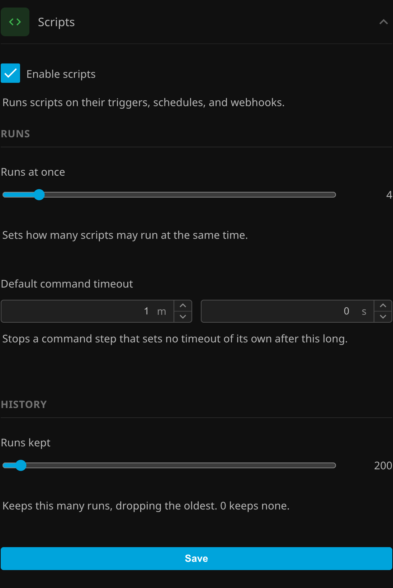
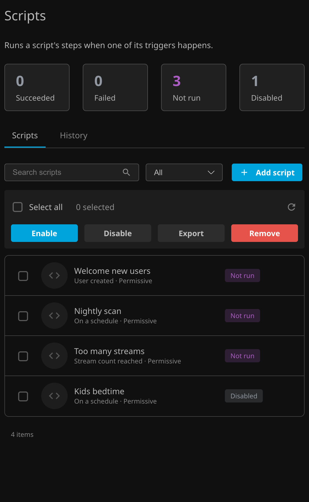
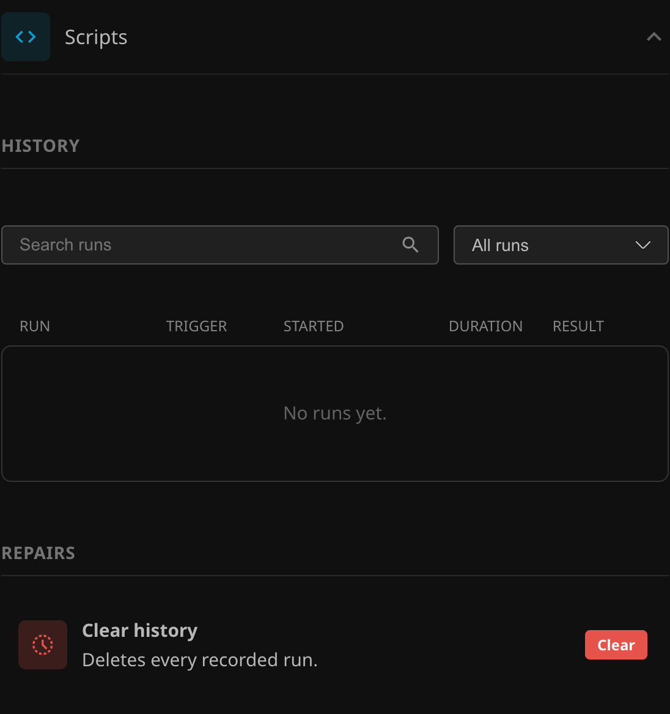

# Scripts

**Scripts** runs your own steps when server events happen. Each script has **triggers**, optional **item kinds**, the **groups** that run it, and **conditions** that narrow which events it runs for, and a list of **steps** it performs in order. Scripts are managed on **Dashboard > Plugins > Necto > Scripts**. For ready-made ideas, see [Examples](#examples).

## Settings

**Settings > Scripts** holds the settings, with **Save** at the end of the section.



* **Enable scripts** runs scripts on their triggers, schedules, and webhooks. Off runs nothing, refuses **Run now**, **Test**, and webhooks, and keeps every script and its history. It is off on a fresh install.
* **Runs**
    * **Runs at once** is a slider that sets how many scripts may run at the same time. Further runs wait their turn.
    * **Default command timeout** is a duration in minutes and seconds. A **Run command** step that sets no timeout of its own is stopped after this long.
* **History**
    * **Runs kept** is a slider. The oldest runs are dropped past this many, and 0 keeps none.

## The Scripts Tool


The counts at the top show how many scripts there are, and how many are enabled and disabled. Select a script from the list above **New**, **Rename**, **Remove**, **Import**, and **Export** to edit it.

| Scripts | Scripts on a phone |
| :---: | :---: |
|  |  |

Each script has a **Name** and an optional **Description** saying what it is for. **New** asks for both and starts from a blank script or a template, such as stopping playback paused for 30 minutes, limiting the server to 3 transcodes, asking "Still watching?" after 3 hours, posting new items to Discord, or scanning every library nightly. **Rename** asks for the open script's new name, which is kept until you **Save**. **Remove** asks first, then removes the open script and saves that at once. Unsaved edits to other scripts stay unsaved.

The editor's sections open and close from their headings, each led by an icon, and all start closed. **General** holds the **Description** and **Enabled**. Each heading says what its section holds, such as *1 trigger*, *2 steps*, *2 groups*, or *2 conditions, all must match*, **General** shows the script's description and whether it is **Enabled** or **Disabled**, and **Testing** names the trigger to test with. A section with a warning names it in an orange badge. **Groups** shows what ignores its groups, such as **Schedule ignored**. **Conditions** counts the conditions a selected trigger never matches, such as **1 never matches**. **Behavior** shows **No item kinds** when it runs for each library item with none chosen, or **For each ignored** when every trigger already has its own item or user.

Every other change is kept until you **Save**. **Save** is the full width bar at the end of the editor, and the line above it says when there are unsaved changes. Leaving the page with unsaved changes asks first.


## Triggers

A script runs on any of the triggers it lists. The list is grouped and searchable. A script with no triggers still runs from **Run now**, from another script's **Run another script** step, or as another script's failure script.


A checked trigger that waits for a number shows it in a panel under the list. **Paused for a while** and **Playing for a while** take a duration in hours and minutes. **Playback passed a percentage**, **Stream count reached**, and **Transcode count reached** take their number on a slider.

### Playback

| Trigger | Runs when |
|---|---|
| Playback started | A client starts playing something. This is after the client has started loading, so it cannot change what plays. |
| Playback stopped | A client stops playing. `PLAYED_TO_COMPLETION` says whether it reached the end. |
| Playback paused, Playback resumed | A playing client pauses or resumes. Fires once per change. |
| Paused for a while | A client stays paused for the minutes you set. Fires once per pause. |
| Playing for a while | A client plays for the minutes you set, not counting pauses. Fires once per playback. |
| Playback passed a percentage | Playback goes from below the percentage you set to at or past it. Fires once per playback. A playback that starts past it, such as one resumed near the end, does not count. |
| Switched to transcoding | A stream that was playing directly starts transcoding. A stream that transcodes from the start is a **Playback started** with **Play method is Transcode**. |
| Stream count reached | The number of active streams rises from below the number you set to at or past it. The event is the stream that reached it. |
| Transcode count reached | The same, counting only transcoding streams. |

Every playback trigger carries the user, session, and item, plus `ACTIVE_STREAMS` and `ACTIVE_TRANSCODES` counted across the server.

### Library

| Trigger | Runs when |
|---|---|
| Item added | An item arrives in a library. It waits up to a minute for the item's metadata, so names and provider IDs are filled. Placeholder items, such as missing episodes, are skipped. |
| Item updated | An item's metadata or images change. `UPDATE_REASON` says why. Busy during scans, so pair it with item kinds or conditions. |
| Item removed | An item leaves a library. By then it has left its library, so `LIBRARY_ID` and `LIBRARY_NAME` are empty and a **Library** condition never matches. |
| Collection created | A new collection is made. |
| Added to collection, Removed from collection | An item is added to or removed from an existing collection. Items a collection is created with count as **Collection created** only. |
| Subtitle download failed, Lyrics download failed | A provider fails to download subtitles or lyrics. `PROVIDER` and `ERROR_MESSAGE` say which and why. |
| Metadata refresh started, Metadata refresh finished | A metadata refresh of an item starts or finishes. |
| Library settings changed | A library's settings are saved. |

### Live TV

| Trigger | Runs when |
|---|---|
| Recording scheduled, Recording cancelled | A single recording is scheduled or cancelled. |
| Series recording scheduled, Series recording cancelled | A series recording is scheduled or cancelled. |

### Activity

| Trigger | Runs when |
|---|---|
| Marked played, Marked unplayed | A user marks an item played or unplayed. |
| Favorite changed | A user adds or removes a favorite. `IS_FAVORITE` says which. A like or dislike is not a favorite change, though the first rating of an item not seen since the server started may be reported as one. |

### Sessions

| Trigger | Runs when |
|---|---|
| Session started, Session ended | A client session starts or ends. |
| Signed in | A user signs in. |
| New device seen | A device the server has not seen before starts a session. The plugin remembers devices from the moment it is installed, and takes the ones connected at that moment as already known. |
| Client connected | A client opens its live connection, so it can receive messages and commands. Use this, not **Signed in**, to message a client as it arrives. |
| Device settings changed | A device's settings, such as its custom name, change. |
| Sign in failed | A sign in fails for an existing user. Jellyfin reports no event for a username that does not exist. |

### Accounts

| Trigger | Runs when |
|---|---|
| User created, User deleted | A user account is created or deleted. |
| User edited | A user's name or profile is edited. Jellyfin reports no event for permission or policy changes. |
| User locked out | A user is locked out after too many failed sign ins. |
| Password changed | A user's password changes. |

### System

| Trigger | Runs when |
|---|---|
| Server started | The server finishes starting. |
| Restart needed | The server needs a restart to apply a change, such as a plugin install. |
| Scheduled task started, Scheduled task finished | A scheduled task starts, or finishes whatever its outcome. |
| Activity logged | Any entry is written to the activity log, by Jellyfin or another plugin. Entries this plugin writes are ignored, so a script cannot set itself off. |
| Server settings changed | The server's settings are saved. `SETTINGS_KEY` names the section, such as `encoding` or `network`. Jellyfin also saves its settings while starting, so expect a run then. |
| Network changed | The server's network interfaces or addresses change. |
| Plugin installing, Plugin installed, Plugin updated, Plugin uninstalled, Plugin install cancelled | A plugin's installation starts, finishes, is updated, removed, or cancelled. |

### Schedule

**On a schedule** turns the script into a Jellyfin scheduled task. Once the script is saved, the task is listed under **Dashboard > Scheduled Tasks**, in the **Scripts** section, under the script's name and with its description. Set when it runs there, with Jellyfin's own daily, weekly, interval, and startup triggers, or run it by hand. Its last run and result show there like any other task's, and a run with a failed step shows the task as failed.

* The task only runs on its triggers while the script is enabled. Run by hand while the script is disabled, it does nothing.
* Renaming the script or editing its description changes the task at once.
* A new script's task starts with no triggers. Add one under **Scheduled Tasks**.
* A script from a template, or an imported one with a schedule of its own, starts its task on that schedule: every so many minutes, daily, or on the chosen days at the chosen time. Jellyfin has no monthly trigger, so a script that runs monthly starts with no trigger and needs one set.
* Deleting the script, or removing **On a schedule** from it, hides and disables the task at once and removes the files Jellyfin kept for it. Jellyfin only drops the task itself when the server restarts.

The script's conditions still apply to each run, and its steps see the event as **On a schedule**.


### Webhook

**Webhook received** gives the script its own address. The **Webhook** panel shows it in an **Address** field with a copy button beside it, and an example `curl` command below. Another service runs the script by sending a `POST` there.


The request needs two things, and is refused when either is missing:

* The **address**, whose last part is a random token that picks the script. **New address** replaces it, and the old one stops working once you save.
* A **Jellyfin API key**, from **Dashboard > API Keys**, sent as `Authorization: MediaBrowser Token="..."`. An administrator's own access token works too.

```sh
curl -X POST "https://jellyfin.example.com/Scripts/Webhook/TOKEN" \
  -H 'Authorization: MediaBrowser Token="YOUR_API_KEY"' \
  -H "Content-Type: application/json" \
  -d '{"eventType": "Download", "series": {"title": "A Show"}}'
```

The body may be up to 64 KB, and its first 16,384 characters arrive as `WEBHOOK_BODY`. Each query parameter and each JSON field also becomes its own variable, named `WEBHOOK_` and then the field in capitals, with nested fields joined by underscores: the request above sets `WEBHOOK_EVENTTYPE` and `WEBHOOK_SERIES_TITLE`. Use them as placeholders or in a step's own condition. The answer is `202` with `Queued` saying whether the script's conditions and cooldown let it run.

The token is kept in Necto's configuration, readable by administrators, and left out of exports. A duplicated or imported script gets its own address.

### Run Now

**Run now** in the editor runs the saved script at once, whatever its triggers, filters, and cooldown say, and records the run in the history as **Run now**. It carries no user, session, or item. Save first: it runs the saved script, not unsaved edits.

## Running for Each Item or User

A schedule, a webhook, **Run now**, and most system triggers carry no item and no user, so steps such as **Add tag** or **Disable or enable user** have nothing to act on. Under **Behavior**, set **Run** to **once for each library item** or **once for each user** and the script runs its steps once per match instead:

* **Each library item** goes through the items of the script's **item kinds**, which must list at least one, and runs for each one that passes the **conditions**. Besides the usual item fields, conditions can use **Days since added**, **Has subtitles**, **Played by anyone**, and **Days since last played**, which counts from when the item was added if nobody has played it.
* **Each user** goes through the users whose groups run the script, and runs for each one that passes the conditions, which can also use **Days since last active** and **Is disabled**.

Each match is its own run in the history. **Most runs per event** is a slider that caps how many one event may start, 50 unless you change it, at most 500. On a trigger that already has an item or a user, such as **Playback started**, the script runs once as usual.

For example, a script on a weekly schedule, for each **Movie** where **Days since last played is at least 90**, with an **Add tag** step, tags every movie nobody has watched in three months.


## Item Kinds

**Item kinds** is a panel under the trigger list. It shows while a checked trigger carries an item, or while the script runs for each library item. Choose the kinds of item the script runs for, such as Movie, Episode, Audio, or Collection. Every kind the server knows is offered, and nothing is assumed: leave the list empty to run for every kind.

While the panel shows, the **Triggers** heading carries a badge, green **All kinds** with none chosen, or blue with the count, such as **2 kinds**. Unchecking the last trigger that carries an item clears the item kinds, since they would filter nothing.

!!! warning
    A library scan adds people, genres, studios, and folders as items too. A script on **Item added** or **Item updated** with no item kinds runs for all of them.

## Groups

The **Groups** section of the editor sets which users a script runs for. **Run for everyone** is on for a new script, so it runs for every user, in a group or not. Turn it off to pick the groups it runs for, where **Everyone** stands for the users in no group. With it off and no group picked, the script runs for administrators only, and the section says so. Administrators run every script, since groups hold no administrators. To leave them out, add an **Is administrator** condition.

On playback, the script runs when it runs for any of the session's users. A failed sign in for a name with no account counts as **Everyone**.

Groups only filter triggers that carry a user. Others ignore them. For anything finer, such as matching a name pattern, use a **User** condition.

## Conditions

Each condition is one row of **Field**, **Operator**, and **Value**. **Add condition** adds a row, and the cross at the end of a row removes it. A condition compares one event value with one or more values, using **is**, **is not**, **contains**, **does not contain**, **starts with**, or **matches regex**. Numeric fields, such as **Year** or **Active transcodes**, also offer **is at least** and **is at most**. Text comparisons ignore case. A positive operator matches when any value matches, and a negative one matches when none do. Choose **All conditions** to run only when every condition matches, or **Any condition** to run when at least one does.

The **Value** box depends on the field. The three boxes of a row line up along their bottom edge, since the values picked for a field sit above its **Value** box.

* A numeric field takes one number in a number box.
* A field with known choices, such as a user, library, scheduled task, collection, or play method, lists the choices that match as you type, and lists them all when you select the empty box. Select one to add it above the box. A user, library, or task is saved by its ID and shown by its name. Text that matches no choice is kept as typed when you press Enter, which suits **contains** and **matches regex**.
* Any other field takes free text as tags. Type each value and press Enter.


| Group | Fields |
|---|---|
| Who | User (ID or name; on playback, any of the session's users), Is administrator, Username attempted |
| Where | Client, Client version, Device name, Device ID, Remote address, Is local network |
| What | Library, Item name, Series name, Item path, Genre, Tag, Studio, Parental rating, Year, Video height, Community rating, Days since added, Has subtitles, Collection |
| For each library item | Played by anyone, Days since last played |
| For each user | Days since last active, Is disabled |
| Playback | Play method, Progress percent, Played to completion, Transcode reasons, Video codec, Audio codec, Active streams, Active transcodes, Is played, Is favorite |
| When | Hour (0-23), Day of week |
| System | Scheduled task, Task status, Task category, Plugin name, Provider, Update reason, Activity type, Activity severity |

Genre, Tag, and Studio match when any of the item's values does. A field the trigger does not supply, or a value this event happens to lack, never matches, for **is not** and **does not contain** too. For example, **Series name is not** does not match a movie, which has no series. The editor warns when a condition's field is missing from some of the selected triggers.

**Matches regex** uses .NET regular expressions, ignores case, and counts as no match when a pattern is invalid or takes longer than 100 ms. The server keeps only the 15 most recently used patterns compiled. With more distinct patterns across your scripts, each one is rebuilt whenever it is checked, which slows down busy triggers such as a library scan. Prefer **contains** or **starts with** where they do the job.

**Cooldown**, under **Behavior**, skips the script for the same trigger, user, and item until that long has passed since its last run, so a script on both start and stop still sees the stop. It keeps pause and resume from running a script over and over. It is a duration in hours, minutes, and seconds, and 0 turns it off.

## Steps

Steps run in order. Each step's card leads with its type's icon. Drag a step, or use its arrows, to reorder it, and open it to edit. Pick a **Step type**, then select **Add step** to add one at the end.


| Group | Step | Does | Needs |
|---|---|---|---|
| Run | Run command | Runs a program or script at any path the server can reach, or a name on the server's PATH such as `curl`. | |
| | HTTP request | Sends a GET, POST, PUT, PATCH, or DELETE with your headers and body. | |
| | Run another script | Runs another script's steps with this event, skipping its triggers and filters. Up to 3 levels deep. A disabled script is not run, so enable a helper script and give it no triggers. | |
| | Wait | Pauses before the next step. | |
| | Stop here | Ends the run. The steps after it are skipped and the run still counts as succeeded. Give it a condition so it only stops when you want. | |
| Sessions | Send message | Shows a message on the event's session, all of the event's user's sessions, every session, or every administrator's session. | |
| | Pause playback | Pauses the event's session. | A session |
| | Stop playback | Stops the event's session, optionally after a message. | A session |
| Items | Mark played, Mark unplayed | Marks the event's item for the event's user. | A user and an item |
| | Set favorite | Adds or removes the event's item as the user's favorite. | A user and an item |
| | Add tag, Remove tag | Adds or removes a tag on the event's item. Placeholders are filled. | An item |
| | Add to collection, Remove from collection | Adds the event's item to a collection, or removes it. | An item |
| | Refresh metadata | Queues a standard or full refresh of the event's item. | An item |
| Users | Disable or enable user | Disables or enables the event's user. Administrators are never disabled. | A user |
| | Sign user out | Signs the event's user out of every device. Administrators are never signed out. | A user |
| Server | Scan libraries | Queues a scan of every library. | |
| | Run scheduled task | Queues a scheduled task. A task starting or finishing cannot queue itself, and a task a script queued cannot queue another, since tasks queuing each other would repeat forever. | |
| | Write to activity log | Adds an entry to the server's activity log. | |
| | Append to file | Appends a line to a file, creating the file if its folder exists. | |

A step that needs something the event lacks is skipped. A failed step stops the rest unless it is set to **Continue on error**. Runs with a failed step are also written to the activity log, summed into one entry named "Script runs failed" that names each script and error, for example `3 runs failed in Notify (2), Backup, with errors The chosen collection no longer exists`. The entry is written 30 seconds after the last failure, or every 5 minutes while failures keep coming. Each failed run also sends `scripts.failed` to **Notifications**, at most once a minute for each script.

### Step Conditions and Saved Output

Every step also has:

* **Only run this step if** tests one variable, such as `ITEM_KIND` **is** `Movie` or `PROGRESS_PERCENT` **is at least** `90`. Any variable works, including a webhook field and one an earlier step saved. The value may hold placeholders. Leave the value empty with **is** or **is not** to test whether the variable has a value at all. A step whose condition does not match is skipped, which is not a failure, and the run carries on.
* **Save the output for later steps**, on **Run command** and **HTTP request**, keeps the command's output or the response body under a name you choose, such as `RESULT`. Later steps use it as `{{RESULT}}`, commands read `$JF_RESULT`, and `{{RESULT_STATUS}}` holds the exit code or HTTP status. When the output is JSON, name a field such as `data.items[0].name` to save just that. A saved value is at most 8,192 characters and is saved even when the step failed, so with **Continue on error** a later step can act on the failure.
* **Continue on error** runs the following steps even if this one fails.

Together these branch a script. A health check, for instance: an HTTP request saved as `HEALTH` that continues on error, then **Stop here** only if `HEALTH_STATUS` is `200`, then a message to the administrators.


### On Failure

Under **Behavior**, **When this script fails, run** names another script to run when this one has a failed run. It gets the same event, including the item or user of a script running for each, plus `FAILED_SCRIPT_NAME`, `FAILED_STEP`, `FAILED_MESSAGE`, and `FAILED_COUNT`. It runs once per event however many runs failed, must be enabled, and needs no triggers of its own. Its own failure is recorded but starts nothing further. Tests do not run it.

### HTTP Request

**Start from a preset** fills the request for a generic JSON webhook, Discord, Slack, ntfy, Gotify, or a Home Assistant service call. Replace the URL, and put tokens in the script's [secrets](#secrets). **Retries**, a slider, tries again up to 5 times and waiting longer each time, after no answer, a 5xx, or a 429.

### Run Command

Placeholders may fill the command, but a value holding a path (a `/`, a `\`, or `..`) is refused there, so an event value such as a device name can never change which program runs. Pass such values as arguments.

Use **Check path** to confirm the server can see the file and that it is executable. The server runs it as the account Jellyfin runs under, in the folder that holds the script unless you set a working folder. It is stopped after its **Timeout**, a duration in minutes and seconds. A timeout of 0 uses the **Default command timeout** in **Settings > Scripts**. A script may start a background process and exit; the step reports the script's own exit code as soon as it finishes.

**Run directly** passes each line of **Arguments** as exactly one argument, with placeholders filled, so a value containing spaces or quotes never splits into more.

**Through the shell** makes the command one line for `/bin/sh -c`, which allows pipes and redirects. Placeholders are not filled in a shell line, so event values such as item or device names can never inject shell syntax. Read them from the environment instead:

```sh
/scripts/log.sh "$JF_USER_NAME" "$JF_ITEM_NAME" >> /scripts/plays.log
```

!!! warning "Windows"
    On Windows a shell line runs through `cmd /c`, which expands `%JF_...%` variables *before* it parses the line, so an event value such as a typed username can carry cmd syntax. Read event values inside a script file instead of in the shell line. A `.bat` or `.cmd` file is refused when one of its filled arguments contains `% " & | < > ^`, since cmd does not honour the quoting other programs get.

!!! info "Docker"
    The path is the path inside the container. Mount your scripts, for example `-v /srv/jellyfin-scripts:/scripts:ro`, and use `/scripts/notify.sh`. The official image has a shell but no Python or most other interpreters, so write scripts for `/bin/sh` or mount the interpreter you need.

!!! warning "Trust"
    A command runs on the server as the account Jellyfin runs under. Only add commands you trust.

## Secrets

Keep tokens and passwords in the script's **Secrets** rather than in its steps. Use one as `{{SECRET_NAME}}` in a step, or `$JF_SECRET_NAME` in a command. Values are encrypted into their own file beside Necto's configuration, never sent back to the browser in any form, and left out of exports. Wherever a secret of three or more characters shows up in a step's message or a command's output, the history and the activity log show `[SECRET_NAME]` instead. Each secret is a row with a **Name** and a **Value**. **Add secret** adds a row, and the cross at the end of a row removes the secret when you save. A name is capital letters, digits, and underscores, and typing fixes it as you go. Renaming a secret keeps its value. A stored value shows as dots and stays until you type a new one. The **Clear** button beside a stored value empties it when you save. A secrets file or key that cannot be read while saving is written to the server log.


## Variables

A command receives every variable the trigger supplies as an environment variable with a `JF_` prefix, such as `$JF_ITEM_NAME`, plus `$JF_EVENT_JSON` holding all of them as one JSON object. A value the event lacks is set to an empty string, so a script under `set -u` can still test it.

In a step's text fields, write a variable as `{{ITEM_NAME}}`. Use `{{ITEM_NAME:json}}` inside a JSON string, and `{{ITEM_NAME:url}}` inside a URL. Under each step text field that takes placeholders, **Variables** opens a list of the ones the selected triggers supply, along with the script's secrets and the outputs its steps save. Select one to insert it at the cursor, such as `{{ITEM_NAME}}`. The **Content type** and **File** fields take no placeholders, so they have no list.

| Group | Variables |
|---|---|
| Every event | `EVENT`, `TIMESTAMP`, `LOCAL_DATE`, `LOCAL_TIME`, `HOUR`, `DAY_OF_WEEK`, `SCRIPT_NAME`, `SERVER_NAME`, `SERVER_ID`, `SERVER_VERSION`, `EVENT_JSON` |
| User | `USER_ID`, `USER_NAME`, `IS_ADMIN` |
| Session | `SESSION_ID`, `CLIENT`, `CLIENT_VERSION`, `DEVICE_ID`, `DEVICE_NAME`, `REMOTE_ADDRESS`, `IS_LOCAL` |
| Item | `ITEM_ID`, `ITEM_NAME`, `ITEM_KIND`, `ITEM_PATH`, `LIBRARY_ID`, `LIBRARY_NAME`, `YEAR`, `RUNTIME_SECONDS`, `SERIES_NAME`, `SEASON_NUMBER`, `EPISODE_NUMBER`, `ALBUM`, `ARTIST`, `GENRES`, `TAGS`, `STUDIOS`, `OFFICIAL_RATING`, `COMMUNITY_RATING`, `VIDEO_WIDTH`, `VIDEO_HEIGHT`, `DATE_ADDED`, `DAYS_SINCE_ADDED`, `HAS_SUBTITLES` (video only), `PROVIDER_IMDB`, `PROVIDER_TMDB`, `PROVIDER_TVDB` |
| Playback | `PLAY_SESSION_ID`, `PLAY_METHOD` (on stop, the method seen while playing), `POSITION_SECONDS`, `PROGRESS_PERCENT`, `IS_PAUSED`, `VIDEO_CODEC`, `AUDIO_CODEC`, `TRANSCODE_REASONS`, `ACTIVE_STREAMS`, `ACTIVE_TRANSCODES`; on stop `PLAYED_TO_COMPLETION`, paused for a while `PAUSED_SECONDS`, playing for a while `PLAYING_SECONDS` |
| Played and favorites | `IS_PLAYED`, `IS_FAVORITE`, `PLAY_COUNT` |
| Collections | `COLLECTION_ID`, `COLLECTION_NAME` |
| Item updated | `UPDATE_REASON` |
| Download failed | `PROVIDER`, `ERROR_MESSAGE` |
| Live TV | `TIMER_ID`, `PROGRAM_ID` |
| Library settings | `LIBRARY_PATH` |
| Device settings | `DEVICE_ID`, `DEVICE_NAME` |
| Server settings | `SETTINGS_KEY` |
| Activity logged | `ACTIVITY_NAME`, `ACTIVITY_TYPE`, `ACTIVITY_OVERVIEW`, `ACTIVITY_SEVERITY`, `USER_ID` |
| Sign in failed | `USERNAME_ATTEMPTED`, `USER_ID` |
| Scheduled task | `TASK_NAME`, `TASK_KEY`, `TASK_CATEGORY`, and when it finishes `TASK_STATUS`, `TASK_ERROR`, `TASK_DURATION_SECONDS` |
| Plugins | `PLUGIN_ID`, `PLUGIN_NAME`, `PLUGIN_VERSION` |
| Webhook | `WEBHOOK_BODY`, `REMOTE_ADDRESS`, `IS_LOCAL`, and `WEBHOOK_` plus the name of each query parameter and JSON field |
| For each library item | Every item variable, plus `PLAYED_BY_ANYONE`, `DAYS_SINCE_PLAYED` |
| For each user | `USER_ID`, `USER_NAME`, `IS_ADMIN`, `DAYS_SINCE_ACTIVE`, `IS_DISABLED` |
| Saved by a step | The name you chose, and that name with `_STATUS` |
| Failure script | `FAILED_SCRIPT_NAME`, `FAILED_STEP`, `FAILED_MESSAGE`, `FAILED_COUNT` |

## Export and Import

**Export** saves every script, including unsaved edits, to a JSON file. Secret values and webhook addresses are left out. **Import** reads one back, adding its scripts or replacing ones with the same ID. Imported scripts start **disabled** and unsaved, so review each one's steps and fill in its secrets before enabling it and saving, since a command runs on your server.

A script's groups are not part of its file. Pick the groups that run an imported script in **Groups**.

## Testing

The **Testing** section, above **Save**, holds the trigger to test with, **Test**, and **Run now**. **Test** runs the open script's steps right away, including unsaved edits and its secrets, with sample values for the chosen trigger, and shows each step's result in a sidecar. Item kinds and conditions are not applied, and steps that act on the event's session, user, or item are skipped, because the sample has none. A message for every session or every administrator goes only to your own sessions. Other steps, such as a command, an HTTP request, a library scan, or a queued task, really run.


A test of a script that runs for each item or user uses one sample item or user. To run the script for real, use **Run now**.

## Troubleshooting

**Troubleshooting > Scripts** holds the run history.



### History

A chart at the top of **History** shows how many runs succeeded and failed on each of the last 14 days, or 7 on a phone, in the server's time zone. Test runs are left out of it, and it is hidden while those days have no run.

Every run, tests included, is listed under the chart, newest first. The table grows with its rows, and more load as you scroll. Its columns are **Run**, **Trigger**, **Started**, **Duration**, and **Result**, and a test shows *(test)* after its script's name. Drag the edge of a heading to resize its column, and the width is kept for the next visit. On a phone the table shows only the run and its result.

Search the runs, or filter them to **Failed**, **Tests**, or one script. Under **Repairs**, **Clear history** asks first, then deletes every recorded run.


Open a run to see, in a sidecar, its result, trigger, start, and length, each step's result with any captured output, and the variables it received.

| Reason | What to do |
| :--- | :--- |
| A script never runs for a user | Check that one of the user's groups runs it, in **Groups** |
| "The server can see this file, but it is not executable. Run chmod +x on it, or call it through an interpreter." | Make the file executable for the account Jellyfin runs under, then select **Check path** |
| "No item kinds" on **Behavior** | Pick at least one item kind for a script that runs for each library item |

## Notifications

| Event | When |
| :--- | :--- |
| `scripts.failed` | A run ends with a failed step, at most once a minute for each script |

## API

Every route is for administrators. A webhook caller sends a Jellyfin API key.

| Route | What it does |
| :--- | :--- |
| `GET /Scripts/Catalog` | Gives what the editor offers: triggers, condition fields, item kinds, libraries, users, collections, and tasks |
| `GET /Scripts/Names` | Lists every script by id and name, for the group editor |
| `POST /Scripts/Test` | Runs a script's steps now with sample values |
| `POST /Scripts/Run/{id}` | Queues a saved script now |
| `POST /Scripts/Webhook/{token}` | Runs the script the token belongs to |
| `GET /Scripts/Status` | Gives each script's last run |
| `GET /Scripts/History` | Gives a page of the run history |
| `GET /Scripts/History/Days` | Counts the runs of each of the last 14 days |
| `DELETE /Scripts/History` | Deletes the run history |
| `GET /Scripts/CheckPath?path=` | Checks a path from the server's side |

## Examples

Each example lists what to set in the editor. Several are also offered as templates under **New**, marked *(template)*. Replace URLs, names, and tokens with your own, and keep tokens in the script's **Secrets**.

### Playback

#### Stop Playback Left Paused *(template)*

Frees the stream when someone pauses and walks away.

| Setting | Value |
|---|---|
| Trigger | **Paused for a while**, 30 minutes |
| Step | **Stop playback**, title `Playback stopped`, message `Stopped after 30 minutes paused.` |

#### Ask "Still Watching?" *(template)*

| Setting | Value |
|---|---|
| Trigger | **Playing for a while**, 3 hours |
| Step | **Send message** to the session that raised the event, title `Still watching?`, message `You have been watching for 3 hours.` |

The time counts playback only, not pauses, and the script runs once per playback.

#### Limit the Server to 3 Transcodes *(template)*

Stops the newest transcode when it would be the fourth.

| Setting | Value |
|---|---|
| Trigger | **Playback started** |
| Conditions | All of: **Play method** is `Transcode`; **Active transcodes** is at least `4` |
| Steps | 1. **Send message** to the event's session: `Too many streams are converting right now. Try a lower quality or direct play.` <br> 2. **Stop playback** |

`ACTIVE_TRANSCODES` counts the playback that just started, so `4` means three were already running.

#### Keep 4K from Transcoding Away from Home

| Setting | Value |
|---|---|
| Trigger | **Playback started** |
| Item kinds | Movie, Episode |
| Conditions | All of: **Play method** is `Transcode`; **Video height** is at least `2160`; **Is local network** is `false` |
| Step | **Stop playback**, message `4K can't be converted for remote streaming. Pick a 1080p version.` |

#### Quiet Hours Overnight

| Setting | Value |
|---|---|
| Trigger | **Playback started** |
| Conditions | **Any** of: **Hour (0-23)** is at least `23`; **Hour (0-23)** is at most `5` |
| Steps | 1. **Send message** to the event's session: `The server is in quiet hours until 6:00.` <br> 2. **Stop playback** |

Hours are the server's local time.

#### Dim the Lights When a Movie Starts *(template)*

| Setting | Value |
|---|---|
| Triggers | **Playback started**, **Playback resumed** |
| Item kinds | Movie |
| Secret | `HA_TOKEN`, a Home Assistant long-lived access token |
| Step | **HTTP request** from the **Home Assistant service call** preset |

The preset fills in:

```text
POST http://homeassistant.local:8123/api/services/light/turn_on
Authorization: Bearer {{SECRET_HA_TOKEN}}

{ "entity_id": "light.living_room", "brightness_pct": 10 }
```

Add a second script on **Playback paused** and **Playback stopped** that calls `light/turn_on` with `"brightness_pct": 80` to bring them back up.

### Library

#### Post New Movies and Episodes to Discord *(template)*

| Setting | Value |
|---|---|
| Trigger | **Item added** |
| Item kinds | Movie, Episode |
| Secret | `DISCORD_WEBHOOK`, the part of the webhook URL after `/webhooks/` |
| Step | **HTTP request**, POST `https://discord.com/api/webhooks/{{SECRET_DISCORD_WEBHOOK}}` |

Body, with `:json` so names containing quotes stay valid JSON:

```json
{ "content": "New on {{SERVER_NAME:json}}: {{SERIES_NAME:json}} {{ITEM_NAME:json}} ({{YEAR}})" }
```

**Item added** waits up to a minute for metadata, so the year and provider IDs are usually filled. Set **Retries** to 2 or 3 so a brief Discord outage does not lose the post.

#### Tag 4K Movies as They Arrive

| Setting | Value |
|---|---|
| Trigger | **Item added** |
| Item kinds | Movie |
| Conditions | **Video height** is at least `2160` |
| Step | **Add tag** `4K` |

#### Tag New Items, Then Untag Once Watched

Script 1 *(template)*:

| Setting | Value |
|---|---|
| Trigger | **Item added** |
| Item kinds | Movie, Series, Episode |
| Step | **Add tag** `new` |

Script 2:

| Setting | Value |
|---|---|
| Trigger | **Playback stopped** |
| Conditions | All of: **Played to completion** is `true`; **Tag** is `new` |
| Step | **Remove tag** `new` |

Tags belong to the item, not a user, so the first person to finish it removes the tag for everyone.

#### Collect Everyone's Favorites

| Setting | Value |
|---|---|
| Trigger | **Favorite changed** |
| Item kinds | Movie |
| Conditions | **Is favorite** is `true` |
| Step | **Add to collection**, choose the collection to gather them in |

A second script with **Is favorite** is `false` and **Remove from collection** keeps it tidy.

### Accounts and Security

#### Alert on Failed Sign Ins *(template)*

| Setting | Value |
|---|---|
| Trigger | **Sign in failed** |
| Cooldown | 5 minutes, so a burst of attempts sends one alert per user |
| Step | **HTTP request** from the **ntfy** preset, URL `https://ntfy.sh/{{SECRET_NTFY_TOPIC}}` |

Body (plain text, so no `:json`):

```text
Failed sign in for {{USERNAME_ATTEMPTED}} from {{REMOTE_ADDRESS}} ({{DEVICE_NAME}})
```

#### Tell the Administrators About a Lockout

| Setting | Value |
|---|---|
| Trigger | **User locked out** |
| Step | **Send message** to every administrator's session, title `Account locked`, message `{{USER_NAME}} was locked out after too many failed sign ins.` |

#### Sign Out Every Device After a Password Change

| Setting | Value |
|---|---|
| Trigger | **Password changed** |
| Step | **Sign user out** |

Anyone still signed in with the old password has to sign in again. Administrators are never signed out or disabled by a script.

### Server

#### Warn Everyone Before a Restart *(template)*

| Setting | Value |
|---|---|
| Trigger | **Restart needed** |
| Step | **Send message** to every active session: `The server needs a restart and may go offline briefly.` |

#### Message the Administrators When a Task Fails *(template)*

| Setting | Value |
|---|---|
| Trigger | **Scheduled task finished** |
| Conditions | **Task status** is `Failed` |
| Step | **Send message** to every administrator's session: `{{TASK_NAME}} failed: {{TASK_ERROR}}` |

#### Scan Every Library Nightly *(template)*

| Setting | Value |
|---|---|
| Trigger | **On a schedule**, with the task set to run daily at `03:00` under Scheduled Tasks |
| Step | **Scan libraries** |

To run it only on, say, Monday, Wednesday, and Friday, give the task a weekly trigger for each of those days instead.

#### Heartbeat for an Uptime Monitor

Pings a service such as Healthchecks.io, which alerts you when the pings stop.

| Setting | Value |
|---|---|
| Trigger | **On a schedule**, with the task set to run every 5 minutes under Scheduled Tasks |
| Secret | `PING_ID`, your check's ID |
| Step | **HTTP request**, GET `https://hc-ping.com/{{SECRET_PING_ID}}`, **Retries** 2 |

### Commands

A **Run command** step runs any program the server can reach, with every variable as a `JF_` environment variable. The examples use `/bin/sh`, which the official Docker image has.

#### Log Every Playback to a CSV File

| Setting | Value |
|---|---|
| Trigger | **Playback started** |
| Step | **Run command**, run directly, command `/scripts/log-play.sh` |

`/scripts/log-play.sh`, made executable with `chmod +x`:

```sh
#!/bin/sh
# Appends one line per playback to plays.csv beside this script.
log="$(dirname "$0")/plays.csv"
[ -f "$log" ] || echo "time,user,item,series,device,method" > "$log"
printf '%s,"%s","%s","%s","%s",%s\n' \
    "$JF_TIMESTAMP" "$JF_USER_NAME" "$JF_ITEM_NAME" "$JF_SERIES_NAME" "$JF_DEVICE_NAME" "$JF_PLAY_METHOD" >> "$log"
```

For a plain text log without a script, an **Append to file** step with the line `{{LOCAL_DATE}} {{LOCAL_TIME}} {{USER_NAME}} played {{ITEM_NAME}}` does the same *(template)*.

#### Pass Values as Arguments *(template)*

| Setting | Value |
|---|---|
| Trigger | **User created** |
| Step | **Run command**, command `/scripts/new-user.sh`, arguments (one per line): <br> `{{USER_NAME}}` <br> `{{USER_ID}}` |

Each line arrives as exactly one argument, `$1` and `$2`, however many spaces or quotes the name has:

```sh
#!/bin/sh
echo "$(date) created $1 ($2)" >> /scripts/new-users.log
```

#### Read the Whole Event as JSON

`JF_EVENT_JSON` holds every variable as one JSON object, which suits a language with a JSON parser. Python is not in the official Docker image, so mount it or use a different image.

```python
#!/usr/bin/env python3
import json
import os

event = json.loads(os.environ["JF_EVENT_JSON"])
print(event["EVENT"], event.get("ITEM_NAME", ""), event.get("USER_NAME", ""))
```

Anything the script prints is kept as the step's output in the run history.

#### Pipes and Redirects

Choose **Through the shell** to write one `/bin/sh` line. Placeholders are not filled there, so use the environment variables:

```sh
echo "$JF_LOCAL_DATE $JF_USER_NAME $JF_ITEM_NAME" | tee -a /scripts/plays.log
```

### Reusing Steps

#### One Notifier for Many Scripts

Put your notification in one script and call it from others with **Run another script**, so the URL and token live in one place.

1. Make a script named *Notify me*, with no triggers and enabled. Give it an **HTTP request** step to your ntfy topic or Discord webhook, with a body such as `{{EVENT}}: {{USER_NAME}} {{ITEM_NAME}}`.
2. In any other script, add **Run another script** and choose *Notify me*.

The helper runs with the calling script's event, so every event placeholder works. `SCRIPT_NAME` is the helper's own name. Scripts may call each other up to 3 levels deep, and a disabled helper is skipped.
