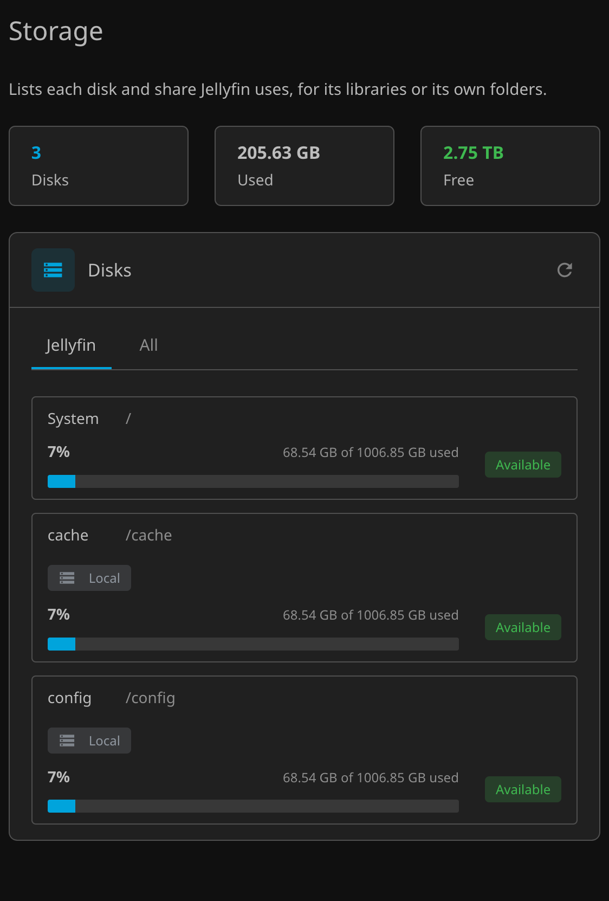
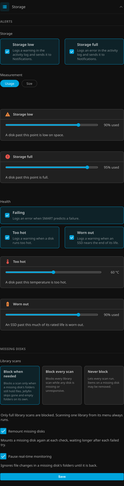
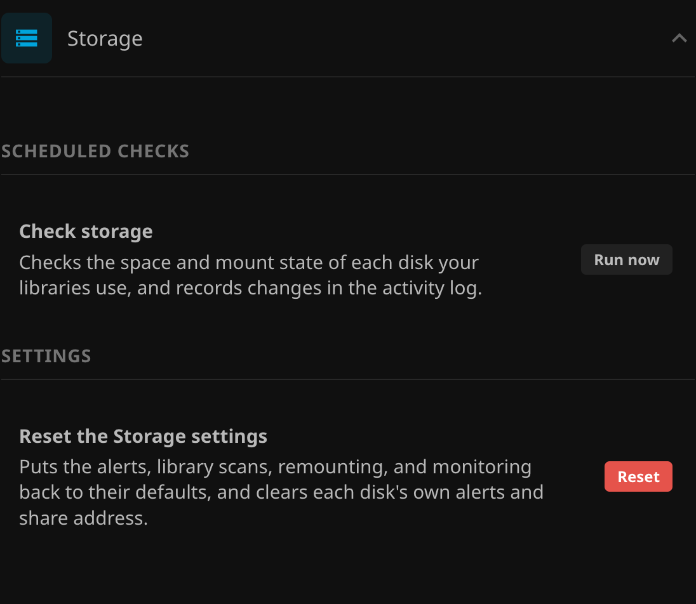

# Storage

**Storage** watches every disk and share Jellyfin uses, keeps library items safe while a disk is missing, and formats new disks for a library.

## What It Does

* **Lists every disk Jellyfin uses.** Each disk and share that holds a library folder or one of Jellyfin's own folders, such as its cache and metadata, with its type, state, and space.
* **Says what needs a look.** A notice names each problem in one line, such as a missing disk or a full one, or says every disk is healthy.
* **Alerts on full disks.** **Storage low** and **Storage full** write to the activity log and send an event to **Notifications**. Each disk can have its own.
* **Alerts on disk health.** A disk whose SMART data predicts a failure, a disk running too hot, and a worn out SSD each send an alert.
* **Protects library items.** While a disk is missing, library scans that would remove its items are blocked, and real-time monitoring ignores its folders.
* **Mounts missing disks again.** A dropped share or disk is mounted again the way its OS does, at each check.
* **Formats new disks.** A blank disk is formatted, mounted where it stays mounted after a restart, and added to a library in one step.
* **Checks that Jellyfin can write.** A library folder or Jellyfin folder that Jellyfin cannot write to is flagged, before NFO files and artwork fail to save.

The **Check storage** scheduled task checks every disk every 30 minutes and at startup. Opening **Storage** or selecting **Refresh** checks them at once. Each check finds where every library folder and Jellyfin folder lives, reads each disk's space and SMART data, compares the result with the last check, and records what changed.

Pooling disks and RAID are not part of **Storage**. See the [Plan](Plan.md#storage).

### Platform Support

| Feature | Linux | macOS | Windows |
| :--- | :--- | :--- | :--- |
| Disk list, space, and alerts | Yes | Yes | Yes |
| SMART health | ATA and NVMe through udisks2 | NVMe | NVMe, and failure prediction for others |
| Unformatted disks | Yes | Yes | Yes, as an administrator |
| Disks that hold data but are not mounted | Yes | No | No |
| Remount missing disks | Entries in `/etc/fstab` | Network shares | Network shares |
| Format disks | ext4, XFS, Btrfs, exFAT, NTFS through udisks2 | APFS and exFAT | NTFS and exFAT, as an administrator |
| Write check | Yes | Yes | No |

!!! info "Docker"
    In a container, Storage sees only the folders mounted into the container. SMART health, formatting, and remounting need the host, so they do not work in Docker.

## Setup

Reading disks, space, and alerts works with Jellyfin's own access on every OS. Remounting, formatting, and some SMART readings change or read disks directly, so they need the setup below.

### Linux

Storage reads SMART data, formats disks, and mounts them through udisks2, and remounts disks through systemd. Install udisks2 when it is missing.

```bash
sudo apt install udisks2
```

Jellyfin running as its own `jellyfin` user needs a polkit rule to format and remount disks. Save this as `/etc/polkit-1/rules.d/50-jellyfin-storage.rules`. polkit reads it at once.

```javascript
polkit.addRule(function (action, subject) {
    if (subject.user != "jellyfin") return;
    if (action.id == "org.freedesktop.systemd1.manage-units" && /\.mount$/.test(action.lookup("unit"))) return polkit.Result.YES;
    if (action.id.indexOf("org.freedesktop.udisks2.") == 0) return polkit.Result.YES;
});
```

!!! warning "What the rule allows"
    The rule lets the `jellyfin` user start mount units and use every udisks2 action, on any disk. Storage itself never touches the system disk or a mounted disk. If Jellyfin were ever compromised, the same rule would allow changes to other disks.

The **Format** form offers each file system udisks2 has the tools to make.

| File system | Package |
| :--- | :--- |
| ext4 | `e2fsprogs`, installed on every system |
| XFS | `xfsprogs` |
| Btrfs | `btrfs-progs` |
| exFAT | `exfatprogs` |
| NTFS | `ntfs-3g` |

A disk is remounted when `/etc/fstab` has an entry for it. A disk Storage formats gets one.

### macOS

Storage remounts a missing share the way Finder's **Connect to Server** does. Connect to the share once in Finder as the account Jellyfin runs as, and save the password in the keychain. Storage records the share's address at any check while it is mounted. macOS mounts local disks on its own, so Storage leaves them alone.

### Windows

Run Jellyfin as a service under LocalSystem, as the installer does, or as an administrator. Reading unformatted disks, reading SMART data, and formatting need administrator rights. Storage reconnects a missing share with the credentials Windows saved for it in Credential Manager.

## Disks

Each disk's row shows its own state, so a disk that is missing, unresponsive, failing, full, low, too hot, worn out, or missing folders reads from its badge, its tags, and its bar. The top of **Storage** names only what no row shows, one line each: red when Jellyfin cannot write to one of its own folders, and orange when it cannot write to some library folders. It is hidden while there is nothing of the kind.

| Storage | Storage on a phone |
| :---: | :---: |
|  |  |

The cards count the disks Jellyfin uses, and add up the used and free space of those that could be read. **Free** takes the color of the fullest disk's alert.

The **Disks** section holds one row per disk or share, with its name, its mount point, and its type as tags, then a bar of its used space under its share and its "X of Y used" line, and its one status badge. The system disk reads **System** and takes no type tag. The bar turns orange and red at the disk's **Storage low** and **Storage full** alerts. Its **Jellyfin** sub-tab lists the disks that hold a library folder or one of Jellyfin's own folders. **All** also lists mounted disks Jellyfin does not use, disks with no file system, and on Linux, disks that hold data but are not mounted. **Refresh**, the icon at the end of the **Disks** header, checks every disk again. Hover over it to see when the disks were last checked. On a phone, the notice, the cards, and the rows stack to fit, and each row's bar takes the row's full width. On Windows, disks show by drive letter and volume label, and shares by their `\\server\share` path.

| Status | Meaning |
| :--- | :--- |
| **Available** | The disk is mounted and can be read |
| **Needs attention** | The disk is past its **Storage low** alert |
| **Full** | The disk is past its **Storage full** alert |
| **Failing** | The disk's SMART data predicts it will fail |
| **Missing** | The disk is not mounted where Jellyfin expects it |
| **Unresponsive** | The disk did not answer in time, as a dead share does |
| **Unused** | The disk is mounted, but no library or Jellyfin folder is on it |
| **Unformatted** | The disk has no file system, so it has no mount point |
| **Not mounted** | The disk holds data, but nothing on it is mounted. Linux only |

| Tag | Meaning |
| :--- | :--- |
| **System** | The disk the server runs from |
| **Local** | A disk inside the server |
| **External** | A disk plugged in from outside, such as over USB or Thunderbolt |
| **Network** | A share reached over the network, such as SMB or NFS |
| **1 folder missing** | A library folder is gone from the disk while it is mounted |
| **Too hot** | The disk runs past the **Too hot** alert |
| **Worn out** | The SSD is past the **Worn out** alert |

## Disk Details

Select a row to open the disk in a sidecar. It lists the disk's status, type, file system, size, mount point, device, and model, each label beside its value. Each part under the list is a section led by its own icon. A disk that reports SMART data also shows its health, temperature, power-on time, and, for an SSD, its wear.


**Space** shows the share of the disk in use as a ring, with the **Used** and **Free** space beside it. **Alerts** opens with **Storage low** and **Storage full**, each as set and with how much space is in use when it fires on this disk. An alert that is off is left out.

### Its Own Alerts

A disk uses the alerts in **Settings > Storage** unless it has its own. Turn on **Use its own alerts** to set this disk's **Storage low** and **Storage full**, then select **Save** at the foot of the sidecar. Turn it off and select **Save** to use the alerts in **Settings** again. **Save** writes the alerts and the **Share address** together, then closes the sidecar and checks the disks again. The close button in its header closes it without saving.

### Share Address

A share, and a disk that is missing, shows its **Share address**, where it is mounted from, such as `smb://nas.example.com/Media`. Storage fills it in whenever it sees the share mounted. Set it by hand for a share that was already gone, then select **Save** at the foot of the sidecar. A missing share is mounted again from it at the next check.

### Libraries and Folders

**Libraries** lists each library with a folder on the disk. **Folders** is a table of every library folder and Jellyfin folder on it, with **Found**, **Not found**, or **Read only**. On a phone the table scrolls sideways inside its frame. A **Read only** folder is one Jellyfin cannot write to, so NFO files and artwork saved next to the media fail there. Jellyfin's own folders show under the names the dashboard gives them, such as **Program data**, **Image cache**, and **Metadata**. Each one puts its disk in use, so it is alerted on and remounted like a library disk. They never block a library scan.

### New Folder

A mounted disk has a **New folder** form. Enter a **Folder name**, such as `Movies`, select a library under **Add to library** or leave **None**, then select **Create folder**. The folder is made at the top of the disk as Jellyfin's own user. A folder that is already there is left alone.

## Missing Disks

A disk is **Missing** when the mount point of its library folders is no longer mounted, even if leftover files make its folders look present. A folder never seen before counts its disk missing when it sits where disks usually mount, such as `/mnt/<name>`, `/media/<name>`, `/Volumes/<name>`, a drive letter, or a network share. A disk is **Unresponsive** when a call to it runs past 5 seconds. A stuck call is never started again until it returns, so a dead share cannot slow later checks.

### Library Scans

Storage checks the disks as each **Scan media library** task starts, and cancels it when a missing disk would lose its items. **Library scans** in **Settings > Storage** sets when. A blocked scan writes "Library scan blocked" to the activity log, naming the disk. When a check cannot finish within 45 seconds, Storage uses the last check, or before the first one, the disks last recorded as missing. A scan is never let through for want of an answer.

### Remounting

With **Remount missing disks** on, each check mounts a missing disk again.

| OS | How | What it needs |
| :--- | :--- | :--- |
| Linux | Starts the mount unit systemd keeps for the disk's `/etc/fstab` entry | The disk in `/etc/fstab`, and the polkit rule from [Setup](#linux) |
| macOS | Mounts the share's address with NetFS | The share's password in the keychain |
| Windows | Restores the mapped drive, or connects the `\\server\share` path | The share's credentials in Credential Manager |

A disk is tried at three checks in a row. After that, Storage waits an hour before the next try, doubling the wait each time up to 12 hours. A new **Share address** is tried at the next check.

On Linux, a library's disk that dropped off may show twice under **All**, once **Missing** and once **Not mounted**. When `/etc/fstab` mounts it where a library expects its disk, its sidecar says so and offers no format. Mount it again instead.

## Formatting

A disk with no file system shows as **Unformatted** under **All**. Open it to format it.

1. Enter a **Name** for the disk, such as `Media`. Use up to 11 letters, numbers, spaces, dashes, or underscores, starting with a letter or number.
2. Select a **File system**. Each card says what it is best for.
3. Select a library under **Add to library**, or leave **None**.
4. Select **Format disk**.
5. Type the disk's new name to confirm, then select **Format**.

On Linux, a disk that holds data but has nothing mounted shows as **Not mounted**, with what it **Holds**. Its form reads **Erase and format**, and the confirm asks for the device name, such as `sdb`.

!!! warning "Formatting erases the disk"
    Everything on the disk is lost. It cannot be undone.

| OS | Mounted at | After a restart |
| :--- | :--- | :--- |
| Linux | `/mnt/<name>`, with dashes for spaces | An `/etc/fstab` entry by UUID mounts it |
| macOS | `/Volumes/<name>` | macOS mounts it when it is plugged in |
| Windows | The next free drive letter | Windows mounts it |

Storage never formats the system disk, a disk with something mounted or in use as swap, a disk something is stacked on such as LVM, RAID, or an encrypted volume, a disk that holds data unless the request says to erase it, or a disk whose folder another disk already uses. It checks the disk again the moment the format starts, and one format runs at a time.

## Settings

**Settings > Storage** holds the alerts every disk uses, and what Storage does while a disk is missing.



| Setting | What it does | Default |
| :--- | :--- | :--- |
| **Enable storage** | Checks the disks on schedule, sends their alerts, and guards library scans. Off checks nothing, sends no alert, blocks no scan, and keeps every setting. The settings below show while it is on | Off |
| **Storage low** | Writes a warning and sends an alert when a disk passes its point, and marks it **Needs attention** | On, 90% used |
| **Storage full** | Writes an error and sends an alert when a disk passes its point, and marks it **Full** | On, 95% used |
| **Measurement** | Sets the points as a share of each disk in use, **Usage**, or as the free space left, **Size** | **Usage** |
| **Failing** | Sends an alert when a disk's SMART data predicts it will fail | On |
| **Too hot** | Sends an alert when a disk runs past this temperature, from 40 °C to 80 °C | On, 60 °C |
| **Worn out** | Sends an alert when an SSD has used this much of its rated life, from 50% to 100% | On, 90% used |
| **Library scans** | Sets when a full library scan is blocked | **Block when needed** |
| **Remount missing disks** | Mounts a missing disk again at each check, waiting longer after each failed try | On |
| **Pause real-time monitoring** | Ignores file changes in a missing disk's folders until it is back | On |

**Usage** runs from 50% to 100% used. **Size** runs from 2000 GB down to 10 GB free, in steps of 10 GB. **Storage full** always sits past **Storage low**, and moving one slider into the other moves the other along. A disk that passes an alert clears it only once it falls 2 points below the point, and a hot disk only once it is 5 °C cooler, so a disk at the point alerts once.

| Choice | What it does |
| :--- | :--- |
| **Block when needed** | Blocks a scan only when a missing disk's folders still hold files |
| **Block every scan** | Blocks every library scan while any disk is missing or unresponsive |
| **Never block** | Lets every scan run. Items on a missing disk may be removed |

Only full library scans are blocked. A scan of one library started from its menu always runs.

## Notifications

Each alert goes to **Notifications** as an event. A check's changes of one kind are summed into one event, such as one for three shares that drop at once.

| Event | When |
| :--- | :--- |
| `storage.disk_missing` | A disk Jellyfin uses is no longer mounted |
| `storage.disk_unresponsive` | A disk Jellyfin uses stopped answering |
| `storage.disk_back` | A missing or unresponsive disk can be read again |
| `storage.disk_remounted` | Storage mounted a missing disk again |
| `storage.remount_failed` | The first try to mount a missing disk again failed |
| `storage.smart_warning` | A disk started predicting a failure, ran too hot, or wore out |
| `storage.space_low` | A disk passed its **Storage low** alert |
| `storage.space_full` | A disk passed its **Storage full** alert |
| `storage.scan_blocked` | A full library scan was cancelled while a disk was missing |
| `storage.format_failed` | A format failed |

## Activity Log

| Entry | When |
| :--- | :--- |
| "Disk missing" | A disk Jellyfin uses is no longer mounted |
| "Disk unresponsive" | A disk Jellyfin uses stopped answering |
| "Disk back" | A missing or unresponsive disk can be read again |
| "Disk remounted" | Storage mounted a missing disk again |
| "Disk not remounted" | The first try to mount a missing disk again failed |
| "Library scan blocked" | A full library scan was cancelled while a disk was missing |
| "Disk low on space", "Disk full" | A disk passed its **Storage low** or **Storage full** alert |
| "Disk failing", "Disk too hot", "Disk worn out" | A disk's SMART data set off a health alert |
| "Disk formatted", "Disk not formatted" | A format finished or failed |
| "Folder added" | Storage made a folder on a disk |

Changes of one kind in one check write one entry, such as "Disks missing". A disk that stays past an alert writes nothing more, since Storage records changes, not states.

Storage also writes to Jellyfin's server log. Information lines record a disk remounted, a folder made, a format, and real-time monitoring paused or resumed. Warning lines record a disk that went missing, passed an alert, or could not be remounted. Turn on Debug logging for `Jellyfin.Plugin.Necto.Services.Storage` to see each check's decisions.

## Troubleshooting

**Troubleshooting > Storage** holds the checks and resets.



* **Run now** beside **Check storage** checks every disk at once.
* **Reset** beside **Reset the Storage settings** asks first, then puts every Storage setting back to its default. Each disk's own alerts and every share address set by hand go with it.

| Reason | What to do |
| :--- | :--- |
| A disk does not show up | Select **All**. A disk smaller than 1 GB, or a volume the OS keeps for itself, is left out on purpose |
| A disk that holds data does not show on macOS or Windows | Mount it with the OS. Only Linux lists these |
| No SMART health | A share, an SD card, or a virtual disk reports none. On Linux install `udisks2`, and on Windows run Jellyfin as an administrator |
| A disk is not remounted | Turn on **Remount missing disks**, add the disk to `/etc/fstab` on Linux, or enter its **Share address** |
| "Jellyfin is not allowed to manage disks" | Add the polkit rule from [Setup](#linux) |
| "This disk is not unformatted anymore, so it was not touched." | Something on it was mounted or written since the sidecar opened. Select **Refresh** |
| "This server cannot format disks." | On Linux, install `udisks2`. In Docker, format on the host |
| A folder is **Read only** | Give Jellyfin's user write access to the folder, then select **Refresh** |
| Library scans are blocked | Mount the disk, or set **Library scans** to **Never block** |

## Permissions

**Storage** is for administrators only. No group gives it.

## API

Every route is for administrators.

| Route | What it does |
| :--- | :--- |
| `GET /Storage/Disks` | Checks every disk and gives one entry per disk, the disks in use first |
| `GET /Storage/Format` | Gives the file systems this server can make, the folder a new disk is mounted in, and whether spaces become dashes |
| `POST /Storage/Format` | Formats a disk with nothing mounted, mounts it, and adds it to a library when one is named |
| `POST /Storage/Folders` | Makes a folder at the top of a mounted disk and adds it to a library when one is named |

```json
{ "Device": "/dev/sdb", "Name": "Media", "FileSystem": "ext4", "Erase": false, "Library": "Movies" }
```

`Erase` must be `true` for a disk that holds data. A format answers `200` with `Formatted`, `MountPoint`, and, when it was refused, `ErrorKey` or `Error`. A folder answers `200` with `Created`, `Path`, and the same.
