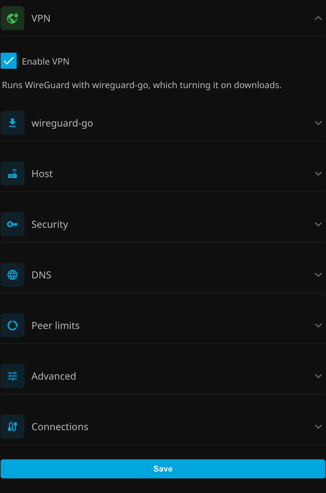
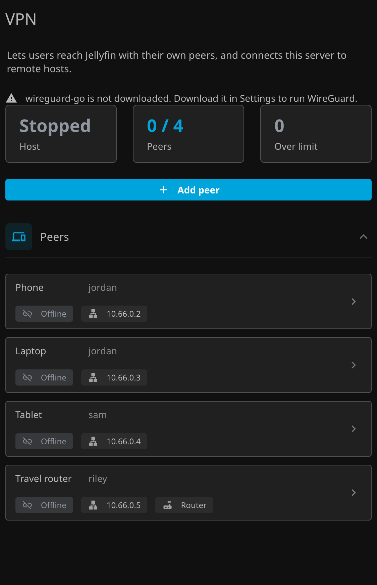
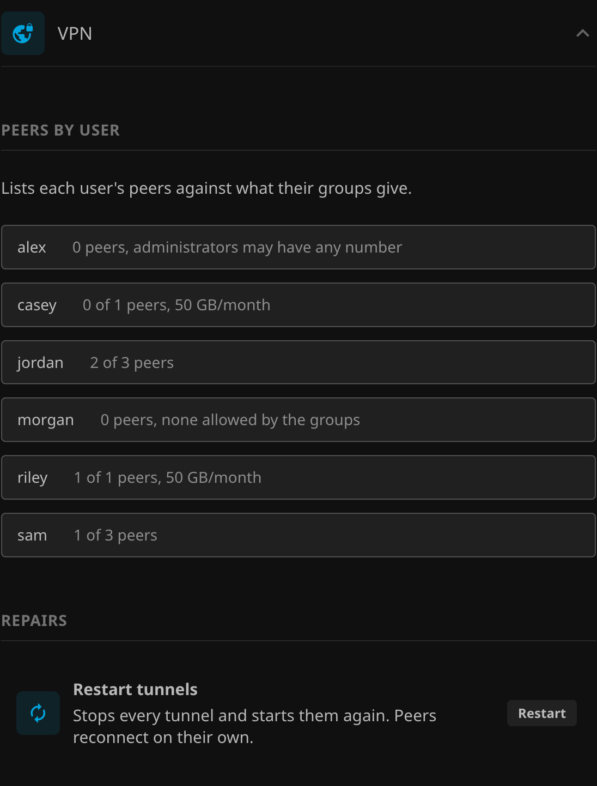

# VPN

**VPN** lets users reach Jellyfin over a WireGuard tunnel with their own peers, and connects this server to other WireGuard hosts. It runs WireGuard in userspace, so it needs no root, no network adapter, and no extra container permissions.

## How It Works

Necto runs `wgsidecar`, a small program built on wireguard-go with its own network stack. Each tunnel runs in its own sidecar, and tunnel traffic never touches the host's network. A change to a tunnel's peers or limits reaches its running sidecar live.

The sidecar is not part of the plugin. Turning on **Enable VPN** in **Settings > VPN** asks to download wireguard-go, and Necto downloads the sidecar for this server's platform from the `wgsidecar` release on the [Necto releases](https://github.com/siphonophore-org/necto/releases). It checks the file against the release's `SHA256SUMS` before it keeps it in Necto's data folder, and refuses a file that does not match.

* The host lets peers connect on one UDP port and reach only Jellyfin. A peer is a device, or a router that brings every device behind it.
* A connection joins another WireGuard host as a peer. Each forward opens a local port that reaches a host across the tunnel.

!!! note "A server with its own WireGuard"
    A server that already runs WireGuard keeps using it. Leave **Enable VPN** off and point that WireGuard at Jellyfin.

## Settings

**Settings > VPN** holds the settings, with **Save** at the end of the section.

* **Enable VPN** runs WireGuard. Turning it on asks to download wireguard-go when the server has none, and stays off when the download is declined or fails. It is off on a fresh install, and while it is off **VPN** leaves the sidebar, the Dashboard, and the group editor.

The settings below show while **Enable VPN** is on. Each group, from **wireguard-go** to **Connections**, is a part of its own that opens from its heading.

### wireguard-go

The line at the top of the part says which wireguard-go the server has, such as "Version 1.0.0 for linux-amd64, downloaded Nov 20, 2026.", or that it is not downloaded yet. **Replace** asks first, then downloads it again and restarts every tunnel with it. Before the first download the button reads **Download**.

### Host

| Setting | What it does | Default |
| :--- | :--- | :--- |
| **Host peers** | Lets peers reach Jellyfin over one UDP port | Off |
| **Public address** | The name or address peers connect to, such as `vpn.example.com`, with an optional port | Blank |
| **Listen port** | The UDP port peers connect to. Forward it on your router | 51820 |
| **Tunnel subnet** | The addresses the host gives itself and its peers. It must not overlap your network. A subnet that leaves a peer's address outside it is refused | `10.66.0.0/24` |

### Security

* **Host public key** shows the host's key, with a Copy button, once the host has one. Necto makes the host's key pair the first time the host runs.
* **Use preshared keys** gives each peer an extra shared key. Peers need new config files after a change.
* **Pass the peer's address to Jellyfin** sends each peer's tunnel address to Jellyfin, so Jellyfin shows it instead of `127.0.0.1`. Add `127.0.0.1` to **Known proxies** in Jellyfin's network settings for Jellyfin to read it.

Private and preshared keys are encrypted at rest. A peer's config file routes only the host's address through the tunnel, so the peer's other traffic never reaches this server.

### DNS

* **Answer DNS for peers** lets peers reach Jellyfin by name. Their config files point DNS at the host.
* **Name** is the name the host answers with its own tunnel address, such as `jellyfin.internal`.
* **Upstream resolvers** answer every other name. Separate them with commas.

### Peer Limits

These are the defaults for every peer. A peer can override them in its editor. 0 is no limit.

* **Download speed (Mbps)** and **Upload speed (Mbps)** cap each peer's speed.
* **Data per peer** is the most data one peer may move in its period.

How much data all of a member's peers may move together is set on groups, as **Data per member (GB)**.

A period is an hour, day, week, month, or year, in UTC. A peer over its data limit is left out of the tunnel until its period starts over, and an activity log entry says so.

### Advanced

| Setting | What it does | Default |
| :--- | :--- | :--- |
| **Keepalive (seconds)** | How often a peer's config keeps the tunnel open through NAT. 0 leaves it out | 25 |
| **MTU** | The tunnel's packet size, from 1280 to 1500 | 1420 |

### Connections

* **Connect to hosts** runs every enabled connection.
* **Download speed (Mbps)**, **Upload speed (Mbps)**, and **Data per connection** are the defaults for every connection. A connection can override them in its editor. 0 is no limit.

A connection over its data limit stops until its period starts over.

## The VPN Tool

While VPN is off, the tool reads "VPN is off. Turn it on in Settings to add peers." While **Host peers** and **Connect to hosts** are both off and there is nothing to list, it reads "Peers and connections are off. Turn them on in Settings to add them." The count cards hide in both cases. While wireguard-go is not downloaded, a warning says so.

| WireGuard | WireGuard on a phone |
| :---: | :---: |
|  |  |

The cards at the top show the host's state, how many **Peers** and **Connections** are connected out of all of them, and how many are over their data limit. **Connections** turns red while any connection failed and gray while **Connect to hosts** is off. **Left out** counts the peers their owners' groups leave out, while there are any. When the host cannot start, the reason shows under the cards.

One table lists this server, the peers, and the connections, each with a **Type** badge, **Host**, **Peer**, or **Connection**, and its state. Search it by name, owner, or address, and filter it to **Peers** or **Connections**. **Add peer** in its toolbar shows while the host is on, and **Add connection** while connecting is on. With nothing to list it reads "No peers or connections yet."

### Peers

Each peer's row shows its owner and address, then what it used, out of its data limit when it has one, where it connects from, and **Router** when it has child networks. The state is **Connected**, **Offline**, **Disabled**, **Over limit**, **Not allowed** when no group of its owner allows peers, or **Over peer count** when its owner has more peers than their groups give.

Select a peer to open its details in a sidecar, with its status, owner, address, child networks, last handshake, source, usage, and speed limit. Its **QR code** and **Config file** sections show the peer's config file, and say why when the host has none to give yet. **Download** saves the config file, and **Edit** opens the editor.

The peer editor has three sections, each led by an icon.

* **Peer**. **Name**, **Owner**, **Address**, **Public key**, and **Enabled**. A blank address takes the next free one. A blank public key makes a new key pair, which needs wireguard-go.
* **Limits**. **Download speed (Mbps)**, **Upload speed (Mbps)**, and **Data limit**, each the default unless overridden. **Inherit** reads **No limit** while the default sets none.
* **Advanced**. **Child networks**, the networks behind a router that does not NAT. Leave it blank for a single device.

A peer that brought its own public key gets a config file without a private key, for the device to fill in. **Remove** asks first. The peer's config file stops working.

### Connections

While the host is on, this server leads the table, named after the server, with its **Public address**. Selecting it opens **Settings**. Each connection's row shows its remote host, then what it used and its forwards.

Select a connection to open its details, with its status, remote host, this server's address, forwards, last handshake, last error, usage, and speed limit. **This server's public key** has a Copy button. Give it to the remote host.

The connection editor has five sections, each led by an icon.

* **Connection**. **Name**, **Remote host**, **Remote public key**, **Preshared key**, **This server's address**, **Private key**, and **Enabled**. A blank private key keeps the saved one, or makes a new one for a new connection.
* **Import a config**. Paste a WireGuard config file to fill in the connection's fields.
* **Forwards**. One per line, as the local port, a space, then the remote host and port, such as `18096 10.0.0.1:8096`. Each opens on `127.0.0.1` only.
* **Limits**. **Download speed (Mbps)**, **Upload speed (Mbps)**, and **Data limit**, each the default unless overridden. **Inherit** reads **No limit** while the default sets none.
* **Advanced**. **Keepalive (seconds)**.

## Permissions

Who may have peers is set on groups, in the **VPN** section of each group in **Groups**. An administrator's peers always connect, and so does a peer with no owner.

| Field | What it does |
| :--- | :--- |
| **Allow peers** | Lets members' peers connect |
| **Peers per member** | How many of a member's enabled peers connect, the oldest first. 0 is no limit |
| **Data per member (GB)** | How much data all of a member's peers may move together in the period. 0 is no limit |
| **Period** | The window **Data per member (GB)** counts over |

Saving or deleting a group applies its peers to the tunnel at once, and any other change, such as a user becoming an administrator, applies within a minute. Administrators add peers for any user. A peer past its owner's count stays stored and shows **Over peer count** until the owner has room or a group gives more.

## Troubleshooting

**Troubleshooting > VPN** holds the peers by user and **Restart tunnels**. Each tunnel's state and error show on the VPN page.

* **Restart tunnels** stops every tunnel and starts them again. Peers reconnect on their own.
* **Peers by user** lists each user's peers against what their groups give, such as "2 of 3 peers".

| Reason | What to do |
| :--- | :--- |
| "wireguard-go is not downloaded. Download it in Settings to run WireGuard." | Select **Download** in **Settings > VPN** |
| "Could not reach the sidecar release. Check the server's internet connection." | Let the server reach `github.com`, then select **Download** again |
| "The downloaded sidecar does not match its release hash, so it was not kept." | Select **Download** again. A file changed on its way is never kept |
| "The tunnel is not running. Check the tunnel subnet and the server log." | Check **Tunnel subnet** and that **Listen port** is free, then select **Restart** |
| A peer shows **Not allowed** | Add its owner to a group with **Allow peers** on |
| A peer shows **Over peer count** | Raise **Peers per member** on the owner's group, or disable another of their peers |
| "Download wireguard-go in Settings first, so Necto can make the keys." | Download wireguard-go, or paste the device's own public key |

## Activity Log

| Entry | When |
| :--- | :--- |
| "Peer connected", "Peer disconnected" | A peer makes its first handshake, or goes quiet for 3 minutes |
| "Connection established", "Connection lost" | A connection reaches its host, or loses it |
| "Data limit reached" | A peer or connection is cut off until its period starts over |
| "Tunnel failed" | A tunnel keeps failing to start. It is still tried again each minute |

## Notifications

| Event | When |
| :--- | :--- |
| `wireguard.connected` | A peer connected, about its owner |
| `wireguard.disconnected` | A peer disconnected, about its owner |
| `wireguard.connection-established` | A connection reached its host |
| `wireguard.connection-lost` | A connection lost its host |
| `wireguard.data-limit` | A peer or connection reached its data limit |
| `wireguard.failed` | A tunnel keeps failing to start |

## API

Every route is for administrators.

| Route | What it does |
| :--- | :--- |
| `GET /WireGuard/Status` | Gives each running tunnel's state, with each peer's traffic and handshake |
| `GET /WireGuard/Usage` | Gives each peer's and connection's traffic in the current window of each period, which are over their limit, and which peers their groups leave out |
| `GET /WireGuard/Peers` | Lists every tunnel end with its state and the address it connects from, which the [Dashboard](Dashboard.md) map places by country |
| `POST /WireGuard/Peers` | Adds a peer |
| `PUT /WireGuard/Peers/{id}` | Saves a peer |
| `DELETE /WireGuard/Peers/{id}` | Removes a peer |
| `GET /WireGuard/Peers/{id}/Config` | Writes a peer's config file |
| `POST /WireGuard/Connections` | Adds a connection |
| `PUT /WireGuard/Connections/{id}` | Saves a connection |
| `DELETE /WireGuard/Connections/{id}` | Removes a connection |
| `GET /WireGuard/Users` | Lists each user's peers against what their groups give |
| `GET /WireGuard/Sidecar` | Describes the downloaded wireguard-go and the release Necto downloads |
| `POST /WireGuard/Sidecar/Download` | Downloads wireguard-go and restarts the tunnels with it |
| `POST /WireGuard/Restart` | Stops every tunnel and starts them again |

A refused change answers `400` with `{ "Error": "..." }`, and a missing peer or connection answers `404`. A download that fails answers `502` with the reason.

## Limitations

* A tunnel subnet is IPv4, from `/8` to `/30`.
* The sidecar is built for Linux on x64, Arm64, and Arm, macOS on x64 and Arm64, and Windows on x64 and Arm64.
