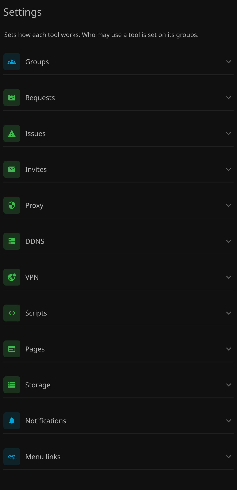
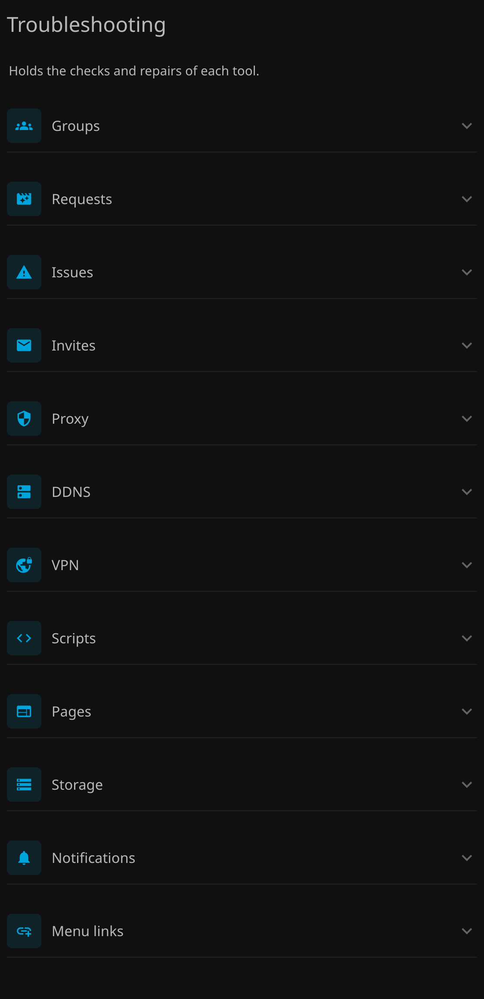

# Necto

Necto is a Jellyfin plugin with tools to keep your server reachable, secure and healthy. It is the Siphonophore administration plugin, built on [Stolon](https://github.com/siphonophore-org/stolon), with one place for permissions and one place for notifications.

!!! warning "Use at your own risk"
    This plugin modifies live data on your Jellyfin server. While extensively tested, I maintain this plugin for my personal use case and I do not account for every server configuration. **Always maintain backups of your Jellyfin data and configuration.** By using this plugin, you accept full responsibility for any data loss or issues that may occur.

## The Page

Necto is one page, **Dashboard > Plugins > Necto**, with a sidebar of tools: [Dashboard](Dashboard.md), [Groups](Groups.md), [Requests](Requests.md), [Issues](Issues.md), [Invites](Invites.md), [Proxy](Proxy.md), [DDNS](DDNS.md), [VPN](VPN.md), [Scripts](Scripts.md), [Pages](Pages.md), [Storage](Storage.md), [Notifications](Notifications.md), **Settings**, and **Troubleshooting**. **Dashboard** is home, with a card for each tool that is on. **Settings** holds a section of settings for each tool, and [Menu links](MenuLinks.md) for the web client's side menu. **Troubleshooting** holds a section of resets, tests, and repairs for each tool.

## Turning Tools On and Off

Dashboard, Groups, Notifications, Settings, and Troubleshooting are always on. Every other tool has a switch named **Enable** and the tool's name, such as **Enable storage**, the first checkbox of its section in **Settings**, and is off on a fresh install. Its tile is green while it is on and gray while it is off.

While a tool is off, it leaves the sidebar, its card leaves the Dashboard, and its section leaves the group editor and Troubleshooting. Its pages answer as off, and its routes, scheduled tasks, and background work do nothing. Turning it off deletes nothing, so turning it on again finds everything as it was.

| Tool | While it is off |
| :--- | :--- |
| [Requests](Requests.md) | `/requests/` answers 404, no request can be made, and the **Requests** menu link comes out |
| [Issues](Issues.md) | `/issues/` answers 404, and the **Issues** menu link comes out |
| [Invites](Invites.md) | Invite links say the invite is unavailable, and `/invites` answers 404 |
| [Proxy](Proxy.md) | Nothing listens on the proxy's ports |
| [DDNS](DDNS.md) | No record is updated |
| [VPN](VPN.md) | WireGuard does not run |
| [Scripts](Scripts.md) | No script runs |
| [Pages](Pages.md) | Every `/pages` address answers 404 |
| [Storage](Storage.md) | No disk is checked, no alert is sent, and no scan is blocked |

| Settings | Troubleshooting |
| :---: | :---: |
|  |  |

The [Plan](Plan.md) lists what each tool holds.
